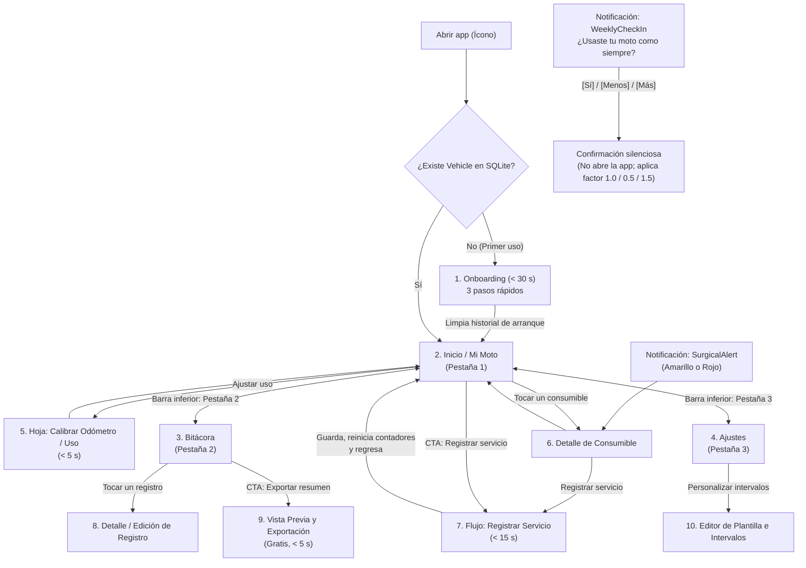

# ROUTES — Mapa de Navegación, Flujos y Pantallas (Itinera MVP)

> **Estado:** `[ACTUALIZADO POST-AUDITORÍA C1–C8 — ALINEADO A DOMAIN.md Y SPECIFICATION.md]`  
> **Propósito:** Definir la arquitectura de navegación, los puntos de entrada, las pantallas, sus widgets funcionales y las reglas de acceso del MVP (`Fase 0`: Android-First, Local-First, motocicletas urbanas, de trabajo y motonetas `110–250cc`, con transmisión por `cadena` o `CVT`).  
> **Frontera de este documento:** Aquí se define **qué hace cada pantalla y cómo fluye el usuario**, sin tomar todavía decisiones visuales (colores, tipografía, espaciados ni estilos), las cuales corresponden al futuro `DESIGN.md`.

---

## 1. Modelo Mental del Usuario y Principios de Flujo

Un motociclista urbano o de trabajo (`110–250cc`, extensible con plantilla personalizada) en Xalapa instala **Itinera** para dejar de olvidar sus servicios y evitar gastos sorpresa o cotizaciones opacas en taller, **no** para administrar una hoja de cálculo diaria.

Su interacción real con la aplicación ocurre en **cuatro momentos concretos**:

1. **Día 1 — Arranque sin fricción (`< 30 s`):** Sin registro de cuenta ni login obligatorio (*Local-First*). El usuario indica qué tipo de moto tiene y cómo la usa en un día normal, selecciona una plantilla inicial y ve de inmediato el estado de su unidad.
2. **Ritmo semanal — Fuera de la app (`< 5 s`):** La aplicación no exige abrirse al cargar gasolina. Una notificación semanal pregunta en la pantalla de bloqueo si usó su moto como siempre (`[Sí] [Menos] [Más]`), sin mencionar kilómetros; con un toque confirma o corrige.
3. **Consulta rápida en casa o en ruta (`< 3 s`):** Al abrir la app, una sola pantalla responde en lenguaje cotidiano qué está bien, qué requiere ir juntando presupuesto y qué ya venció.
4. **Después de un servicio o reparación (`< 15 s`):** Registra qué consumible atendió (en taller o *DIY*), guarda opcionalmente costo/foto local y reinicia el contador.

---

## 2. Diagrama de Flujo General y Puntos de Entrada

Debido a su enfoque de baja fricción (*Low-Touch*), Itinera tiene **tres puntos de entrada reales**: el ícono de la app, la notificación de confirmación semanal (`WeeklyCheckIn`) y la alerta preventiva/crítica (`SurgicalAlert`).

---

## 3. Tabla Maestra de Rutas y Reglas de Acceso

El MVP gestiona **1 motocicleta principal gratuita** por usuario (el soporte para `2+` unidades personales/familiares y Cloud Sync pertenecen a `PlusSubscription` en Fase 1; las flotillas comerciales de `2–15` unidades a `MicroFleetAccount` en Fase 2). La navegación raíz se mantiene en **3 pestañas inferiores** (`Inicio`, `Bitácora`, `Ajustes`) acompañadas de pantallas de detalle y hojas modales enfocadas.

| Ruta / ID | Pantalla | Tipo | Entradas Permitidas | Regla de Acceso (*Guard*) | Comportamiento de Salida / *Back* |
| :--- | :--- | :--- | :--- | :--- | :--- |
| `/onboarding` | Bienvenida y Configuración Inicial | Flujo inicial (3 pasos) | Arranque de app sin vehículo registrado | Solo accesible si `COUNT(Vehicle) == 0` | Al finalizar, reemplaza la pila (*stack*) y abre `/home` (botón Atrás no vuelve al onboarding) |
| `/home` | Inicio / Mi Moto | Pestaña principal (Tab 1) | Arranque normal, fin de onboarding, barra inferior | Requiere `COUNT(Vehicle) >= 1` | Botón Atrás cierra/minimiza la app |
| `/history` | Bitácora de Servicios | Pestaña principal (Tab 2) | Barra inferior | Requiere `COUNT(Vehicle) >= 1` | Regresa a `/home` o sigue navegación estándar de pestañas |
| `/settings` | Ajustes de Moto y App | Pestaña principal (Tab 3) | Barra inferior | Requiere `COUNT(Vehicle) >= 1` | Regresa a `/home` o sigue navegación estándar de pestañas |
| `/calibrate` | Calibración Rápida de Odómetro / Uso | Hoja modal (*Bottom Sheet* / Modal) | Botón `Ajustar uso` del header de `/home` o toque en el cuerpo de la notificación `WeeklyCheckIn` | Requiere vehículo activo | Al confirmar o cancelar, cierra la hoja y refresca `/home` |
| `/consumable/:id` | Detalle de Consumible | Pantalla de detalle | Tarjeta en `/home` o *deep link* de `SurgicalAlert` | Requiere `ConsumableItem` válido (`1` de los `5`) | Regresa a `/home` (si entró por notificación, Atrás cae en `/home`) |
| `/log-service` | Registrar Servicio (`< 15 s`) | Flujo modal / pantalla enfocada | CTA en `/home`, CTA en `/consumable/:id`, o estado vacío de `/history` | Acepta parámetro opcional `consumableId` para preselección | Al guardar, reinicia ciclos aplicables, actualiza `Km_base` si cambió y regresa a la pantalla origen |
| `/history/:logId` | Detalle y Edición de Registro | Pantalla de detalle | Tocar una fila en `/history` | Requiere `MaintenanceLog` existente | Regresa a `/history` (refresca lista si hubo edición o eliminación) |
| `/export` | Resumen Exportable Gratuito | Vista previa + Share Sheet | Botón `Exportar resumen` en `/history` | Requiere vehículo activo (funciona incluso con historial vacío mostrando estado actual) | Cierra vista previa y regresa a `/history` |
| `/settings/intervals` | Editor de Plantilla e Intervalos | Pantalla secundaria | Opción `Intervalos de mantenimiento` en `/settings` | Requiere vehículo activo | Guarda cambios por consumible y regresa a `/settings` |

---

## 4. Desglose Pantalla por Pantalla y Widgets Funcionales

### A. Arranque Inicial (Una Sola Vez)

#### 1. Onboarding (`/onboarding` — `< 30 s`, 3 pasos cortos)
- **Objetivo para el usuario:** Dejar su moto configurada en menos de medio minuto sin saber mecánica ni crear cuentas.
- **Widgets funcionales:**
  - **Paso 1 — Tipo de Moto, Identidad y Plantilla (`Vehicle` + `ServiceTemplate`):**
    - **Selector de tipo de moto (4 tarjetas con ícono):** *Motoneta automática (scooter)*, *De calle o trabajo*, *Doble propósito*, *Deportiva o alta cilindrada*. Deduce `Vehicle.transmision` (`Motoneta automática` $\to$ `CVT`; el resto $\to$ `cadena`) y muestra una línea editable *"Transmisión: Cadena / Banda CVT"* por si el usuario necesita corregirla.
    - Campo opcional de apodo/referencia (ej. *"Mi FT150"*, con valor sugerido rápido).
    - **Selector de Plantilla Base (3 tarjetas):** *Moto Urbana (110–250cc)*, *Moto Trabajo / Uso Rudo*, *Personalizada (incl. >250cc)*. Cada opción resume en una línea sus intervalos clave (ej. aceite cada `2,500 km` o `2,000 km`). Si en el Paso 2 se elige la rutina R4 (*Reparto o uso continuo*), la app sugiere *Moto Trabajo / Uso Rudo*.
  - **Paso 2 — Odómetro Físico y Rutina Diaria (`Vehicle` + `OdometerProjection`):**
    - Selector de estado del tablero: *"¿Funciona tu odómetro físico?"*
      - **Sí funciona:** campo numérico para ingresar el kilometraje actual del tablero (`Km_base`).
      - **No funciona / Chicote roto:** activa el modo de proyección relativa desde `0` y respaldo automático por tiempo calendario sin bloquear el registro.
    - **Selector de rutina** *"¿Cómo usas tu moto en un día normal?"* (idéntico a la tabla canónica de `DOMAIN.md §5.1` y al reactivo `A11` del Instrumento A): *Traslados cortos dentro de mi zona (1 o 2 viajes al día)*, *Cruzo la ciudad de ida y vuelta (escuela o trabajo)*, *Varios viajes en el día (trabajo, mandados o clientes)*, *Reparto o uso continuo casi todo el día*. Enlace secundario: *Ingresar km/día manualmente*.
    - **Selector de días de uso** *"¿Cuántos días a la semana la usas?"* (idéntico a `A12`): *1 o 2 días*, *3 o 4 días*, *5 o 6 días*, *Todos los días*. Con rutina y días se calcula `Tasa_dia` sin mostrar ni pedir kilómetros.
  - **Paso 3 — Desfase Inicial del Ciclo Actual (Opcional en 1 toque):**
    - Pregunta rápida para motos que ya están en circulación: *"¿Cuándo fue tu último cambio de aceite?"*
    - Opciones rápidas: `Recién afinada (0%)`, `A mitad de camino (~50%)`, `Ya le toca pronto (~85%)`, `No recuerdo / Empezar desde cero`.
    - Evita que una moto usada recién instalada aparezca falsamente al 100% en Verde el día 1.
  - **CTA Principal:** `Empezar seguimiento` $\to$ guarda en SQLite, programa el `WeeklyCheckIn` semanal y navega a `/home`.

---

### B. Navegación Principal (3 Pestañas Inferiores)

#### 2. Inicio / Mi Moto (`/home` — Tab 1)
- **Objetivo para el usuario:** Responder en menos de 3 segundos: *"¿Puedo rodar tranquilo hoy o qué servicio se acerca?"*
- **Widgets funcionales:**
  - **Encabezado de Unidad y Odómetro Proyectado:**
    - Nombre de la moto y plantilla activa.
    - Lectura de `Km_proyectado(t)` marcada claramente como *estimado* o *confirmado*, o etiqueta de *Modo sin odómetro (seguimiento por uso y tiempo)* cuando el chicote está averiado.
    - Rutina activa en lenguaje cotidiano (ej. *"Reparto, todos los días"*) y botón rápido `Ajustar uso` $\to$ abre `/calibrate`. La tasa en km/día solo se muestra dentro de Ajustes para usuarios que la editan manualmente.
  - **Tarjeta / Banner de Prioridad del Día:**
    - Mensaje único en lenguaje cotidiano que sintetiza el estado global: *"Todo en rango"*, *"El aceite entra pronto en ventana preventiva (~280 km o 4 días)"*, o *"1 servicio vencido: Cadena"*.
  - **Lista de los 5 Consumibles Críticos (`WearTrafficLight`):**
    - Tarjetas fijas y escaneables para:
      1. Aceite de motor
      2. Transmisión: se rotula *Cadena* *(lubricación/ajuste y cambio de kit)* si `transmision = cadena`, o *Banda CVT* *(inspección y reemplazo de banda/rodillos)* si `transmision = CVT`
      3. Frenos (balatas)
      4. Bujía
      5. Llantas
    - **Contenido de cada tarjeta:**
      - Nombre del consumible + estado del semáforo (`Óptimo` / `Preventivo` / `Crítico`).
      - Margen restante en **regla dual**: *"Faltan ~X km o Y días (lo que ocurra primero)"*.
      - Acción directa: tocar la tarjeta abre `/consumable/:id`; si está en Amarillo o Rojo, muestra acceso directo `Registrar` hacia `/log-service?consumableId=...`.
  - **CTA Principal Persistente (`Registrar servicio`):**
    - Abre `/log-service` en cualquier momento para registrar mantenimiento preventivo o correctivo.
  - **Nota de Fase 1 (Inactivo en MVP):** El espacio contextual para `ContextualPromotion` permanece apagado en Fase 0 hasta superar la compuerta de `>1,000–2,000` MAU locales. Su comportamiento diferido se documenta en `§4.D`.

#### 3. Bitácora (`/history` — Tab 2)
- **Objetivo para el usuario:** Sustituir los recibos arrugados de la guantera con un historial cronológico confiable y fácil de compartir.
- **Widgets funcionales:**
  - **Franja de Resumen:** Total de servicios registrados y suma acumulada de gastos opcionales (`$ MXN`).
  - **Barra de Filtros Rápidos:** `Todos`, `DIY (Hecho por mí)`, `Taller`, más filtro por consumible (`Aceite`, `Cadena` o `Banda CVT` según `transmision`, `Frenos`, `Bujía`, `Llantas`).
  - **Botón `Exportar resumen gratuito`:** Abre `/export`.
  - **Lista Cronológica de `MaintenanceLog`:**
    - Cada fila muestra fecha, consumible(s) atendido(s), tipo (`Preventivo` / `Correctivo`), modalidad (`DIY` o nombre libre del taller), odómetro del servicio, costo si se capturó e indicador si tiene foto local adjunta.
    - Tocar una fila abre `/history/:logId`.
  - **Estado Vacío (Día 1):** Explicación breve de para qué sirve la bitácora y botón directo `Registrar mi primer servicio`.

#### 4. Ajustes (`/settings` — Tab 3)
- **Objetivo para el usuario:** Ajustar su unidad, intervalos y frecuencia de recordatorios sin estorbar la pantalla principal.
- **Widgets funcionales:**
  - **Perfil de la Moto:** Editar apodo, tipo de moto y `transmision` (`Cadena` / `Banda CVT`), cambiar/reaplicar una de las 3 `ServiceTemplate`, cambiar rutina y días de uso, o editar manualmente `Tasa_dia`.
  - **Mi taller de confianza (`HomeWorkshopTag`):** Escribir el nombre del taller habitual o escanear su QR estático (nombre y contacto); habilita el botón *"Agendar con mi taller"* en las alertas. No envía datos a ningún servidor.
  - **Interruptor de Odómetro Físico (`Chicote roto`):** Permite activar o desactivar en cualquier momento el modo sin odómetro físico (si se rompe después del onboarding o si el usuario lo repara).
  - **Acceso `Intervalos de mantenimiento`:** Navega a `/settings/intervals`.
  - **Notificaciones y `WeeklyCheckIn`:** Selector de día y hora preferida para el check-in semanal (ej. domingo `19:00`) y control de alertas preventivas (`Amarillo` + `Rojo` o solo `Rojo`).
  - **Portabilidad Local (MVP Local-First):** Exportar/importar respaldo local en JSON dentro del dispositivo (para no perder datos al cambiar de teléfono antes de que exista Cloud Sync en Fase 1) y opción de reiniciar datos con doble confirmación.

---

### C. Hojas Modales y Pantallas Secundarias

#### 5. Calibración Rápida de Odómetro / Uso (`/calibrate` — `< 5 s`)
- **Activación:** Desde el botón `Ajustar uso` del encabezado de `/home` o tocando el cuerpo de la notificación `WeeklyCheckIn`.
- **Widgets funcionales (adaptados al estado del tablero):**
  - **Modo Odómetro Funcional:**
    - Muestra el odómetro proyectado actual (`~12,970 km`), un campo numérico editable para capturar el kilometraje real del tablero y la diferencia calculada. Aquí sí se usan kilómetros porque el usuario los lee directamente de su tablero; nunca se le pide estimarlos.
    - Botón `Confirmar` $\to$ actualiza `Km_base` y recalcula `Tasa_dia` suavemente (*Rolling Average*).
  - **Modo Chicote Roto (sin odómetro físico):**
    - No pide un número de tablero inexistente ni muestra kilómetros. Presenta un selector de intensidad semanal: *"¿Cómo usaste tu moto esta semana?"* (`No la usé`, `Menos que de costumbre`, `Como siempre`, `Más que de costumbre`), que aplica los factores `0 / 0.5 / 1 / 1.5` de `DOMAIN.md §5.1`.
    - Enlace secundario *"Cambié mi rutina"* para volver a elegir rutina y días de uso (misma lista del onboarding).

#### 6. Detalle de Consumible (`/consumable/:id`)
- **Activación:** Al tocar un consumible en `/home` o abrir una `SurgicalAlert`.
- **Widgets funcionales:**
  - **Lectura Dual de Desgaste:** Muestra por separado el avance por kilometraje ($\Delta Km / I_{km}$) y por tiempo ($\Delta \text{Días} / I_{tiempo}$), indicando explícitamente qué criterio va más cerca del límite (*"Vence primero por kilometraje"* o *"por tiempo"*).
  - **Bloque "Qué revisar y por qué importa":**
    - De acuerdo con [SPECIFICATION.md](file:///C:/Users/OGSha/OneDrive/Escritorio/Developer/App%20Development/Itinera/.routing/academic/SPECIFICATION.md#L45-L52) (listas simples de inspección preventiva *DIY* y respaldo informativo ante talleres), muestra **3–4 viñetas universales y estáticas en lenguaje cotidiano** aplicables a cualquier motocicleta urbana/de trabajo (`110–250cc`: ej. ruido metálico en frenos, color/nivel de aceite). No constituye un manual ni catálogo de refacciones por modelo/año.
    - **Viñetas de transmisión según `transmision`:** *Cadena* $\to$ holgura al presionarla con el dedo, óxido o eslabones secos, dientes del sprocket en punta. *Banda CVT* $\to$ jaloneo o patinazo al arrancar, ruido o vibración en la tapa del variador, pérdida de velocidad final; aclara que la banda **no se lubrica** y que la revisión requiere abrir la tapa (normalmente en taller).
  - **Acción de taller (opcional):** si existe `HomeWorkshopTag`, muestra el botón *"Agendar con mi taller"* (enlace directo a WhatsApp o llamada).
  - **Edición Rápida de Intervalo:** Permite sobrescribir $I_{km}$ o $I_{tiempo}$ solo para esta pieza (ej. usar aceite sintético cada `3,000 km`).
  - **Historial Reciente del Consumible:** Últimos `MaintenanceLog` filtrados a este ítem.
  - **CTA Principal:** `Registrar servicio de [Consumible]` $\to$ abre `/log-service` con el consumible preseleccionado.

#### 7. Registrar Servicio (`/log-service` — `< 15 s`)
- **Activación:** CTA de `/home`, CTA de `/consumable/:id` o estado vacío de `/history`.
- **Widgets funcionales (ordenados de esencial arriba a opcional abajo):**
  1. **Selección de Consumible(s):** *Chips* de selección múltiple con los 5 consumibles críticos (permite marcar varios en una misma visita, ej. *Aceite + Bujía*) + opción `Otro / Reparación general` para fallas correctivas. El chip de transmisión se rotula según `transmision` y abre una sub-opción: *Cadena* $\to$ `Lubricación/ajuste` o `Cambio de kit`; *Banda CVT* $\to$ `Inspección` o `Reemplazo de banda/rodillos` (ver reinicio parcial en `DOMAIN.md §5.4`).
  2. **Tipo de Intervención:** Selector `Preventivo (reinicia contador)` (por defecto) vs `Correctivo / Revisión (no reinicia otros ciclos)`.
  3. **Modalidad (`DIY` o `Taller`):** Selector `Hecho por mí (DIY)` vs `Taller / Refaccionaria`. Al elegir Taller, aparece un campo opcional en texto libre (autocompletado solo con talleres que el propio usuario ya escribió antes en SQLite; sin directorio global).
  4. **Fecha y Odómetro:** Fecha (hoy por defecto) y kilometraje prellenado con `Km_proyectado` (editable si el usuario mira el tablero en ese momento; en modo chicote roto muestra etiqueta de estimación).
  5. **Detalles Opcionales (sección colapsable para garantizar `< 15 s`):**
     - Costo total (`$ MXN`).
     - Nota breve (ej. *"Aceite 20W-50 mineral"*).
     - Foto local (cámara o galería guardada en almacenamiento interno del teléfono como respaldo visual de ticket o pieza cambiada).
  - **CTA Principal (`Guardar registro`):** Guarda el `MaintenanceLog`, reinicia los contadores correspondientes y regresa a la pantalla previa.

#### 8. Detalle y Edición de Registro (`/history/:logId`)
- **Activación:** Tocar un registro en `/history`.
- **Widgets funcionales:** Lectura completa de fecha, consumibles, modalidad, odómetro, costo y nota; visor a pantalla completa de la foto local adjunta (útil al mostrar evidencia en taller); botones `Editar` y `Eliminar` (con confirmación clara si afecta el último reinicio).

#### 9. Vista Previa y Exportación de Resumen (`/export` — `< 5 s`)
- **Activación:** Botón `Exportar resumen gratuito` en `/history`.
- **Widgets funcionales:**
  - **Opciones de Salida:** Alcance (`Últimos 6 meses` vs `Historial completo`) e interruptor `Incluir montos ($ MXN)` (permite ocultar lo que pagó el dueño al pedir cotización o mostrar la bitácora a un comprador).
  - **Vista Previa (`ExportableSummary`):** Documento limpio y 100% gratuito con datos de la unidad, estado actual de los 5 consumibles y tabla cronológica de servicios (`fecha`, `ítem`, `DIY/Taller`, `km`).
  - **CTA `Compartir / Guardar PDF`:** Invoca la hoja nativa de compartir de Android (*Share Sheet*).

#### 10. Editor de Plantilla e Intervalos (`/settings/intervals`)
- **Activación:** Desde `/settings`.
- **Widgets funcionales:** Lista editable de los 5 `ConsumableItem` con sus campos de $I_{km}$ y $I_{tiempo}$ (ej. días o meses; el de transmisión muestra sus dos tareas: corta y reemplazo), más un botón `Restablecer desde plantilla` para volver a los valores base de una de las 3 `ServiceTemplate` en la variante de `transmision` activa.

---

### D. Espacio Diferido de Fase 1 (No se construye en MVP; documentado para prototipo y Estudio de Mercado)

Estas vistas **no existen en Fase 0**. Se describen para que el prototipo de validación (capturas 5 y 6 del Estudio de Mercado) muestre exactamente lo que define `DOMAIN.md §3` y `§3.1`, sin prometer funciones fuera del dominio. Se activan solo al cruzar la compuerta de `>1,000–2,000` MAU locales.

#### 11. Promoción en Detalle de Consumible (`/consumable/:id`, bloque `ContextualPromotion`)
- **Condición:** El consumible está en `Amarillo` o `Rojo`, existe un `MerchantPartner` activo en la zona y el usuario no desactivó promociones.
- **Widgets funcionales:** Tarjeta con la leyenda visible **"Promoción pagada"**, nombre del comercio, beneficio (ej. *"10% en cambio de aceite"*), vigencia, **código corto único** y botón *"Cómo llegar / Escribir por WhatsApp"*. Texto fijo: *"Itinera no califica ni certifica talleres."* Sin estrellas, reseñas ni insignias.
- **Ajuste asociado en `/settings`:** Interruptor *"Mostrar promociones de negocios cercanos"*.

#### 12. Vista de Comprobación del Comercio (fuera de la app del conductor)
- **Naturaleza:** Enlace web ligero abierto desde el celular del encargado (sin instalar software ni requerir computadora en caja); alternativa equivalente por WhatsApp o en hoja de registro conciliada semanalmente (`CouponRedemption`).
- **Widgets funcionales:** Campo *"Escribe el código del cliente"* con respuesta *Válido / Ya usado / Vencido*; contador de la prueba por volumen (*"Clientes comprobados gratis: 4 de N"*); **reporte del mes** con promociones mostradas, códigos canjeados y esquema activo (`cuota mensual` o `pago por venta comprobada`); acceso a su cartel con **QR** para que sus clientes descarguen la app.

#### 13. Vinculación Ligera con el Taller (`WorkshopLink`, opt-in)
- **Condición:** El `HomeWorkshopTag` del usuario corresponde a un `MerchantPartner`.
- **Widgets funcionales:** Pantalla de consentimiento expreso: *"¿Quieres que [Taller] te recuerde tu próximo servicio? Solo compartiremos la fecha estimada"*, con botones `Aceptar` / `Ahora no` y opción permanente de revocar en `/settings`.

---

## 5. Flujos de Notificaciones y Política Anti-Spam

Las notificaciones locales nativas de Android sostienen el modelo *Low-Touch* sin servidores ni canales externos (cero SMS/WhatsApp):

1. **`WeeklyCheckIn` (1 vez por semana, horario configurable):**
   - Texto: *"¿Usaste tu moto como siempre esta semana?"* (sin cifras de kilómetros ni odómetro estimado).
   - **Acciones `[Sí]`, `[Menos]`, `[Más]`:** Ejecutan confirmación silenciosa en segundo plano sin abrir la interfaz gráfica, aplicando los factores `1.0`, `0.5` y `1.5` de `DOMAIN.md §5.1`.
   - **Toque en el cuerpo de la notificación:** Abre `/calibrate` (por ejemplo, para capturar el tablero o indicar que no usó la moto).
2. **`SurgicalAlert` (Únicamente al cruzar umbral Amarillo `0.80` o Rojo `1.00`):**
   - Aplica la regla dual $\min(t_{alcanza\_km},\; t_{alcanza\_meses})$.
   - Al tocar la notificación, abre `/consumable/:id` del consumible afectado, mostrando su margen restante, guía rápida de qué revisar y botón directo a `/log-service`.
   - **Regla anti-spam:** No se emiten recordatorios diarios mientras el usuario no descarte o atienda; un ítem en Verde nunca genera notificaciones.

---

## 6. Exclusiones Explícitas en Rutas del MVP (Para Revisión de PRs y Prototipos)

Para proteger el foco definido en [DOMAIN.md](file:///C:/Users/OGSha/OneDrive/Escritorio/Developer/App%20Development/Itinera/.routing/DOMAIN.md#L47-L55) y [SPECIFICATION.md](file:///C:/Users/OGSha/OneDrive/Escritorio/Developer/App%20Development/Itinera/.routing/academic/SPECIFICATION.md#L54-L70), las siguientes pantallas y flujos **quedan fuera de `ROUTES.md` en Fase 0**:

- Pantallas de **registro, inicio de sesión, recuperación de contraseña o sincronización en la nube** (el MVP es *Local-First* puro).
- Módulo o formulario de **cargas de gasolina, rendimiento km/L o contabilidad de viajes** (`FuelAccountingLedger` — tipo Drivvo).
- **Mapa o directorio de talleres "certificados"** con calificaciones o pines verificados (`CertifiedWorkshopDirectory`). Las vistas de `§4.D` no son un directorio: solo muestran promociones pagadas etiquetadas y pertenecen a Fase 1.
- **Biblioteca/catálogo universal de refacciones por modelo y año** (`ExactModelPartsCatalog`).
- **Pasarela de cobro para certificado PDF de `$49 MXN`** (`ExportableSummary` es 100% gratuito).
- **Selector de múltiples vehículos (`2+`, `PlusSubscription`), panel de micro-flotillas (`2–15`, `MicroFleetAccount`) o soporte para autos/tráilers** (pospuestos a Fase 1–2 o excluidos).
