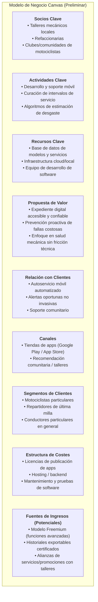

# Notas de Borrador y Retroalimentación — Proyecto Itinera

> **Propósito:** Registro histórico del borrador inicial de la actividad académica y bitácora de retroalimentación recibida por la profesora para su refinamiento progresivo.  
> **Estado:** `[HISTÓRICO / EN PURGA]`  
> **Asignatura:** Economía para Toma de Decisiones — Licenciatura en Ingeniería de Software.  
> **Ubicación y fecha:** Xalapa, Veracruz — Octubre/Noviembre 2026.  
> **Equipo de trabajo:**
> - Gerardo Abraham Barrón Gómez
> - Edgar Vázquez García
> - Alberto Villalba Figueroa

---

## Bitácora de Retroalimentación de la Profesora
1. **Sobre el Planteamiento del Problema:**
   - *Comentario:* *"El problema no es carencia de herramienta. Es un tener un sistema eficiente."*
   - *Impacto:* Redefinir el problema de la ausencia de una app hacia la ineficiencia sistémica, la alta fricción de los métodos tradicionales y la reactividad del mantenimiento.
2. **Sobre los Factores Socioculturales y Económicos:**
   - *Comentario recibido en lugar de la respuesta de tecnología/smartphones:*
     - "No hay costumbre de anotar fechas." (Hábito/Cultura)
     - "No hay recursos para agendar un mantenimiento en tiempo y forma." (Economía/Liquidez)
     - "Exceso de confianza del dueño que piensa que todo 'está bajo control'." (Sesgo cognitivo/Psicológico)
     - "El usuario no desea estar obligado a ir a un taller y gastar tiempo/dinero." (Resistencia/Costo de oportunidad)
     - "Desconfianza del taller." (Factor social/Opacidad)
   - *Impacto:* Incorporar estos factores humanos como las causas fundamentales que explican el abandono del mantenimiento preventivo.

---

## 1. Resumen Ejecutivo y Visión

- **Nombre del proyecto:** Itinera
- **Lema:** *"Donde cada kilómetro cuenta"*
- **Propósito central:** Proporcionar a los propietarios de vehículos particulares (con énfasis prioritario en motocicletas y vehículos de dos ruedas) un expediente digital y bitácora interactiva accesible desde dispositivos móviles, que permita dar seguimiento a los mantenimientos preventivos y correctivos mediante recordatorios oportunos, estimaciones de desgaste por uso y un lenguaje comprensible sin tecnicismos mecánicos abrumadores.

---

## 2. Planteamiento del Problema (TPNSc)

### 2.1 Definición Canónica
> *"Las personas propietarias de autos y motocicletas particulares en México necesitan un expediente digital simple, confiable y accesible desde el teléfono celular para registrar, comprender y dar seguimiento al mantenimiento de sus vehículos, debido a que la información técnica y de servicios se encuentra dispersa, se olvida o no se documenta adecuadamente; esto dificulta prevenir fallas costosas, planificar gastos, certificar el cuidado del vehículo ante terceros y tomar decisiones seguras en el camino."*

### 2.2 Diagnóstico del Entorno Actual
1. **Cultura reactiva vs. preventiva:** La mayoría de los usuarios no realiza revisiones periódicas programadas; esperan a que el vehículo presente una falla o avería crítica para acudir al taller.
2. **Brecha de conocimiento técnico:** Gran parte de los conductores desconoce la periodicidad adecuada para cambios de consumibles críticos (aceite de motor, kit de arrastre/cadena, balatas/frenos, bujías, neumáticos, suspensión). Los manuales de fabricante suelen ser voluminosos, poco consultados o se extravían.
3. **Desconfianza y opacidad en talleres:** Existe un recelo generalizado hacia talleres mecánicos informales respecto a diagnósticos dudosos, cobros injustificados o piezas no reemplazadas. La falta de un historial estructurado deja al usuario sin respaldo.
4. **Herramientas actuales inadecuadas:**
   - **Agencias automotrices:** Utilizan sistemas internos y hojas de cálculo (Excel) enfocadas en su facturación interna, no en empoderar al conductor con acceso en tiempo real.
   - **Talleres locales:** Carecen de digitalización o trazabilidad para sus clientes.
   - **Aplicaciones de mercado (ej. Drivvo):** Enfocadas prioritariamente en administración de combustible, registros de viajes y control financiero detallado, lo que genera sobrecarga cognitiva e interfaces saturadas para el usuario común que únicamente busca mantener su vehículo en óptimas condiciones operativas.

---

## 3. Segmentación de Usuarios (Consumidores, Clientes y Usuarios - CCU)

| Segmento | Rango de Edad | Perfil y Contexto de Uso | Puntos de Dolor Principales | Valor Esperado de Itinera |
| :--- | :--- | :--- | :--- | :--- |
| **Propietarios de motocicletas particulares** *(Foco principal de entrada)* | 18 – 35 años | Estudiantes y profesionistas de nivel socioeconómico medio y medio-bajo que usan la moto como transporte diario o trabajo secundario. | El desgaste de componentes en moto es acelerado; ignorar un servicio impacta directamente en su seguridad física. Horarios ajustados para acudir a talleres. | Avisos de mantenimiento según kilometraje, registro rápido en pocos pasos y recomendaciones claras de inspección. |
| **Conductores y repartidores de plataformas** | 18 – 45 años | Repartidores de DiDi, Rappi, Uber Eats y mensajería urbana que dependen de su vehículo para generar sus ingresos diarios. | Uso intensivo (alto kilometraje diario), presupuestos ajustados y riesgo de perder días de trabajo por averías mecánicas imprevistas. | Notificaciones preventivas oportunas, cálculo estimado de desgaste diario y control del historial de reparaciones. |
| **Propietarios de vehículos particulares generales** | 18 – 65 años | Dueños de automóviles familiares o utilitarios con diferentes grados de experiencia técnica (desde novatos hasta aficionados). | Pérdida de bitácoras físicas de agencia, desinformación sobre intervalos de servicio y dificultad para justificar el valor de reventa. | Historial centralizado transferible, alertas de servicio y resumen comprensible de gastos por mantenimiento. |

---

## 4. Filosofía y Diferenciadores de Itinera

1. **Salud mecánica sobre finanzas complejas:** Mientras que la competencia se concentra en balances de gasolina y presupuestos, Itinera prioriza el **estado de salud de los componentes** y la **prevención de averías**.
2. **Diseñado para el teléfono móvil (Mobile-First):** Interfaz optimizada para registrar datos en segundos desde la gasolinera, taller o estacionamiento, accesible para usuarios de todos los niveles de alfabetización digital.
3. **Cero tecnicismos innecesarios:** Explicación amigable del "por qué" y "cuándo" de cada servicio (ej. por qué revisar el nivel y estado del aceite, qué revisar en la tensión de cadena).
4. **Enfoque inicial en motocicletas:** Mercado con alto crecimiento en México y Latinoamérica, con mayor frecuencia de mantenimiento preventivo y menor oferta de software especializado accesible.

---

## 5. Objetivos del Proyecto

### 5.1 Objetivo General
Desarrollar una aplicación móvil multiplataforma que funcione como bitácora y asistente de mantenimiento vehicular, facilitando a los conductores el registro, seguimiento y planificación preventiva del estado mecánico de sus unidades para prolongar su vida útil y elevar la seguridad vial.

### 5.2 Objetivos Específicos
1. **Gestión de unidades:** Permitir el registro de uno o múltiples vehículos con sus datos base (marca, modelo, año, kilometraje inicial).
2. **Bitácora digital de servicios:** Registrar mantenimientos preventivos y correctivos (fecha, odómetro, componentes atendidos, notas, costos y taller/auto-servicio).
3. **Sistema de alertas inteligentes:** Notificar al usuario sobre servicios próximos con base en umbrales de kilometraje y/o tiempo transcurrido.
4. **Monitoreo de desgaste:** Proveer un tablero visual que indique el estado estimado de salud de consumibles críticos (aceite, frenos, neumáticos, bujías, cadena/transmisión).
5. **Generación de historial transferible:** Permitir la consulta organizada del historial de mantenimiento como respaldo técnico y valor agregado para una eventual venta.

---

## 6. Boceto del Modelo de Negocio (Canvas Preliminar)

---

## 7. Brechas Técnicas y Aspectos por Definir

A partir del análisis crítico del documento original, se identifican las siguientes decisiones de ingeniería que deben resolverse en el proceso de arquitectura y modelado de dominio:

1. **Estimación de kilometraje sin hardware telemático:** Al no contar inicialmente con dispositivos OBD-II o GPS continuo por consumo de batería, el sistema requiere un modelo matemático de estimación basado en hábitos (ej. promedio de km recorridos por día/semana ingresado por el usuario o inferido por actualizaciones periódicas).
2. **Catálogo de vehículos:** Determinar si se implementará un catálogo precargado cerrado o un esquema mixto (marcas/modelos comunes precargados con opción de entrada libre para modelos atípicos o modificaciones).
3. **Persistencia y modo Offline:** Vital para repartidores y zonas de baja conectividad; la base de datos debe operar en local (Local-First) con capacidades de sincronización posterior.
4. **Definición del Stack Tecnológico:** Selección fundamentada de framework móvil (ej. Flutter, React Native / Expo) y backend/persistencia (ej. SQLite / Supabase / Firebase / Postgres).
