# Notas de Borrador y Retroalimentación — Proyecto Itinera

> **Propósito:** Registro histórico del borrador inicial de la actividad académica y bitácora de retroalimentación recibida por la profesora para su refinamiento progresivo.  
> **Estado:** `[HISTÓRICO / EN PURGA]`  
> **Asignatura:** Economía para Toma de Decisiones — Licenciatura en Ingeniería de Software.  
> **Ubicación y fecha:** Xalapa, Veracruz — Octubre/Noviembre 2026.  
> **Equipo de trabajo:**
> - Gerardo Abraham Barrón Gómez
> - Edgar Vázquez García
> - Alberto Villalba Figueroa

---

## Bitácora de Retroalimentación de la Profesora
1. **Sobre el Planteamiento del Problema:**
   - *Comentario:* *"El problema no es carencia de herramienta. Es un tener un sistema eficiente."*
   - *Impacto:* Redefinir el problema de la ausencia de una app hacia la ineficiencia sistémica, la alta fricción de los métodos tradicionales y la reactividad del mantenimiento.
2. **Sobre los Factores Socioculturales y Económicos:**
   - *Comentario recibido en lugar de la respuesta de tecnología/smartphones:*
     - "No hay costumbre de anotar fechas." (Hábito/Cultura)
     - "No hay recursos para agendar un mantenimiento en tiempo y forma." (Economía/Liquidez)
     - "Exceso de confianza del dueño que piensa que todo 'está bajo control'." (Sesgo cognitivo/Psicológico)
     - "El usuario no desea estar obligado a ir a un taller y gastar tiempo/dinero." (Resistencia/Costo de oportunidad)
     - "Desconfianza del taller." (Factor social/Opacidad)
   - *Impacto:* Incorporar estos factores humanos como las causas fundamentales que explican el abandono del mantenimiento preventivo.
3. **Sobre ¿Qué sabemos sobre el TPNSc?:**
   - *Comentario:* *"Muchos usuarios desconocen qué componentes se desgastan, el ratio en el que lo hacen y cada cuánto deben sustituirse o darles mantenimiento."*
   - *Impacto:* Reconocer la asimetría y el analfabetismo mecánico del usuario. La solución no puede ser una bitácora en blanco; debe ser un sistema experto guiado con catálogo predefinido de piezas, ratios de desgaste e intervalos estándar.
4. **Sobre ¿Qué NO sabemos sobre el TPNSc?:**
   - *Comentario:*
     1. *"El alcance mínimo más viable y que genere beneficio de modo que tengamos la posibilidad de expandir alcance."*
     2. *"¿Cómo funcionan agencias de motos? ¿Qué vehículos contemplar? ¿Hasta dónde abarcamos?"*
     3. *"No centrarse en la solución sino en el problema en sí. Se debe entender lo que los usuarios necesitan y el dominio del problema. ¿Las agencias realizan recordatorios? ¿Se involucran en el mantenimiento de los vehículos de sus clientes?"*
   - *Impacto:* Delimitar estrictamente el MVP a motocicletas utilitarias/urbanas de 125cc-250cc (Italika, Bajaj, Honda, etc.). Modelar la desconexión real de las agencias (que abandonan el seguimiento post-garantía y no realizan recordatorios proactivos) y centrarse en la raíz del problema antes de idear interfaces.
5. **Sobre Disposición a Capturar Datos y Tolerancia a Notificaciones:**
   - *Comentario / Preguntas:*
     - *"¿Los usuarios están dispuestos a introducir los datos relevantes y tener un seguimiento?"*
     - *"¿Están dispuestos a recibir muchas notificaciones?"*
   - *Impacto:* Asumir el principio de fatiga de usuario: los conductores **no** toleran capturas manuales diarias ni bombardeo de notificaciones invasivas. Requiere:
     1. Modelo de proyección de odómetro por hábitos de uso semanal y confirmaciones rápidas en un toque (*One-tap Check-in*).
     2. Política de notificaciones de alto valor por umbral (anticipación para planificar gastos y alerta crítica por seguridad), eliminando recordatorios triviales o spam.
6. **Sobre ¿Por qué vale la pena solucionar este TPNSc?:**
   - *Comentario / Preguntas:*
     - *"Agencia tiene más trabajo, clientes seguros. Se evitan accidentes y seguros no tienen que pagar. ¿Es relevante contemplar estos afectados secundarios?"*
     - *"Saber cuándo reservar tiempo, ahorrar dinero para cuando se necesite mantenimiento y evitar el problema secundario de coche descompuesto, llegar tarde o faltar a actividades como escuela o trabajo."*
   - *Impacto:* Separar la justificación en dos niveles claros:
     1. **Impacto Primario (Conductor):** Previsibilidad de tiempo y dinero; eliminación del efecto dominó de la avería (pérdida de jornadas escolares/laborales, sanciones o merma de ingresos de reparto).
     2. **Impacto Secundario / Externalidades Positivas:** Menor siniestralidad vial e indemnizaciones para aseguradoras, mayor demanda programada y recurrente para talleres mecánicos, y mayor disponibilidad operativa para plataformas y empleadores.
7. **Sobre Preguntas Guía para Descubrir Soluciones (Empatía 2):**
   - *Corrección de la profesora:* Reemplazar las preguntas autorreferenciales del equipo por auténticas preguntas de descubrimiento del ecosistema:
     1. *"¿Cómo ayudar a las personas a llevar el seguimiento de tiempos?"* (Métricas duales: km y tiempo calendario).
     2. *"¿Cómo gestionan las agencias los recordatorios del mantenimiento?"* (Investigar el abandono post-garantía y la falta de CRM activo).
     3. *"¿Cómo ayudar a los talleres y facilitar agendar mantenimientos?"* (Generación de órdenes y facilitación de citas).
     4. *"¿Hay más interesados que puedan beneficiarse y quieran participar?"* (Aseguradoras, refaccionarias, clubes de motos).
     5. *"¿Qué segmentos de la población se consideran (personas mayores, mujeres, personas muy ocupadas)?"* (Inclusión, accesibilidad y combate a la asimetría en talleres).
     6. *"¿Conviene considerar la gestión del mantenimiento de vehículos empresariales? ¿Necesitan funcionalidades que no puedan ser abarcadas en nuestra primera solución y sería viable incluirles más adelante?"* (Delimitación: B2C individual en MVP vs. B2B / microflotillas en fases posteriores).
8. **Sobre Segmentación de Consumidores, Clientes y Usuarios (CCU) y Perfiles de Cliente:**
   - *Comentario sobre Conductores de Reparto:*
     - *"Conductores de reparto pueden ser tanto individuales como trabajar para empresas. Quizás no conviene incluirlos."*
     - *"Se sustituiría este segmento por compañías que deseen que sus transportistas tengan sus vehículos en condiciones y mantener un registro de lo que está pasando."*
   - *Comentarios sobre el Perfil de Cliente (Anotaciones en azul en la imagen):*
     - *"El rango de edad se puede expandir. Pero hay que segmentarlo en la concentración de personas que entran en cada uno."*
     - *"Puede que haya segmentos menores pero que puedan ayudarnos a expandir el uso."*
     - *"Se debe ser cuidadoso en los segmentos que se incluyen."*
     - *"Las encuestas y la investigación de mercado se usan para determinar segmentos."*
   - *Impacto:* Reestructurar la segmentación para eliminar el perfil confuso de "conductor de reparto como consumidor final genérico", reenfocar el B2C en propietarios reales (con clusters de concentración de edad), identificar segmentos nicho de expansión inicial y modelar a las compañías/empresas de transporte/reparto como un segmento B2B diferenciado.

---

## Bitácora de Retroalimentación del Equipo (Compañeros)
1. **Abraham Barrón — Sobre el Modelo de Negocio Canvas:**
   - *Comentario:* *"Boceto de modelo de negocio Canvas: En socios clave, es erróneo incluir las comunidades de motociclistas, en su lugar se puede incluir las marcas y empresas de refacciones automotrices. Fuentes de ingresos potenciales, incluir en Alianzas de servicios/promociones con talleres, las marcas de productos e insumos automotrices."*
   - *Análisis e Impacto:* 
     - **Corrección de categoría:** Reubicar las comunidades de motociclistas fuera de "Socios Clave" (ya que operan como canal orgánico de recomendación y tracción inicial, no como socios formales de negocio).
     - **Socios Clave:** Incorporar formalmente a las marcas y fabricantes de refacciones e insumos automotrices/motocicletas (lubricantes, neumáticos, balatas, cadenas).
     - **Fuentes de Ingresos:** Expandir las alianzas comerciales más allá del taller local, abriendo esquemas de promoción, afiliación y cupones patrocinados con marcas fabricantes de insumos y consumibles.
2. **Edgar Vázquez / Alberto Villalba — Sobre Alcance Vehicular, Fricción del Papel, Desconocimiento de Talleres y Arquitectura Multi-entidad:**
   - *Comentario:*
     - *"1. Propósito general: ¿realmente el enfoque está en las motos?, o era en general vehículos?"*
     - *"2.2. Creo que se puede añadir la pérdida de información al usar otros medios y la dificultad de consultar información, como lo es el papel, además de que, aunque lo tengas puede ser difícil de encontrar al momento de buscarlo."*
     - *"2.3. Creo que se pueden considerar dos cosas más, una es la falta de tiempo, este puede estar presente debido a las ocupaciones de los usuarios ya sean familias o trabajadores, el otro es la falta de conocimiento sobre talleres, lugares de compra en donde mandar componer... y o los productos para hacerlo uno mismo..."*
     - *"Duda: ¿entonces no se van a tomar en cuenta automóviles?"*
     - *"2.5.2: si no recuerdo mal, la maestra nos comentó que se enfocara a las entidades que pueden pagar, además, creo que también merece acomodar la arquitectura a las demás entidades, más si va a ser un solo producto para todas las entidades."*
   - *Análisis e Impacto:*
     - **Clarificación de Alcance (Autos + Motos):** El producto abarca vehículos particulares en general (automóviles y motocicletas). La arquitectura de datos soporta ambos desde el diseño base; las motocicletas representan únicamente el primer cohorte ágil del MVP por sus ciclos cortos (cada 2,500 km) y alta exposición a riesgos.
     - **Ineficiencia del Medio Físico (El 'Síndrome de la Guantera'):** Integrar la inoperatividad del papel arrugado, la ilegibilidad y la nula capacidad de indexación y búsqueda en emergencias viales.
     - **Factores de Tiempo y Desierto de Opciones:** Incorporar la falta de tiempo de vida cotidiana y la desorientación geográfica/técnica del usuario respecto a talleres y refaccionarias confiables.
     - **Directiva de Arquitectura Multi-entidad (Plataforma de Dos Lados):** Diseñar la arquitectura desacoplada pero unificada: la app gratuita para el conductor genera la masa crítica de usuarios, mientras que la capa B2B de talleres, refaccionarias y marcas monetiza la visibilidad y demanda programada.

3. **Edgar Vázquez / Alberto Villalba — Sobre Ejemplos de Micro-flotas (3.1), Alcance Vehicular a Largo Plazo y Fundamentación de Nicho de Mujeres Conductoras (3.2.3):**
   - *Comentario:*
     - *"3.1: en el apartado de empresas con personal de transporte y reparto, se toman en cuenta los siguientes ejemplos de usuarios, es nada más para confirmar: dueño de taxis (quien tiene, cuida y pone a su nombre para la renta bajo contrato), negocios como ferreterías (manejan compra y entrega de productos, lonas, pastelerías, panaderías, verdulerías, etc.), negocio de renta (lonas, techo para eventos, sillas y demás)."*
     - *"Duda: ¿se va a tomar en cuenta otros vehículos en la planeación hacia largo plazo? Como trailers, camionetas, automóviles, ¿tal vez incluso autobuses?"*
     - *"3.2.3: Se que tampoco es mi campo, pero ¿han identificado problemas específicos en ese aspecto?, porque, de ser así, tal vez se debieron de añadir desde los problemas que se tienen, los beneficios y así, y tener un segmento propio en el 3.1, segmentación canónica de clientes y usuarios."*
   - *Análisis e Impacto:*
     - **Confirmación de Casos de Uso en 3.1 (Micro-flotas Utilitarias):** Totalmente acertado. Estos ejemplos representan con precisión la realidad de las micro-flotas locales en México (1 a 10 unidades de trabajo). El dueño es quien asume el costo patrimonial de la depreciación y la reparación por negligencia del operador. Se incorporan formalmente como casos ilustrativos en la tabla de 3.1.
     - **Delimitación de Vehículos a Largo Plazo (Vehículos Ligeros y Medianos vs. Carga Pesada):**
       - *Dentro de alcance (Largo plazo / Roadmap):* Automóviles particulares/taxis, motocicletas, camionetas pick-up y vans utilitarias (reparto ligero, comercio local, ferreterías, eventos).
       - *Fuera de alcance (Delimitación explícita):* Tráilers (tractocamiones) y autobuses de pasajeros. Pertenecen a la categoría de transporte pesado federal (*Heavy-Duty Fleet Management*), regidos por telemetría OBD-II/J1939 satelital, normas SCT, frenos de aire y ciclos por horas de motor. Querer abarcarlos dispersaría el foco del producto y requeriría una infraestructura corporativa enterprise ajena a la agilidad de Itinera.
     - **Tratamiento Metodológico de Mujeres Conductoras (3.2.3 vs. 3.1):**
       - *Por qué no es un renglón en 3.1:* La tabla 3.1 clasifica por **tipo de unidad y relación jurídica/económica** (Propietarios particulares moto B2C, auto B2C, Micro-flotillas B2B). Colocar a las mujeres en un renglón separado rompería la ortogonalidad (una conductora ya es dueña de auto o moto).
       - *Atención a la crítica:* El compañero tiene plena razón en que sus dolores no estaban suficientemente explícitos en el Planteamiento del Problema. Se incorpora un factor específico en la Sección 2.3 ("Asimetría de género, condescendencia técnica y vulnerabilidad de seguridad personal") y se articula cómo Itinera funge como un "escudo técnico" objetivo frente al taller.

4. **Edgar Vázquez / Alberto Villalba — Sobre Estrategia B2B por Tiers de Flota (3.3), Algoritmo de Desgaste (4.5) y Vehículos Usados:**
   - *Comentario:*
     - *"3.3: En estrategia, en la parte de empresas, se va a separar el trato según el nivel de la empresa (inicial, pequeña, mediana y grande), ya que según el nivel, también se puede reflejar en la necesidad de la empresa en cuestión de números de vehículos, y, tal vez, hacer niveles de planes según el tipo de empresa, para que sea según las necesidades o el alcance de cada uno (algo más personalizado, para que el cliente elija algo más apegado a la visión de cada uno y que pueda tener un sentimiento de elegir algo suyo, como la ropa)..."*
     - *"Duda: en la parte 4.5, se maneja una proyección algorítmica, ¿qué características se incluyen?"*
     - *"Duda: ¿se van a tomar en cuenta vehículos de uso?"*
   - *Análisis e Impacto:*
     - **Tiers B2B por Tamaño de Flota (3.3):** Excelente propuesta económica. En lugar de una tarifa plana, se estructuran planes según el volumen de unidades gestionadas (Micro 1-3 unidades, PyME 4-10 unidades, Mediana 10+ unidades). Se matiza la metáfora de la "ropa/personalización": en B2B no se busca moda sino ROI, control de pérdidas y configuración flexible de umbrales según el giro comercial. Se ratifica que esto **excluye tajantemente tractocamiones y tráilers**, limitándose a flotas utilitarias locales (motos, autos y camionetas).
     - **Especificación del Algoritmo de Proyección (4.5):** Se desglosan formalmente las variables matemáticas de entrada: Odómetro base inicial, hábitos declarados (km/día y días laborables), delta temporal acumulado, calibración ágil mediante *One-Tap Check-in*, ajuste adaptativo de tasa (*rolling average*) y regla dual ("lo que ocurra primero": km o tiempo calendario).
     - **Cobertura de "Vehículos de Uso":** 100% integrados. En su acepción de *vehículos usados / de segunda mano*, representan más del 70% del parque vehicular y son el cliente predilecto de Itinera porque ya no van a la agencia, no tienen garantía y requieren un expediente digital para respaldar su valor de reventa. En su acepción de *vehículos de uso rudo o utilitarios*, son los que más rápido desgastan consumibles y más se benefician de las alertas preventivas.

5. **Edgar Vázquez / Alberto Villalba — Sobre Modelo Canvas (6): Canales, Estructura de Costes, Mapeo Segmento-Producto y Monetización:**
   - *Comentario:*
     - *"Relación con clientes / Canales: ¿no se van a tomar en cuenta las redes sociales?... es importante en el aspecto de publicidad mantener varias redes sociales activas con el fin de interactuar con el consumidor y no consumidor..."*
     - *"Estructura de costes: definir más, el criterio es: Qué costes fijos y variables tiene nuestro modelo de negocio, Qué actividades y recursos clave tienen un mayor coste."*
     - *"Propuesta de valor: especificar más qué productos ofrecemos a cada segmento de clientes, definir los productos con más detalle."*
     - *"Fuente de ingresos: niveles de planes según funciones, minimapa con publicidad de talleres cercanos como producto diferente, anuncios contextuales mecánicos no invasivos para usuarios free, planes para empresas... tomar en cuenta nivel económico..."*
   - *Análisis e Impacto:*
     - **Rechazo a la Deuda Operativa de Redes Sociales (Venture-Killer):** Se desecha la propuesta ingenua de *"mantener varias redes sociales activas para interactuar continuamente y dar soporte"*. Para un equipo de ingeniería de software, convertirse en agencia de marketing o moderadores de redes representa una deuda operativa inasumible. En su lugar, los canales se concentran en **ASO (App Store Optimization)** en Google Play/App Store, material físico mínimo (QR) en refaccionarias aliadas y recomendación boca a boca. La relación con el cliente se blinda como **autoservicio estricto in-app**.
     - **Rigor en Estructura de Costes (Fijos vs. Variables):** Se dividen formalmente: Costos Fijos (cuotas de desarrollador Apple/Google, servidores e infraestructura base, mantenimiento técnico) vs. Costos Variables (almacenamiento en la nube por fotografías de facturas, APIs de notificaciones push/SMS y comisiones de pasarela de pago Stripe/MercadoPago).
     - **Mapeo Formal Segmento $\to$ Producto Entregable (Propuesta de Valor):** Se crea una matriz clara que asigna a cada segmento su producto tangible: App Móvil + Semáforo DIY para motociclistas, Expediente Digital + Certificado PDF para automovilistas, Dashboard Web/Móvil Multi-unidad para micro-flotillas, y Módulo de Presencia en Minimapa para talleres/refaccionarias.
     - **Monetización en Dos Horizontes y Corrección de Precios:** Se rechaza de raíz discriminar precios por "nivel socioeconómico" (inviable e indiscreto en software). Se divide la monetización en: **Fase 1 (MVP comprobable hoy):** Plan Free + Plan Pro (\$49 MXN por Certificado PDF de reventa), y **Fase 2 (Escalamiento B2B tras masa crítica):** Minimapa con pines destacados, convenios con marcas de aceite y suscripciones B2B por unidad.

---

## 1. Resumen Ejecutivo y Visión

- **Nombre del proyecto:** Itinera
- **Lema:** *"Donde cada kilómetro cuenta"*
- **Propósito central:** Proporcionar a los propietarios de vehículos particulares (con énfasis prioritario en motocicletas y vehículos de dos ruedas) un expediente digital y bitácora interactiva accesible desde dispositivos móviles, que permita dar seguimiento a los mantenimientos preventivos y correctivos mediante recordatorios oportunos, estimaciones de desgaste por uso y un lenguaje comprensible sin tecnicismos mecánicos abrumadores.

---

## 2. Planteamiento del Problema (TPNSc)

### 2.1 Definición Canónica
> *"Las personas propietarias de autos y motocicletas particulares en México necesitan un expediente digital simple, confiable y accesible desde el teléfono celular para registrar, comprender y dar seguimiento al mantenimiento de sus vehículos, debido a que la información técnica y de servicios se encuentra dispersa, se olvida o no se documenta adecuadamente; esto dificulta prevenir fallas costosas, planificar gastos, certificar el cuidado del vehículo ante terceros y tomar decisiones seguras en el camino."*

### 2.2 Diagnóstico del Entorno Actual
1. **Cultura reactiva vs. preventiva:** La mayoría de los usuarios no realiza revisiones periódicas programadas; esperan a que el vehículo presente una falla o avería crítica para acudir al taller.
2. **Brecha de conocimiento técnico:** Gran parte de los conductores desconoce la periodicidad adecuada para cambios de consumibles críticos (aceite de motor, kit de arrastre/cadena, balatas/frenos, bujías, neumáticos, suspensión). Los manuales de fabricante suelen ser voluminosos, poco consultados o se extravían.
3. **Desconfianza y opacidad en talleres:** Existe un recelo generalizado hacia talleres mecánicos informales respecto a diagnósticos dudosos, cobros injustificados o piezas no reemplazadas. La falta de un historial estructurado deja al usuario sin respaldo.
4. **Herramientas actuales inadecuadas:**
   - **Agencias automotrices:** Utilizan sistemas internos y hojas de cálculo (Excel) enfocadas en su facturación interna, no en empoderar al conductor con acceso en tiempo real.
   - **Talleres locales:** Carecen de digitalización o trazabilidad para sus clientes.
   - **Aplicaciones de mercado (ej. Drivvo):** Enfocadas prioritariamente en administración de combustible, registros de viajes y control financiero detallado, lo que genera sobrecarga cognitiva e interfaces saturadas para el usuario común que únicamente busca mantener su vehículo en óptimas condiciones operativas.

---

## 3. Segmentación de Usuarios (Consumidores, Clientes y Usuarios - CCU)

| Segmento | Rango de Edad | Perfil y Contexto de Uso | Puntos de Dolor Principales | Valor Esperado de Itinera |
| :--- | :--- | :--- | :--- | :--- |
| **Propietarios de motocicletas particulares** *(Foco principal de entrada)* | 18 – 35 años | Estudiantes y profesionistas de nivel socioeconómico medio y medio-bajo que usan la moto como transporte diario o trabajo secundario. | El desgaste de componentes en moto es acelerado; ignorar un servicio impacta directamente en su seguridad física. Horarios ajustados para acudir a talleres. | Avisos de mantenimiento según kilometraje, registro rápido en pocos pasos y recomendaciones claras de inspección. |
| **Conductores y repartidores de plataformas** | 18 – 45 años | Repartidores de DiDi, Rappi, Uber Eats y mensajería urbana que dependen de su vehículo para generar sus ingresos diarios. | Uso intensivo (alto kilometraje diario), presupuestos ajustados y riesgo de perder días de trabajo por averías mecánicas imprevistas. | Notificaciones preventivas oportunas, cálculo estimado de desgaste diario y control del historial de reparaciones. |
| **Propietarios de vehículos particulares generales** | 18 – 65 años | Dueños de automóviles familiares o utilitarios con diferentes grados de experiencia técnica (desde novatos hasta aficionados). | Pérdida de bitácoras físicas de agencia, desinformación sobre intervalos de servicio y dificultad para justificar el valor de reventa. | Historial centralizado transferible, alertas de servicio y resumen comprensible de gastos por mantenimiento. |

### 3.1 Mapas de Empatía Detallados (Transcripción de Artefactos Visuales y Retroalimentación Docente)

A continuación se documentan formalmente los tres mapas de empatía visuales generados en la actividad de ideación junto con las anotaciones críticas en rojo realizadas por la profesora:

#### A. Mapa de Empatía 1: Carlos (34 años) — Propietario de Automóvil Particular
*Anotaciones docentes en rojo:*
- En el centro: *"Subsegmento"* (reconoce que Carlos no representa la totalidad del universo, sino un subconjunto con características particulares).
- En ¿Qué oye?: *"Suena a que algo truena"* (identifica el disparador sensorial crítico que rompe la inercia).
- En ¿Qué dice y hace?: *"Seguir funcionando (trabajar, estudiar, etc.)"* (el objetivo vital primordial).
- En Esfuerzos: *"Tiempo falta. No quedarse sin vehículo"* (el verdadero obstáculo operativo).

* **¿Qué piensa y siente?**
  - *Incertidumbre mecánica:* "Espero que este mes no se descomponga nada caro en el coche".
  - *Desconfianza en talleres:* Teme que le cobren de más o le cambien piezas que aún servían.
  - *Duda recurrente:* "¿Cuándo fue la última vez que cambié el aceite o revisé balatas?".
  - *Seguridad familiar:* Necesita certeza absoluta de que el auto es seguro en carretera.
* **¿Qué ve?**
  - *En el auto:* Testigos amarillos encendidos en el tablero y fugas leves de aceite.
  - *En la guantera:* Facturas arrugadas, recibos de taller y carnets perdidos.
  - *En el mercado:* Precios desorbitados en agencias frente a talleres independientes informales.
* **¿Qué oye?**
  - *Amigos:* "Llévalo con mi mecánico de confianza para que no te piquen los ojos".
  - *La agencia oficial:* "Haga el servicio a los 10,000 km o perderá la garantía de fábrica".
  - *Familia:* "¿Ya revisaste los frenos y las llantas antes de salir de viaje?".
* **¿Qué dice y hace?**
  - *Lo que dice:* "El sábado sin falta lo llevo al taller para que le hagan la afinación".
  - *Lo que hace:* Lo posterga por falta de tiempo hasta que el auto rechina o tiembla.
  - *Búsqueda social:* Pide recomendaciones en grupos de WhatsApp de vecinos antes de ir a un taller.
* **Esfuerzos (Miedos, Frustraciones, Obstáculos):**
  - *Reparaciones costosas:* Daños graves en motor o transmisión por olvidar un cambio de aceite a tiempo.
  - *Falta de control:* Sensación de no saber si el mecánico realmente cambió las piezas cobradas.
  - *Pérdida patrimonial:* Malvender el auto por no tener cómo comprobar los servicios realizados.
* **Resultados (Con Itinera):**
  - *Paz mental absoluta:* Alertas preventivas en el celular sin tener que memorizar fechas ni kilometrajes.
  - *Bitácora digital fotográfica:* Historial comprobable con fotos de piezas, recibos y costos.
  - *Mayor valor de reventa:* Certificación digital de que el auto fue mantenido con rigor preventivo.

---

#### B. Mapa de Empatía 2: Bryan (23 años) — Propietario de Motocicleta Particular
*Anotaciones docentes en rojo en el encabezado:*
> *"Hay subsegmentos que identificar. Taller, agencia. Identificar de dónde salen recursos: persona no paga, taller/agencia sí. Posibilidad de añadir publicidad de talleres/agencias cercanas."*  
*(Directiva clave de monetización y viabilidad económica: el conductor particular experimenta alta resistencia al pago directo; los recursos provienen de la cadena comercial B2B).*

* **¿Qué piensa y siente?**
  - *Herramienta vital:* "Mi moto es mi único medio de transporte; si se para, no llego a clases ni al trabajo".
  - *Autosuficiencia (DIY):* Le da satisfacción cambiar él mismo el aceite, pero teme saltarse algún ajuste de seguridad.
  - *Desgaste constante:* Frustración por lo rápido que se afloja la cadena o se ensucia la bujía con la lluvia.
* **¿Qué ve?**
  - *En la moto:* El odómetro sumando kilómetros a un ritmo muy rápido (1,000 km por quincena).
  - *Estado físico:* La cadena floja, seca o con óxido tras rodar bajo la lluvia en la ciudad.
  - *En TikTok y YouTube:* Tutoriales de mecánica rápida sobre cómo calibrar punterías o cambiar balatas.
* **¿Qué oye?**
  - *Comunidad motociclista:* "Métele aceite sintético de buena marca para que no se te caliente el motor en el tráfico".
  - *El de la refaccionaria:* "Esta bujía genérica te aguanta igual que la de agencia por la mitad de precio".
  - *Familia preocupada:* "Ten cuidado, si esa moto te falla en una bajada o de noche es peligrosísimo".
* **¿Qué dice y hace?**
  - *Lo que dice:* "El cambio de aceite de esta moto se lo hago yo en 15 minutos en el patio de mi casa".
  - *Lo que hace:* Compra bujía y aceite, pero olvida anotar el kilometraje exacto en que los colocó.
  - *Método actual:* Intenta recordar las fechas de memoria o en un chat solitario de WhatsApp.
* **Esfuerzos (Miedos, Frustraciones, Obstáculos):**
  - *Presupuesto corto:* Imposible pagar los costos desproporcionados de mano de obra en agencias.
  - *Quedarse varado:* Terror a quedarse tirado de noche o en una avenida peligrosa por rotura de cadena.
  - *Intervalos cortos:* Olvidar el cambio de aceite porque en motos debe hacerse cada 2,500 - 3,000 km.
* **Resultados (Con Itinera):**
  - *Alertas de ciclo corto:* Recordatorios precisos configurados para los ciclos intensivos de motocicletas.
  - *Registro de servicios DIY:* Subir fotos del envase de aceite o ticket de la refaccionaria como evidencia.
  - *Mayor vida del motor:* Evitar desbieladas o daños al pistón, alargando los años de vida de la moto.

---

#### C. Mapa de Empatía 3: Miguel (29 años) — Conductor de Plataforma (Uso Rudo / Intensivo)
* **¿Qué piensa y siente?**
  - *Presión de sustento:* "Día que el auto pasa parado en el taller, día que no llevo dinero a mi casa".
  - *Estrés por baches:* Ansiedad por el desgaste acelerado de llantas, amortiguadores y balatas de freno.
  - *Sensación de fuga:* Siente que gasta demasiado en mantenimiento y gasolina sin métricas claras de ganancia.
* **¿Qué ve?**
  - *El velocímetro:* El odómetro avanzando entre 150 y 300 kilómetros diarios de uso rudo en ciudad.
  - *Calles en mal estado:* Baches y topes sin pintar que castigan la suspensión del vehículo a diario.
  - *En las gasolineras:* Los costos de combustible y refacciones automotrices subiendo continuamente.
* **¿Qué oye?**
  - *Compañeros de base:* "Si sientes el pedal esponjoso cambia balatas ya, antes de que rayes los discos".
  - *La app de conductor:* "Mantén el vehículo impecable para evitar quejas de pasajeros y bajas de calificación".
  - *Mecánicos lentos:* "Déjamelo y te lo tengo listo en dos días" (una pesadilla para su ingreso semanal).
* **¿Qué dice y hace?**
  - *Lo que dice:* "Tengo que cuidar cada centavo; el mantenimiento es mi inversión obligatoria para no frenar".
  - *Lo que hace:* Busca mecánicos que atiendan de noche o en domingo para no perder turnos de viaje.
  - *Monitoreo continuo:* Revisa la presión de llantas y el nivel de anticongelante religiosamente cada dos días.
* **Esfuerzos (Miedos, Frustraciones, Obstáculos):**
  - *Paros imprevistos:* Perder días completos de ingresos y endeudarse por refacciones caras de emergencia.
  - *Informalidad mecánica:* Talleres que retrasan la entrega de la unidad o meten cobros sorpresa no acordados.
  - *Ceguera de costos:* No saber cuánto le cuesta el mantenimiento por kilómetro para calcular su ganancia neta.
* **Resultados (Con Itinera):**
  - *Mantenimiento predictivo:* Programar servicios preventivos con anticipación en sus días de baja demanda.
  - *Costo exacto por kilómetro:* Métricas financieras claras para deducir impuestos y conocer su utilidad real.
  - *Máxima disponibilidad operativa:* Cero sorpresas en ruta para garantizar ingresos diarios constantes.

---

## 4. Filosofía y Diferenciadores de Itinera

1. **Salud mecánica sobre finanzas complejas:** Mientras que la competencia se concentra en balances de gasolina y presupuestos, Itinera prioriza el **estado de salud de los componentes** y la **prevención de averías**.
2. **Diseñado para el teléfono móvil (Mobile-First):** Interfaz optimizada para registrar datos en segundos desde la gasolinera, taller o estacionamiento, accesible para usuarios de todos los niveles de alfabetización digital.
3. **Cero tecnicismos innecesarios:** Explicación amigable del "por qué" y "cuándo" de cada servicio (ej. por qué revisar el nivel y estado del aceite, qué revisar en la tensión de cadena).
4. **Enfoque inicial en motocicletas:** Mercado con alto crecimiento en México y Latinoamérica, con mayor frecuencia de mantenimiento preventivo y menor oferta de software especializado accesible.

---

## 5. Objetivos del Proyecto

### 5.1 Objetivo General
Desarrollar una aplicación móvil multiplataforma que funcione como bitácora y asistente de mantenimiento vehicular, facilitando a los conductores el registro, seguimiento y planificación preventiva del estado mecánico de sus unidades para prolongar su vida útil y elevar la seguridad vial.

### 5.2 Objetivos Específicos
1. **Gestión de unidades:** Permitir el registro de uno o múltiples vehículos con sus datos base (marca, modelo, año, kilometraje inicial).
2. **Bitácora digital de servicios:** Registrar mantenimientos preventivos y correctivos (fecha, odómetro, componentes atendidos, notas, costos y taller/auto-servicio).
3. **Sistema de alertas inteligentes:** Notificar al usuario sobre servicios próximos con base en umbrales de kilometraje y/o tiempo transcurrido.
4. **Monitoreo de desgaste:** Proveer un tablero visual que indique el estado estimado de salud de consumibles críticos (aceite, frenos, neumáticos, bujías, cadena/transmisión).
5. **Generación de historial transferible:** Permitir la consulta organizada del historial de mantenimiento como respaldo técnico y valor agregado para una eventual venta.

---

## 6. Boceto del Modelo de Negocio (Canvas Preliminar)

```mermaid
flowchart TD
    subgraph Negocio["Modelo de Negocio Canvas (Preliminar)"]
        direction LR
        Socios["<b>Socios Clave</b><br/>• Talleres mecánicos locales de confianza<br/>• Refaccionarias y distribuidores minoristas<br/>• Marcas y fabricantes de refacciones e insumos automotrices"]
        Actividades["<b>Actividades Clave</b><br/>• Desarrollo y soporte móvil<br/>• Curación de intervalos de servicio<br/>• Algoritmos de estimación de desgaste"]
        Recursos["<b>Recursos Clave</b><br/>• Base de datos de modelos y servicios<br/>• Infraestructura cloud/local<br/>• Equipo de desarrollo de software"]
        Propuesta["<b>Propuesta de Valor</b><br/>• Expediente digital accesible y confiable<br/>• Prevención proactiva de fallas costosas<br/>• Enfoque en salud mecánica sin fricción técnica"]
        Relacion["<b>Relación con Clientes</b><br/>• Autoservicio móvil automatizado<br/>• Alertas oportunas no invasivas<br/>• Soporte comunitario"]
        Canales["<b>Canales</b><br/>• Tiendas de apps (Google Play / App Store)<br/>• Recomendación orgánica (boca a boca / clubes de motociclistas)<br/>• Talleres aliados y puntos de servicio"]
        Segmentos["<b>Segmentos de Clientes</b><br/>• Propietarios de motos particulares (MVP: 125-250cc)<br/>• Nichos de adopción (DIY, novatos, mujeres)<br/>• Propietarios de autos y empresas de transporte (Roadmap)"]
        Costos["<b>Estructura de Costes</b><br/>• Licencias de publicación de apps<br/>• Hosting / backend<br/>• Mantenimiento y pruebas de software"]
        Ingresos["<b>Fuentes de Ingresos (Potenciales)</b><br/>• Modelo Freemium (funciones avanzadas)<br/>• Historiales exportables certificados<br/>• Alianzas comerciales, cupones y patrocinio de marcas de refacciones/insumos<br/>• Comisiones por referencia a talleres certificados"]
    end
```

---

## 7. Brechas Técnicas y Aspectos por Definir

A partir del análisis crítico del documento original, se identifican las siguientes decisiones de ingeniería que deben resolverse en el proceso de arquitectura y modelado de dominio:

1. **Estimación de kilometraje sin hardware telemático:** Al no contar inicialmente con dispositivos OBD-II o GPS continuo por consumo de batería, el sistema requiere un modelo matemático de estimación basado en hábitos (ej. promedio de km recorridos por día/semana ingresado por el usuario o inferido por actualizaciones periódicas).
2. **Catálogo de vehículos:** Determinar si se implementará un catálogo precargado cerrado o un esquema mixto (marcas/modelos comunes precargados con opción de entrada libre para modelos atípicos o modificaciones).
3. **Persistencia y modo Offline:** Vital para repartidores y zonas de baja conectividad; la base de datos debe operar en local (Local-First) con capacidades de sincronización posterior.
4. **Definición del Stack Tecnológico:** Selección fundamentada de framework móvil (ej. Flutter, React Native / Expo) y backend/persistencia (ej. SQLite / Supabase / Firebase / Postgres).
