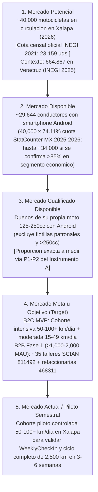

# Estudio de Mercado — Proyecto Itinera

> **Documento Operativo del Entregable Académico (`STUDY.md` — `TASK 1–5`)**  
> **Estado:** `[DISEÑO METODOLÓGICO E INSTRUMENTOS COMPLETOS — FASE DE CAMPO PENDIENTE]`  
> **Asignatura:** Economía para Toma de Decisiones — Licenciatura en Ingeniería de Software  
> **Proyecto:** [Itinera](file:///C:/Users/OGSha/OneDrive/Escritorio/Developer/App%20Development/Itinera/README.md) (*"Donde cada kilómetro cuenta"*)  
> **Ciudad Piloto:** Xalapa, Veracruz, México  
> **Fecha:** Noviembre 2026  
> **Equipo de trabajo:** Gerardo Abraham Barrón Gómez, Edgar Vázquez García, Alberto Villalba Figueroa  

---

## 1. Objetivo del Estudio de Mercado (`TASK 1`)

### 1.1 Objetivo General

Validar la viabilidad de mercado, conductual y comercial de **Itinera** en **Xalapa, Veracruz** —una aplicación móvil Android *Local-First* enfocada en el seguimiento preventivo *Low-Touch* de los cinco consumibles críticos de motocicletas `125–250cc` en su MVP gratuito (Fase 0), articulada con un modelo de atribución local B2B en mostrador (`ContextualPromotion`) para refaccionarias y talleres independientes (Fase 1)—, cuantificando la demanda real de la cohorte objetivo, las brechas de la oferta existente, los canales orgánicos de menor fricción y la disposición a participar en ambos lados de la plataforma.

### 1.2 Objetivos Específicos

De acuerdo con los cuatro estudios de detalle establecidos en la consigna de la asignatura (incorporada en [spec.md](file:///C:/Users/OGSha/OneDrive/Escritorio/Developer/App%20Development/Itinera/.tickets/003-design-itinera-market-study/spec.md)), los objetivos específicos se estructuran por eje analítico:

1. **Análisis de la Demanda (Segmento B2C — Conductores `125–250cc`):**
   - Medir la proporción de propietarios-operadores de motocicletas `125–250cc` con teléfono **Android** en Xalapa, diferenciando la cohorte de uso intensivo (`50–100+ km/día`, incluyendo repartidores independientes dueños de su unidad) frente a usuarios de traslado urbano moderado (`15–30` a `49 km/día`).
   - Cuantificar la prevalencia de **odómetro físico dañado o chicote roto**, el abandono de libretas físicas (*Síndrome de la Guantera*), la práctica de auto-mantenimiento (*DIY*) y la frecuencia de fallas o gastos imprevistos en los cinco `ConsumableItem` (aceite de motor, kit de arrastre/cadena, frenos/balatas, bujía y llantas).
   - Evaluar la aceptación de la experiencia *Low-Touch* de Itinera: `WeeklyCheckIn` en 1 toque (`< 5 s/semana`), alertas quirúrgicas (`SurgicalAlert`) únicamente en umbrales `Amarillo` y `Rojo`, semáforo `WearTrafficLight` y resumen exportable gratuito (`ExportableSummary`).
2. **Análisis de la Oferta y Competencia (Sustitutos Digitales y Analógicos):**
   - Contrastar la propuesta de valor de Itinera frente a competidores digitales disponibles en Google Play México (**Drivvo**, **Fuelio**, **MotoLog / MotoriLog**) y sustitutos analógicos (libretas en guantera, stickers de taller, memoria o notas en el teléfono).
   - Verificar si las tres plantillas editables (`ServiceTemplate`) y la bitácora rápida (`MaintenanceLog < 15 s`) resuelven las fricciones que provocan abandono en apps de contabilidad exhaustiva de combustible.
3. **Análisis de Canales de Comercialización:**
   - Identificar los canales de descubrimiento y descarga con menor costo y cero deuda operativa para el equipo: búsqueda orgánica en **Google Play Store (ASO)**, recomendación boca a boca en grupos/clubes locales (potenciada por `ExportableSummary` gratuito) y receptividad ante señalética con código **QR** en mostrador de refaccionarias (Fase 1).
   - Validar en el lado B2B qué canales emplean actualmente las refaccionarias y talleres de Xalapa para atraer clientes `125–250cc` y cubrir sus valles estacionales de demanda.
4. **Análisis de Precios y Disposición a Pagar / Redimir:**
   - Confirmar la sensibilidad al precio en el Lado A (B2C), contrastando el modelo MVP de **`$0 MXN`** (núcleo completo y `ExportableSummary` gratuitos) frente a la resistencia a pagar suscripciones o documentos pagos en el segmento particular `125–250cc`.
   - Medir en el Lado B (B2B Fase 1) la disposición de refaccionarias y talleres locales a ofrecer descuentos trazables en mostrador (`ContextualPromotion`) y su tarifa o costo por adquisición (CPA) aceptable (referencia `$299–$499 MXN/mes` o pago por cupón redimido en caja) **sin exigir certificación mecánica presencial en campo**, así como la disposición de los motociclistas a canjear dichos cupones cuando reciben una alerta `Amarillo`/`Rojo`.

---

## 2. Metodología, Fuentes e Instrumentos de Recolección (`TASK 2`)

### 2.1 Estilo y Diseño Metodológico del Estudio

Conforme al marco teórico establecido en [MARKET_STUDY.md](file:///C:/Users/OGSha/OneDrive/Escritorio/Developer/App%20Development/Itinera/.routing/reference/MARKET_STUDY.md#L203-L213) y al requerimiento de doble segmento de la consigna académica ([spec.md](file:///C:/Users/OGSha/OneDrive/Escritorio/Developer/App%20Development/Itinera/.tickets/003-design-itinera-market-study/spec.md)), el estudio adopta un **diseño metodológico mixto** que combina dos enfoques diferenciados según la naturaleza de cada lado de la plataforma:

| Dimensión Metodológica | Segmento A — Lado A (B2C: Motociclistas `125–250cc`) | Segmento B — Lado B (B2B Fase 1: Refaccionarias y Talleres) |
| :--- | :--- | :--- |
| **Estilo de estudio** | **Estadístico / Cuantitativo** (encuesta estructurada con muestreo finito probabilístico / estratificado por cuotas operativas). | **No Estadístico / Cualitativo-Exploratorio** (entrevista estructurada en punto físico con muestreo por juicio y zonas comerciales). |
| **Justificación metodológica** | Existe un universo amplio y acotado (`~40,000` motocicletas en circulación en Xalapa) donde se requiere estimar con rigor estadístico ($95\%$ de confianza, $\pm 5\%$ de error) la proporción de conductores con Android, uso intensivo (`50–100+ km/día`), odómetro averiado y aceptación de `WeeklyCheckIn` para proyectar la adopción del MVP. | El número de talleres especializados en motos en Xalapa es reducido (`~35` unidades registradas en SCIAN `811492` más refaccionarias `468311`). El objetivo en Fase 1 no es extrapolar medias poblacionales masivas, sino comprender márgenes, ticket promedio, estacionalidad y viabilidad comercial de `ContextualPromotion` con informantes clave. |
| **Técnica e instrumento** | Cuestionario cerrado de **14 reactivos** (**Instrumento A**), digitalizado en Google Forms para captura rápida en campo (código QR) y grupos locales. | Guion de entrevista presencial de **9 reactivos** (**Instrumento B**), aplicado mediante visita directa a mostradores en las principales zonas viales de Xalapa. |

> [!NOTE]
> **Cumplimiento de la regla de segmentación de `STUDY.md` (línea 43):** Dado que Itinera opera como una plataforma de dos lados asimétrica donde el usuario que adopta gratis (motociclista `125–250cc`) posee atributos y motivaciones radicalmente distintos al actor comercial con margen para pagar en Fase 1 (dueño de refaccionaria o taller), se diseñan **dos instrumentos de recolección independientes y no intercambiables**.

---

### 2.2 Fuentes Secundarias Verificadas

Las fuentes secundarias oficiales y comerciales se recopilaron para dimensionar el parque vehicular real en México, Veracruz y Xalapa, estimar el universo de talleres locales, verificar la cuota de sistema operativo Android y analizar el posicionamiento de competidores existentes en Google Play México.

#### A. Estadísticas Oficiales del Parque Vehicular, Talleres y Tecnología Móvil

| Indicador / Dato Verificado | Cifra Exacta | Ámbito Geográfico | Año / Corte | Fuente Oficial / Verificable |
| :--- | :--- | :--- | :--- | :--- |
| **Motocicletas registradas en circulación (Nacional)** | **`10,547,500`** unidades (`16.1%` del parque nacional; `+17.8%` vs. `8,953,446` en 2024) | México (Nacional) | 2025 (anual definitivo) | INEGI — *Vehículos de Motor Registrados en Circulación (VMRC)* ([inegi.org.mx](https://www.inegi.org.mx/programas/vehiculosmotor/)) |
| **Motocicletas registradas en circulación (Estatal)** | **`664,867`** unidades (5.º lugar nacional; `+29.0%` vs. `515,288` en 2024 y `383,839` en 2023) | Veracruz de Ignacio de la Llave | 2025 (anual definitivo) | INEGI — *VMRC* ([inegi.org.mx](https://www.inegi.org.mx/programas/vehiculosmotor/)) |
| **Parque vehicular total en el municipio de Xalapa** | **`232,680`** vehículos de motor totales registrados (2.º municipio del estado) | Xalapa, Veracruz | Cierre 2024 | INEGI — *VMRC* ([inegi.org.mx](https://www.inegi.org.mx/programas/vehiculosmotor/)) |
| **Motocicletas registradas en Xalapa (cota censal oficial desglosada)** | **`23,159`** unidades (`22,720` particulares y `439` oficiales) | Xalapa, Veracruz | 2021 (último desglose abierto indexado) | INEGI / CEIEG Veracruz — *Cuadernillos Municipales / IEGEMC* ([ceieg.veracruz.gob.mx](https://www.ceieg.veracruz.gob.mx/cuadernillos-municipales/)) |
| **Motocicletas en circulación estimadas en Xalapa** | **`~40,000`** unidades en circulación (el parque se duplicó en 5 años; ~50% sin placas locales o en proceso de regularización) | Xalapa, Veracruz | Oct–Nov 2026 | Departamento de Movilidad Urbana, Ayuntamiento de Xalapa (citado en prensa estatal 2026) |
| **Siniestralidad vial con motocicletas en Xalapa** | **`273`** colisiones con moto de **`804`** siniestros viales totales (ene–oct 2026); `10–15` percances diarios reportados | Xalapa, Veracruz | Ene–Nov 2026 | Movilidad Urbana Xalapa / conteo ciudadano *Physis Ciclovida* (2026) |
| **Talleres de reparación y mantenimiento de motocicletas (SCIAN `811492`)** | **`~35`** establecimientos especializados registrados en el municipio (adicionales a comercios/refaccionarias en SCIAN `468311`) | Xalapa, Veracruz (`CLEE 30087`) | Edición `05/2026` | INEGI — *DENUE* ([inegi.org.mx/app/mapa/denue/](https://www.inegi.org.mx/app/mapa/denue/default.aspx)) y directorios DENUE ([talleresdemotos.com](https://www.talleresdemotos.com/)) |
| **Participación de mercado de Android en México** | **`74.11%`** Android vs. `25.89%` iOS (oct 2025–oct 2026); **`89.13%`** Android en año completo 2024 | México (Nacional) | 2024 y Oct 2025–Oct 2026 | StatCounter Global Stats — *Mobile OS Market Share Mexico* ([gs.statcounter.com](https://gs.statcounter.com/os-market-share/mobile/mexico)) |

> [!IMPORTANT]
> **Transparencia metodológica sobre el dato municipal de Xalapa:** El boletín abierto anual del INEGI publica cifras actualizadas hasta nivel estatal (`664,867` motos en Veracruz en 2025) y el parque total municipal (`232,680` vehículos en Xalapa en 2024), mientras que la serie municipal específica de motocicletas requiere extracción en tabulados OLAP o Cuadernillos CEIEG (último dato municipal abierto indexado: `23,159` en 2021). Para reflejar la realidad operativa de 2026 (incluyendo el crecimiento reciente y unidades sin emplacamiento local), la Sección 3 utiliza la cifra oficial municipal más reciente de **`40,000`** motocicletas en circulación y demuestra la convergencia estadística frente a la cota censal de **`23,159`** unidades.

#### B. Benchmark de Competidores Digitales (Google Play México) y Sustitutos Analógicos

| Competidor / Sustituto | Tipo | Modelo de Precios y Monetización | Enfoque Principal y Capacidades | Fricción Crítica / Brecha frente a Itinera |
| :--- | :--- | :--- | :--- | :--- |
| **Drivvo – Control de gastos** *(CTN Cardoso)* | Digital (App Android / iOS / Web) | *Freemium* con anuncios en plan gratis (hasta 2 vehículos). Suscripción recurrente sin pago único: tarifas MX referenciales `~$174.90–$499.90 MXN/año` (Individual/PRO) o `$24.90–$49.90 USD/año` global; Flota `$210 MXN/veh/año`. | Contabilidad exhaustiva de gastos, cargas de gasolina, ingresos para choferes de apps (Uber/DiDi) y gestión básica de mantenimiento con sincronización en nube. | **Alta fricción de captura (`FuelAccountingLedger`):** exige cuenta obligatoria, muestra anuncios a pantalla completa en la versión gratis y ha generado quejas en reseñas por alzas de suscripción y fallos de restauración PRO. No resuelve chicote roto ni opera con check-in de 1 toque. |
| **Fuelio** *(Sygic)* | Digital (App Android / iOS) | En Android es gratuita, sin anuncios y sin cuenta obligatoria; respaldo en Drive/Dropbox. Suscripción *Fuelio Premium* opcional (`$4.99–$15.99 USD` / `~9 €/año`) para planificador de rutas y escaneo de tickets. | Rendimiento de combustible (L/100 km, km/L), historial de gastos y recordatorios secundarios de servicio. | **Centrada en combustible, no en salud mecánica:** las reseñas reportan interfaz densa, dificultad para editar registros históricos y **no permite registrar lecturas aisladas de odómetro sin capturar una carga de gasolina o gasto**. Mapa de precios poco fiable en México. |
| **MotoLog / MotoriLog** *(Apps especializadas en Google Play)* | Digital (App móvil) | *Freemium* / compras in-app; enfocadas en garaje digital, VIN, grabación GPS de rutas o diagnóstico con IA. | Bitácoras orientadas a entusiastas de gama media-alta, rutas GPX, inclinación, respaldo en nube o trámites de auto. | **Sobrecarga técnica y baja pertinencia para `125–250cc` utilitaria:** asumen tableros funcionales, exigen captura detallada por VIN o carga manual frecuente y carecen de proyección adaptativa para odómetro averiado o redención de cupones en refaccionarias locales. |
| **Libretas, stickers de taller y notas en WhatsApp/memoria** | Analógico / Informal | `$0 MXN` directo (costo oculto en reparaciones correctivas por olvido). | Anotación manual en libreta de guantera, etiqueta adhesiva en tanque/chasis o mensajes sueltos al mecánico. | ***Síndrome de la Guantera*:** el papel se extravía, se moja o queda ilegible; es pasivo (no suma kilómetros ni avisa con ventana anticipada para ahorrar) y no respalda cotizaciones frente a asimetría en talleres. |

---

### 2.3 Fuentes Primarias — Dos Instrumentos Diferenciados (`STUDY.md` Línea 43)

#### Instrumento A: Encuesta Estructurada para Motociclistas `125–250cc` (Segmento B2C)

*Formato listo para copiar a Google Forms. Tiempo estimado de respuesta: 2 a 3 minutos. Incluye preguntas filtro al inicio para garantizar la validez muestral en Xalapa, Veracruz.*

**Título del formulario:** *Estudio sobre hábitos de uso y mantenimiento de motocicletas 125–250cc en Xalapa, Veracruz*  
**Aviso de confidencialidad:** *Esta encuesta es estrictamente académica y anónima; tus respuestas ayudarán a diseñar herramientas prácticas para el cuidado preventivo de motocicletas en Xalapa.*

1. **[Filtro 1 — Cilindrada y Propiedad]** ¿Conduces actualmente una motocicleta de entre `125cc` y `250cc` en Xalapa o zona conurbada, y de quién es la unidad?
   - [ ] Sí, `125–250cc` **de mi propiedad** *(Continúa a P2)*
   - [ ] Sí, `125–250cc` **propiedad de mi empresa / patrón** *(Agradecer y derivar a nota de segmento laboral; fin de encuesta MVP B2C)*
   - [ ] Conduzco otra cilindrada (`< 125cc` o `> 250cc`) *(Fin de encuesta)*
   - [ ] No conduzco motocicleta *(Fin de encuesta)*
2. **[Filtro 2 — Sistema Operativo]** ¿Qué sistema operativo utiliza tu teléfono celular principal con el que descargas aplicaciones?
   - [ ] Android (Google Play Store)
   - [ ] iOS (iPhone / App Store)
   - [ ] Otro / No utilizo smartphone para apps
3. **[Uso e Intensidad Diaria]** ¿Cuál es tu actividad principal con la moto y cuántos kilómetros recorres aproximadamente al día?
   - [ ] Uso intensivo / trabajo propio (reparto en plataformas, mensajería independiente o trayectos largos): **`50 a 100+ km/día`**
   - [ ] Traslado cotidiano moderado (trabajo/universidad): **`20 a 49 km/día`**
   - [ ] Uso ligero u ocasional: **`Menos de 20 km/día`**
4. **[Estado del Odómetro Físico]** ¿Cómo funciona actualmente el odómetro / velocímetro (chicote) de tu motocicleta?
   - [ ] Funciona correctamente y marca el kilometraje real.
   - [ ] Está descompuesto (chicote roto, tablero apagado o marca de forma intermitente).
   - [ ] No me fijo en el odómetro; calculo el servicio "al tanteo" o por semanas.
5. **[Dolor en los 5 Consumibles Críticos]** En los últimos 12 meses, ¿con cuál de estos cinco consumibles has sufrido una falla imprevista, desgaste acelerado o gasto sorpresa por no haberlo revisado a tiempo? *(Selección múltiple)*
   - [ ] Aceite de motor (bajo nivel, degradación o daño al motor)
   - [ ] Kit de arrastre / cadena (destensada, seca, rotura o desgaste de sprockets)
   - [ ] Frenos / balatas (ruido, pérdida de frenado o daño al disco/tambor)
   - [ ] Bujía (fallas de encendido o pérdida de potencia)
   - [ ] Llantas (desgaste liso, grietas o derrapes por baja adherencia)
   - [ ] Ninguno; siempre cambio todo a tiempo.
6. **[Método Actual de Seguimiento]** ¿Cómo controlas actualmente cuándo te toca realizar el siguiente servicio o cambio de refacciones?
   - [ ] De memoria ("cuando siento que suena raro o falla").
   - [ ] Anotado en una libreta, ticket de papel o sticker del taller.
   - [ ] En notas del celular o chat propio de WhatsApp.
   - [ ] Con una aplicación móvil (ej. Drivvo, Fuelio, MotoLog u otra).
   - [ ] El taller o la agencia me avisa.
7. **[Auto-mantenimiento DIY vs. Taller y Asimetría]** Cuando realizas mantenimiento preventivo a tu moto, ¿dónde lo atiendes con mayor frecuencia y qué tanto confías en las cotizaciones de talleres?
   - [ ] Yo mismo realizo los cambios básicos (*DIY* en casa: aceite, cadena, bujía, etc.).
   - [ ] Acudo siempre a un taller mecánico independiente o refaccionaria con servicio.
   - [ ] Combinado (hago lo básico en casa y lo complejo en taller).
   - *(Sub-reactivo de percepción, escala 1 a 5)* ¿Qué tan frecuente sientes desconfianza ante posibles sobreprecios o diagnósticos poco claros al pedir presupuesto en un taller? (`1 = Nunca` a `5 = Muy frecuente`)
8. **[Fricción de Registro — `WeeklyCheckIn`]** Si una app te enviara una sola notificación ligera a la semana en tu pantalla de bloqueo (*"¿Esta semana rodaste ~X km? [Sí, igual] [Ajustar]"*) que toma menos de `5 segundos`, ¿qué tan probable sería que la uses de forma constante frente a una app que te pida registrar datos cada vez que cargas gasolina?
   - [ ] Muy probable; prefiero 1 toque por semana (`< 5 s`) que anotar cada carga de gasolina.
   - [ ] Algo probable; la probaría si no requiere abrir formularios largos.
   - [ ] Poco probable; prefiero registrar cada carga de gasolina / gasto manualmente.
   - [ ] Nada probable; no usaría ninguna app.
9. **[Política de Alertas — `SurgicalAlert`]** ¿Con qué frecuencia aceptarías recibir avisos de mantenimiento de la aplicación sin llegar a silenciarla o desinstalarla?
   - [ ] Únicamente alertas clave cuando falte poco para un servicio (`Amarillo`) o cuando ya sea urgente (`Rojo`).
   - [ ] Recordatorios diarios o varios avisos por semana.
   - [ ] Prefiero no recibir notificaciones y entrar solo cuando me acuerde.
10. **[Utilidad del Semáforo `WearTrafficLight`]** ¿Qué tan útil consideras ver un semáforo simple (Verde / Amarillo / Rojo) que te avise en **Amarillo** (~2 semanas o ~300 km antes) para poder juntar el dinero del aceite o las balatas sin gastos sorpresa? (`Escala Likert 1 a 5`: `1 = Nada útil` a `5 = Muy útil`)
11. **[Utilidad del `ExportableSummary` Gratuito]** ¿Para qué utilizarías principalmente un resumen exportable gratuito del historial de servicios de tu moto (con fechas, piezas cambiadas y costos)? *(Selección única o principal)*
    - [ ] Para consultar rápidamente qué se le cambió la última vez y evitar que me vendan piezas repetidas en el taller.
    - [ ] Para respaldar el historial de cuidados al momento de vender o transferir la motocicleta.
    - [ ] Para llevar mi control personal de cuánto gasto al año en mi moto.
    - [ ] No le veo utilidad práctica.
12. **[Disposición a Pagar B2C]** Para usar una aplicación móvil en tu motocicleta personal (`1 unidad`) con bitácora, semáforo de desgaste, alertas y resumen exportable, ¿cuál esquema estarías dispuesto a utilizar?
    - [ ] Únicamente si el núcleo básico es **100% gratuito (`$0 MXN`)**.
    - [ ] Pagaría una suscripción mensual baja (`$30–$49 MXN/mes`) incluso teniendo 1 sola moto.
    - [ ] Pagaría solo si tuviera `3 o más` vehículos y necesitara respaldo en la nube.
13. **[Receptividad a Cupones Locales — `ContextualPromotion`]** Cuando el semáforo te avise que tu moto está próxima a requerir cambio de aceite, balatas o kit de arrastre (`Amarillo`/`Rojo`), ¿canjearías un cupón de descuento (ej. 10–15% o revisión gratuita) de una refaccionaria o taller cercano en Xalapa mostrando un código en mostrador?
    - [ ] Sí, definitivamente lo usaría si el comercio queda cerca de mi ruta y el descuento es real.
    - [ ] Tal vez, dependiendo del precio final y la reputación del lugar.
    - [ ] No, prefiero ir siempre con mi mecánico habitual aunque no haya descuento.
14. **[Canal de Descubrimiento]** ¿Por cuál medio sueles descubrir y descargar aplicaciones o herramientas nuevas para tu motocicleta?
    - [ ] Buscando directamente en Google Play Store (ej. "mantenimiento moto", "cambio de aceite").
    - [ ] Recomendación boca a boca de otros motociclistas, compañeros de reparto o grupos/clubes locales.
    - [ ] Código QR o anuncio físico en el mostrador de la refaccionaria o taller donde compro mis piezas.
    - [ ] Redes sociales / videos cortos.

---

#### Instrumento B: Guion de Entrevista Estructurada para Dueños de Refaccionarias y Talleres Locales (Segmento B2B — Fase 1)

*Guion listo para levantamiento presencial en campo en zonas comerciales y corredores viales de Xalapa (Av. Lázaro Cárdenas, Blvd. Adolfo Ruiz Cortines, Av. 20 de Noviembre, Col. Revolución / Rafael Lucio). Duración estimada: 10–12 minutos.*

**Datos de control (llena el investigador):** Fecha | Nombre comercial del establecimiento | Giro (`Refaccionaria` / `Taller independiente` / `Mixto`) | Colonia / Zona en Xalapa | Cargo del entrevistado (`Dueño` / `Encargado`).

1. **[Volumen de Clientes `125–250cc`]** Aproximadamente, ¿cuántos clientes propietarios de motocicletas de trabajo o urbanas (`125–250cc`, ej. Italika, Bajaj, Honda, Vento) atienden al mes en su mostrador o bahía de servicio?
   - *(Registrar cifra estimada mensual y proporción aproximada entre repartidores/uso intensivo y particulares)*
2. **[Ticket Promedio en los 5 Consumibles Críticos]** ¿Cuál es el ticket promedio (refacción y/o mano de obra en `$ MXN`) que suele dejar un cliente `125–250cc` en sus servicios más frecuentes?
   - Cambio de aceite: `$_____ MXN` | Frenos/balatas: `$_____ MXN` | Kit de arrastre/cadena: `$_____ MXN` | Bujía/afinación menor: `$_____ MXN` | Llantas: `$_____ MXN`.
3. **[Estacionalidad y Valles Operativos]** ¿En qué días de la semana o épocas del mes/año nota una baja en la afluencia de clientes (valles operativos) donde más le convendría atraer motociclistas adicionales?
4. **[Canales Actuales de Captación y Gasto Publicitario]** Actualmente, ¿cómo atrae nuevos clientes motociclistas a su negocio (ubicación a pie de calle, recomendación boca a boca, Google Maps, volantes, Facebook) y cuánto invierte aproximadamente al mes en promoción?
5. **[Pérdida de Recurrencia por Olvido del Cliente]** Desde su experiencia en taller o mostrador, ¿qué porcentaje aproximado de sus clientes ocasionales deja pasar demasiado tiempo antes de regresar por cambio de aceite o cadena, llegando finalmente cuando la pieza ya falló o comprando de emergencia en otro sitio?
6. **[Aceptación del Cupón Contextual Trazable — `ContextualPromotion`]** Imagine una aplicación gratuita usada por motociclistas de Xalapa que les avisa unos `300 km` antes de que les toque cambio de aceite, frenos o cadena. Si la app mostrara un cupón promocional de su negocio únicamente a usuarios cercanos en ese momento para que lo canjeen con código en su caja (sin que la plataforma audite ni "certifique" su taller en campo), ¿qué tan útil le parecería este mecanismo para medir si la publicidad realmente le llevó ventas? (`Escala 1 a 5` + comentarios cualitativos).
7. **[Esquema de Cobro y CPA / Margen Aceptable]** Si participara en una etapa posterior cuando la app supere los `1,000–2,000` usuarios activos en Xalapa, ¿qué esquema comercial le daría mayor confianza y qué rango estaría dispuesto a pagar?
   - [ ] Pauta mensual local accesible (ej. `$299–$499 MXN/mes` por aparecer ante usuarios en ventana preventiva dentro de su zona).
   - [ ] Pago exclusivo por resultado / cupón efectivamente redimido en caja (ej. `$20–$40 MXN` de comisión/CPA por venta comprobada).
   - [ ] No pagaría pauta digital en apps.
   - *(Sub-pregunta)* ¿Qué incentivo o descuento máximo en mostrador (ej. `10%` en aceite, mano de obra promocional en balatas o revisión de cadena sin costo) le resultaría rentable ofrecer al usuario del cupón sin sacrificar su margen?
8. **[Adopción de QR en Mostrador]** Para que sus clientes actuales recuerden regresar a tiempo a su negocio, ¿estaría dispuesto a colocar un pequeño letrero con código **QR** en su mostrador para que descarguen gratis la app de recordatorios? (`Sí / No / Condiciones`).
9. **[Barreras u Objeciones B2B]** ¿Qué requisito indispensable (comprobante de canje, simplicidad sin instalar software complejo en caja, exclusividad de zona o reportes mensuales de redención) necesitaría ver para probar un piloto durante un mes?

---

## 3. Universo de Estudio y Cálculo de Muestreo (`TASK 3`)

### 3.1 Embudo de Demanda de 5 Niveles (Xalapa, Veracruz)

Siguiendo la taxonomía del mercado según tipo de demanda definida en [MARKET_STUDY.md](file:///C:/Users/OGSha/OneDrive/Escritorio/Developer/App%20Development/Itinera/.routing/reference/MARKET_STUDY.md#L353-L361), el universo del proyecto en Xalapa se depura progresivamente desde el parque circulante estimado hacia el piloto semestral:

| Nivel del Embudo | Definición Operativa en Xalapa, Veracruz | Magnitud Cuantitativa Anclada | Fuente / Criterio de Depuración |
| :--- | :--- | :--- | :--- |
| **1. Mercado Potencial** | Total de motocicletas que circulan en el municipio de Xalapa (universo base local del estudio). | **`40,000`** unidades circulantes estimadas en 2026 *(cota mínima censal oficial: `23,159` en 2021, `22,720` particulares)*. | Movilidad Urbana Xalapa (2026) / INEGI-CEIEG (`2021`, `2025`). |
| **2. Mercado Disponible** | Motociclistas en Xalapa con acceso tecnológico compatible con el MVP (*Android + Google Play*). | **`29,644`** unidades *(aplicando la cota conservadora de `74.11%` Android de StatCounter Oct 2025–Oct 2026; rango superior hasta `35,652` con `89.13%` de 2024)*. | StatCounter Global Stats México (`74.11%`–`89.13%` Android). |
| **3. Mercado Cualificado Disponible** | Propietarios-operadores (dueños de su unidad) de cilindrada **`125–250cc`** con Android que requieren seguimiento preventivo o padecen *Síndrome de la Guantera* / chicote roto. | `[ESTIMACIÓN DE PROPORCIÓN MEDIANTE P1–P4 EN CAMPO]` *(referencia histórica de mercado mexicano dominado por baja cilindrada `125–250cc`)*. | Filtros P1 y P2 del **Instrumento A**; reglas CCU de `SPECIFICATION.md`. |
| **4. Mercado Meta u Objetivo (*Target*)** | *Lado A (MVP):* Conductores `125–250cc` propios con prioridad en uso intensivo (`50–100+ km/día`) y secundario moderado (`15–49 km/día`). *Lado B (Fase 1):* Comercios locales tras superar `>1,000–2,000` MAU. | *B2C:* Subconjunto intensivo y urbano de Nivel 3. *B2B:* **`~35`** talleres especializados (`811492`) + refaccionarias (`468311`) en Xalapa. | `SPECIFICATION.md` + INEGI DENUE `05/2026` (`CLEE 30087`). |
| **5. Mercado Actual / Piloto Semestral** | Usuarios activos iniciales captados para validar retención semanal (`WeeklyCheckIn`) y cierre de al menos un `MaintenanceLog` en `3–6` semanas. | **`[PENDIENTE DE EJECUCIÓN PILOTO]`** *(meta operativa inicial previa a la Compuerta 1 de `>1,000–2,000` MAU)*. | `BUSINESS_MODEL_CANVAS.md` (Compuerta Fase 0 $\to$ Fase 1). |

---

### 3.2 Cálculo Estadístico de Muestra para Segmento A (B2C — Universo Finito)

Para garantizar representatividad estadística sobre el universo local de motocicletas en Xalapa ($N = 40{,}000$ unidades en circulación), se formula el contraste de hipótesis base y se aplica la **fórmula de universo finito corregida** documentada en [MARKET_STUDY.md](file:///C:/Users/OGSha/OneDrive/Escritorio/Developer/App%20Development/Itinera/.routing/reference/MARKET_STUDY.md#L308-L314):

- **Hipótesis de trabajo:**
  - $H_0$: La proporción de propietarios-operadores de motocicletas `125–250cc` en Xalapa con necesidad latente de seguimiento preventivo *Low-Touch* y disposición a adoptar una herramienta gratuita de check-in semanal no alcanza un nivel relevante de aceptación ($p \le 0.50$).
  - $H_1$: La proporción de propietarios-operadores con dicha necesidad y disposición a adoptar la herramienta *Low-Touch* es mayoritaria ($p > 0.50$).
- **Parámetros estadísticos seleccionados:**
  - **Universo conocido ($N$):** `40,000` motocicletas en circulación en Xalapa (Movilidad Urbana, 2026).
  - **Nivel de confianza ($Z$):** `95%` $\implies$ **$z = 1.96$** (estándar mínimo aceptado por la industria).
  - **Margen de error ($e$):** `±5%` $\implies$ **$e = 0.05$** (máximo estándar recomendado).
  - **Variabilidad ($p, q$):** Al no existir un estudio previo idéntico en Xalapa sobre seguimiento *Low-Touch*, se adopta el criterio conservador de varianza máxima: **$p = 0.50$**, **$q = 1 - p = 0.50$** ($p \cdot q = 0.25$).

#### Desarrollo Matemático Paso a Paso

$$n = \frac{z^2 \cdot N \cdot p \cdot q}{e^2(N - 1) + z^2 \cdot p \cdot q}$$

1. **Cálculo de componentes constantes:**
   - $z^2 = (1.96)^2 = 3.8416$
   - $e^2 = (0.05)^2 = 0.0025$
   - $p \cdot q = 0.50 \times 0.50 = 0.25$
   - $z^2 \cdot p \cdot q = 3.8416 \times 0.25 = 0.9604$
2. **Cálculo del numerador:**
   $$\text{Numerador} = 3.8416 \times 40{,}000 \times 0.25 = 38{,}416.0000$$
3. **Cálculo del denominador:**
   $$\text{Denominador} = 0.0025 \times (40{,}000 - 1) + 0.9604 = (0.0025 \times 39{,}999) + 0.9604 = 99.9975 + 0.9604 = 100.9579$$
4. **Cociente y redondeo conservador hacia arriba:**
   $$n = \frac{38{,}416.0000}{100.9579} = 380.5150 \approx \mathbf{381\;\text{encuestas válidas}}$$

#### Análisis de Sensibilidad por Base Poblacional y Margen de Error (Restricción Semestral)

Para demostrar la robustez del cálculo frente a distintas definiciones de $N$ y documentar alternativas prácticas si el calendario académico restringe las horas de campo, se presenta la matriz de sensibilidad verificada con $Z = 1.96$ (`95%` de confianza) y $p = q = 0.50$:

| Escenario / Referencia de $N$ | Universo ($N$) | Error ($e$) | Resultado Exacto ($n$) | Muestra Requerida ($\lceil n \rceil$) | Uso Recomendado |
| :--- | :---: | :---: | :---: | :---: | :--- |
| **Base principal: Parque circulante Xalapa (2026)** | `40,000` | **`±5%`** (`0.05`) | `380.52` | **`381` encuestas** | **Estándar formal completo** del estudio estadístico. |
| **Base Mercado Disponible Android (`74.11%`)** | `29,644` | `±5%` (`0.05`) | `379.26` | `380` encuestas | Confirma que acotar al subconjunto Android solo cambia la muestra en `1` encuesta. |
| **Cota mínima censal oficial INEGI/CEIEG (2021)** | `23,159` | `±5%` (`0.05`) | `377.91` | `378` encuestas | Referencia histórica oficial mínima (`22,720` particulares también arroja `378`). |
| **Sensibilidad académica intermedia (Xalapa 2026)** | `40,000` | `±7%` (`0.07`) | `195.05` | **`196` encuestas** | Alternativa de viabilidad si el equipo dispone de recursos semestrales limitados. |
| **Sensibilidad exploratoria rápida (Xalapa 2026)** | `40,000` | `±10%` (`0.10`) | `95.81` | **`96` encuestas** | Mínimo exploratorio cuantitativo con tolerancia ampliada de error ($\pm 10\%$). |

- **Estrategia de levantamiento para Segmento A:** Dado que no existe un padrón público nominal con teléfono de cada motociclista en Xalapa para sorteo aleatorio simple, se empleará un **muestreo estratificado por cuotas operativas y puntos de afluencia** distribuidos en corredores clave de la ciudad (Av. Lázaro Cárdenas, Circuito Presidentes, Av. Xalapa / Zona Universitaria, Av. 20 de Noviembre y puntos de espera de repartidores independientes), procurando equilibrar al menos **50% de encuestas en la cohorte intensiva (`50–100+ km/día`)** y hasta **50% en traslado moderado/ligero (`< 50 km/día`)** para contrastar ambos perfiles sin sesgar la muestra únicamente a repartidores.

---

### 3.3 Muestreo No Probabilístico para Segmento B (B2B) y Piloto Semestral

Para el **Segmento B (Refaccionarias y Talleres Mecánicos Locales — Fase 1)** se aplica **muestreo no probabilístico por juicio (intencional) y cuotas geográficas**, con base en las siguientes razones metodológicas:

1. **Tamaño reducido del marco censal:** El DENUE `05/2026` contabiliza alrededor de `35` establecimientos en reparación de motocicletas (`SCIAN 811492`) en Xalapa, complementados por refaccionarias y comercios mixtos (`SCIAN 468311`). Aplicar una fórmula probabilística de $e = \pm 5\%$ a $N = 35$ exigiría entrevistar prácticamente un censo ($33$ de $35$ negocios), lo cual no aporta mayor claridad decisoria en una etapa donde `ContextualPromotion` ni siquiera se monetiza hasta superar `1,000–2,000` MAU en Fase 1.
2. **Calidad sobre cantidad en información B2B:** La técnica de entrevista presencial estructurada (**Instrumento B**) exige dialogar directamente con el **dueño o encargado con poder de decisión comercial** (quien fija precios y descuentos en mostrador), siendo más valiosas **10 a 15 entrevistas profundas** distribuidas por zonas comerciales de Xalapa (Zona Centro/20 de Noviembre, Corredor Ruiz Cortines/Obrero Campesina, Zona Norte Revolución/Rafael Lucio y Corredor Lázaro Cárdenas) que formularios anónimos respondidos por ayudantes sin capacidad de decisión.
3. **Relación con la Cohorte Piloto Semestral del MVP:** De forma paralela al estudio de mercado, el piloto funcional de la app en Fase 0 priorizará una cohorte controlada de propietarios-operadores a `50–100+ km/día` para cerrar al menos un ciclo completo de cambio de aceite (`2,500 km` en `3–6 semanas`) dentro del semestre académico.

---

## 4. Análisis de Resultados (`TASK 4 — Plantilla de Vaciado`)

> [!IMPORTANT]
> **Estado de recolección en campo:** Al momento de emitir este diseño metodológico, el levantamiento primario de los Instrumentos A y B **no ha sido ejecutado**. Todas las métricas, proporciones y hallazgos empíricos permanecen marcados explícitamente como `[PENDIENTE DE RECOLECCIÓN EN CAMPO]` para garantizar cero fabricación o simulación de datos.

### 4.1 Análisis de la Demanda (Segmento B2C)

| Variable Medida (Instrumento A) | Métrica / Indicador a Tabular | Resultado Observado | Gráfica / Soporte Visual |
| :--- | :--- | :--- | :--- |
| **Tasa de elegibilidad MVP (`P1` + `P2`)** | `%` de motos `125–250cc` propias + `%` con smartphone Android en Xalapa | `[PENDIENTE DE RECOLECCIÓN EN CAMPO]` | Gráfica de embudo / pastel |
| **Distribución de intensidad de uso (`P3`)** | `%` cohorte intensiva (`50–100+ km/día`) vs. moderada (`20–49 km/día`) vs. ligera (`<20 km/día`) | `[PENDIENTE DE RECOLECCIÓN EN CAMPO]` | Gráfica de barras por segmento |
| **Incidencia de odómetro averiado (`P4`)** | `%` de unidades con chicote roto / tablero inoperante o cálculo "al tanteo" | `[PENDIENTE DE RECOLECCIÓN EN CAMPO]` | Gráfica de barras / proporción |
| **Ranking de fallas en 5 `ConsumableItem` (`P5`)** | Frecuencia de gastos sorpresa en aceite, cadena, frenos, bujía y llantas | `[PENDIENTE DE RECOLECCIÓN EN CAMPO]` | Diagrama de Pareto |
| **Práctica *DIY* y desconfianza en talleres (`P7`)** | `%` que realiza mantenimiento propio + mediana/promedio de desconfianza (1–5) | `[PENDIENTE DE RECOLECCIÓN EN CAMPO]` | Histograma escala Likert |
| **Aceptación de UX *Low-Touch* (`P8`, `P9`, `P10`, `P11`)** | `%` que prefiere `WeeklyCheckIn` `<5 s`, `SurgicalAlert`, utilidad `WearTrafficLight` y uso de `ExportableSummary` | `[PENDIENTE DE RECOLECCIÓN EN CAMPO]` | Barras apiladas de aceptación |

**Comentario analítico de la demanda:** `[PENDIENTE DE RECOLECCIÓN EN CAMPO — Contrastar si el porcentaje real de odómetros dañados y la preferencia por WeeklyCheckIn frente a registro por gasolina confirman las hipótesis conductuales de SPECIFICATION.md]`.

---

### 4.2 Análisis de la Oferta (Competencia Digital, Sustitutos y Red B2B)

| Dimensión Analizada | Hallazgo Secundario Verificado (Base) | Validación Primaria en Campo (`P6` e Instrumento B) |
| :--- | :--- | :--- |
| **Penetración real de apps competidoras (Drivvo / Fuelio / MotoLog)** | Disponibles en Google Play; altas fricciones por registro de gasolina, anuncios o interfaces densas. | `[PENDIENTE DE RECOLECCIÓN EN CAMPO — % de motociclistas en Xalapa que usa alguna app vs. papel/memoria]` |
| **Persistencia del *Síndrome de la Guantera*** | Libretas y stickers no proyectan kilometraje ni previenen olvidos en intervalos cortos de `2,500 km`. | `[PENDIENTE DE RECOLECCIÓN EN CAMPO — % que controla por memoria, libreta o sticker]` |
| **Capacidad y valles de talleres/refaccionarias (`E1`–`E5`)** | `~35` talleres `SCIAN 811492` + refaccionarias `468311` mapeados en Xalapa (DENUE `05/2026`). | `[PENDIENTE DE RECOLECCIÓN EN CAMPO — Volumen mensual 125–250cc y días/semanas valle reportados]` |

**Comentario analítico de la oferta:** `[PENDIENTE DE RECOLECCIÓN EN CAMPO]`.

---

### 4.3 Análisis de los Canales de Comercialización

| Canal Evaluado | Lado / Fase | Indicador Esperado a Medir (`P14`, `E4`, `E8`) | Resultado de Campo |
| :--- | :--- | :--- | :--- |
| **Google Play Store (ASO orgánico)** | B2C (Fase 0) | `%` de motociclistas que busca herramientas directamente en Play Store | `[PENDIENTE DE RECOLECCIÓN EN CAMPO]` |
| **Recomendación boca a boca y clubes locales** | B2C (Fase 0) | `%` que descubre apps por recomendación de pares/repartidores + uso de `ExportableSummary` al compartir | `[PENDIENTE DE RECOLECCIÓN EN CAMPO]` |
| **QR en mostrador de refaccionarias/talleres** | B2C + B2B (Fase 1) | `%` de usuarios receptivos a escanear QR en mostrador y `%` de comercios dispuestos a exhibirlo | `[PENDIENTE DE RECOLECCIÓN EN CAMPO]` |

**Comentario analítico de canales:** `[PENDIENTE DE RECOLECCIÓN EN CAMPO]`.

---

### 4.4 Análisis de Precios y Disposición a Pagar / Redimir

| Variable Económica | Hipótesis Base Reconciliada | Resultado Observado (`P12`, `P13`, `E2`, `E6`, `E7`) |
| :--- | :--- | :--- |
| **Disposición a pagar B2C por 1 unidad (`P12`)** | Resistencia mayoritaria a pagar en Fase 0; adopción solo a `$0 MXN` en núcleo MVP. | `[PENDIENTE DE RECOLECCIÓN EN CAMPO]` |
| **Disposición B2C a canjear `ContextualPromotion` (`P13`)** | Alta receptividad cuando el cupón aparece en ventana preventiva `Amarillo`/`Rojo`. | `[PENDIENTE DE RECOLECCIÓN EN CAMPO]` |
| **Ticket promedio local en 5 consumibles (`E2`)** | Referencia necesaria para validar si el descuento/comisión cabe en el margen del taller. | `[PENDIENTE DE RECOLECCIÓN EN CAMPO]` |
| **Tarifa / CPA aceptable por comercios (`E6`, `E7`)** | Pauta local `$299–$499 MXN/mes` o pago por cupón redimido en caja sin auditoría de campo. | `[PENDIENTE DE RECOLECCIÓN EN CAMPO]` |

**Comentario analítico de precios y elasticidad:** `[PENDIENTE DE RECOLECCIÓN EN CAMPO]`.

---

### 4.5 Matriz FODA de Síntesis (Estructura Preparada para Vaciado)

| Origen | Factores Positivos | Factores Negativos |
| :--- | :--- | :--- |
| **Interno** *(Producto y Equipo)* | **Fortalezas (F):** • Arquitectura *Local-First* Android (`$0` servidores en Fase 0) y operación offline. • Diseño *Low-Touch* (`WeeklyCheckIn < 5 s`, regla dual $\min(t_{km}, t_{meses})$ que funciona aun con chicote roto). • `[PENDIENTE DE RECOLECCIÓN EN CAMPO — Diferenciadores mejor evaluados por usuarios]` | **Debilidades (D):** • Ausencia inicial de versión iOS (`Fase 2`). • Cobertura mediante 3 `ServiceTemplate` editables en lugar de catálogo exacto por lote. • `[PENDIENTE DE RECOLECCIÓN EN CAMPO — Objeciones o brechas detectadas en encuesta]` |
| **Externo** *(Mercado de Xalapa)* | **Oportunidades (O):** • Parque creciente (`~40,000` motos en Xalapa; `+29.0%` anual en Veracruz en 2025). • Brecha clara frente a apps centradas en gasolina (Fuelio/Drivvo). • `[PENDIENTE DE RECOLECCIÓN EN CAMPO — % de talleres dispuestos a probar ContextualPromotion + QR]` | **Amenazas (A):** • Hábito arraigado de no llevar ningún registro hasta la falla. • Competencia consolidada en descargas globales (Drivvo/Fuelio) y resistencia a notificaciones. • `[PENDIENTE DE RECOLECCIÓN EN CAMPO — Riesgos de abandono o rechazo de cupones]` |

---

## 5. Conclusiones y Proyección hacia Estudios Posteriores (`TASK 5 — Plantilla de Cierre`)

> [!NOTE]
> **Estatus de cierre:** Esta sección documenta las **decisiones e hipótesis condicionales** que se dictaminarán una vez tabulados los datos primarios de la Sección 4 (`[PENDIENTE DE RESULTADOS]`), estableciendo exactamente qué parámetros debe entregar el Estudio de Mercado a los cuatro estudios subsecuentes exigidos por `STUDY.md`.

### 5.1 Proyección hacia el Estudio Técnico

`[PENDIENTE DE RESULTADOS]` — Al concluir el vaciado de campo, se confirmarán o ajustarán los siguientes parámetros técnicos para el MVP Android:
- **Capacidad y segmentación inicial:** Validar si el `>80%` del parque `125–250cc` entrevistado en Xalapa coincide con las especificaciones estándar de las 3 `ServiceTemplate` (*Moto Urbana*, *Moto Trabajo / Uso Rudo* y *Personalizada*) o si se requiere ajustar los intervalos base de aceite (`2,000–2,500 km`) y lubricación de cadena (`400–500 km`).
- **Prioridad de modo sin odómetro:** Si la proporción de motos con chicote roto (`P4`) supera el `25%–30%`, priorizar desde el onboarding el flujo de odómetro relativo (`Km_base = 0`) respaldado por la regla temporal de `OdometerProjection`.
- **Restricciones de dispositivo:** Confirmar versiones predominantes de Android en el segmento `125–250cc` para fijar el `minSdk` de la app SQLite *Local-First*.

### 5.2 Proyección hacia el Estudio Económico-Financiero

`[PENDIENTE DE RESULTADOS]` — Los resultados de los Instrumentos A y B alimentarán las proyecciones financieras sin supuestos arbitrarios:
- **Confirmación de Fase 0 (`$0 MXN` ingreso B2C):** Verificar si la resistencia a pagar en `P12` confirma que el ingreso directo del Año 0 debe mantenerse en `$0 MXN` con costos limitados a la licencia única de Google Play (`$25 USD`).
- **Calibración de precio B2B en Fase 1 (`ContextualPromotion`):** Utilizar el ticket promedio real (`E2`), el margen máximo de descuento (`E7`) y la tarifa/CPA aceptada por las refaccionarias de Xalapa (`E7`) para modelar el punto de equilibrio de Fase 1 una vez alcanzada la compuerta de `>1,000–2,000` MAU locales.
- **Estimación de tasa de canje:** Cruzar la intención de redención (`P13`) con el ciclo promedio de servicio para proyectar ingresos conservadores por atribución en mostrador.

### 5.3 Adecuaciones al Business Model Canvas

`[PENDIENTE DE RESULTADOS]` — Con base en la evidencia empírica de Xalapa, se revisará el [BUSINESS_MODEL_CANVAS.md](file:///C:/Users/OGSha/OneDrive/Escritorio/Developer/App%20Development/Itinera/.routing/reference/BUSINESS_MODEL_CANVAS.md) bajo los siguientes criterios de decisión:
- **Propuesta de Valor y Relación con Clientes:** Confirmar si `WeeklyCheckIn` (`< 5 s`) y `ExportableSummary` gratuito son los impulsores reales de retención, o si el nicho *DIY* / mujeres conductoras requiere énfasis adicional en las guías de inspección rápida.
- **Canales:** Ponderar el peso real entre **ASO en Google Play**, recomendación boca a boca en grupos de repartidores y **QR en mostrador** para asignar el esfuerzo de lanzamiento en Fase 0 y Fase 1.
- **Socios Clave:** Confirmar la viabilidad de afiliar comercios únicamente mediante cupones trazables sin certificación presencial de talleres.

### 5.4 Proyección hacia el Estudio Organizacional

`[PENDIENTE DE RESULTADOS]` — Determinar la carga operativa mínima que soportará el equipo de 3 ingenieros según la respuesta del mercado:
- **Fase 0 (Autoservicio estricto):** Confirmar que la tasa de incidencias reportadas y la claridad de las plantillas permiten operar sin mesa de ayuda humana ni gestión diaria de redes sociales.
- **Fase 1 (Operación B2B local):** Estimar cuántas horas semanales de prospección comercial y colocación de material QR en Xalapa exige atender la cuota objetivo de refaccionarias y talleres aliados sin desviar horas críticas de desarrollo de software.

---

## 6. Referencias y Fuentes Consultadas

### 6.1 Fuentes Secundarias Externas Verificadas

1. **Instituto Nacional de Estadística y Geografía (INEGI)** (2025). *Vehículos de motor registrados en circulación (VMRC) — Estadística Anual 2023, 2024 y 2025 (Nacional y Veracruz)*. https://www.inegi.org.mx/programas/vehiculosmotor/
2. **Instituto Nacional de Estadística y Geografía (INEGI)** (2026). *Directorio Estadístico Nacional de Unidades Económicas (DENUE), Edición 05/2026 — Claves SCIAN 811492 (Reparación y mantenimiento de motocicletas) y 468311 (Comercio al por menor de motocicletas), Municipio 30087 Xalapa, Veracruz*. https://www.inegi.org.mx/app/mapa/denue/default.aspx
3. **Comité Estatal de Información Estadística y Geográfica de Veracruz (CEIEG / SEFIPLAN)** (2022–2026). *Cuadernillos Municipales e Información Estadística — Municipio de Xalapa (desglose histórico municipal de motocicletas 2021)*. https://www.ceieg.veracruz.gob.mx/cuadernillos-municipales/
4. **Departamento de Movilidad Urbana del Ayuntamiento de Xalapa / Organización Physis Ciclovida** (octubre–noviembre de 2026). *Estimación del parque circulante de motocicletas en Xalapa (~40,000 unidades) y conteo preliminar de siniestralidad vial enero–octubre 2026* (reportado en prensa estatal de Veracruz: *Diario de Xalapa / OEM*, *Libertad Bajo Palabra*, *e-veracruz*).
5. **Directorio DENUE Sectorial — Talleres de Motos México** (2026). *Establecimientos de reparación y mantenimiento de motocicletas en Xalapa, Veracruz (SCIAN 811492)*. https://www.talleresdemotos.com/
6. **StatCounter Global Stats** (2024–2026). *Mobile Operating System Market Share Mexico (Android vs. iOS: año completo 2024 y ventana octubre 2025 – octubre 2026)*. https://gs.statcounter.com/os-market-share/mobile/mexico
7. **Drivvo — CTN Cardoso** (2026). *Drivvo – Control de gastos de vehículos: planes, tarifas México y reseñas en Google Play*. https://www.drivvo.com/es-MX/ y https://play.google.com/store/apps/details?id=br.com.ctncardoso.ctncar
8. **Fuelio — Sygic** (2026). *Fuelio: Precios del combustible y control de gastos/mantenimiento en Google Play*. https://fuel.io/ y https://play.google.com/store/apps/details?id=com.kajda.fuelio
9. **MotoLog / MotorApp** (2026). *Aplicaciones especializadas de bitácora y registro de kilometraje para motocicletas en Google Play*. https://www.motorapp.net/

### 6.2 Documentación Canónica Interna del Proyecto Itinera

10. Consigna académica de la asignatura (*Estudio de Mercado*, incorporada en [spec.md](file:///C:/Users/OGSha/OneDrive/Escritorio/Developer/App%20Development/Itinera/.tickets/003-design-itinera-market-study/spec.md)) — Pasos generales, 4 estudios de detalle y requerimientos `TASK 1–5`.
11. [MARKET_STUDY.md](file:///C:/Users/OGSha/OneDrive/Escritorio/Developer/App%20Development/Itinera/.routing/reference/MARKET_STUDY.md) — *Monografía: Estudio de Mercado — Fundamentos Económicos, Muestreo Estadístico y Aplicación Reconciliada en Itinera* (marco teórico, tabla `Z`, fórmula de universo finito corregida y exclusiones).
12. [SPECIFICATION.md](file:///C:/Users/OGSha/OneDrive/Escritorio/Developer/App%20Development/Itinera/.routing/academic/SPECIFICATION.md) — *Especificación Académica y de Dominio — Proyecto Itinera* (línea base MVP reconciliada, segmentación CCU `125–250cc`, cohorte `50–100+ km/día` y bitácora de recortes).
13. [DOMAIN.md](file:///C:/Users/OGSha/OneDrive/Escritorio/Developer/App%20Development/Itinera/.routing/DOMAIN.md) — *Modelo Conceptual y Diccionario del Dominio (Itinera)* (entidades MVP, entidades Fase 1–2, exclusiones e invariantes matemáticas).
14. [BUSINESS_MODEL_CANVAS.md](file:///C:/Users/OGSha/OneDrive/Escritorio/Developer/App%20Development/Itinera/.routing/reference/BUSINESS_MODEL_CANVAS.md) — *Monografía: Business Model Canvas y su Aplicación Reconciliada en el Proyecto Itinera* (plataforma de dos lados asimétrica y compuertas por fases).
