# Especificación Académica y de Dominio — Proyecto Itinera

> **Documento Purgado y Refinado**  
> **Estado:** `[REFINED / EN EVOLUCIÓN PROGRESIVA]`  
> **Asignatura:** Economía para Toma de Decisiones — Licenciatura en Ingeniería de Software.  
> **Ubicación y fecha:** Xalapa, Veracruz — Octubre/Noviembre 2026.  
> **Equipo de trabajo:**
> - Gerardo Abraham Barrón Gómez
> - Edgar Vázquez García
> - Alberto Villalba Figueroa

---

## 1. Resumen Ejecutivo y Visión

- **Nombre del proyecto:** Itinera
- **Lema:** *"Donde cada kilómetro cuenta"*
- **Propósito central:** Optimizar y hacer eficiente la gestión del ciclo de mantenimiento preventivo y correctivo de vehículos particulares (abarcando tanto automóviles como motocicletas, con estrategia de despliegue inicial en estas últimas), proveyendo una bitácora digital ágil y de baja fricción que conecte el uso cotidiano de la unidad con alertas oportunas, estimación visual de desgaste de consumibles y fomento del auto-mantenimiento seguro.

---

## 2. Planteamiento del Problema (TPNSc)

### 2.1 Definición Canónica del Problema
> *"El proceso actual de gestión y seguimiento del mantenimiento de vehículos particulares en México opera bajo un esquema ineficiente, reactivo y desarticulado. A pesar de existir métodos convencionales de registro (notas físicas, stickers, hojas de cálculo o bitácoras en papel), estos demandan una alta carga de captura manual y carecen de dinamismo, lo que provoca el abandono del seguimiento preventivo. Como consecuencia, los propietarios enfrentan asimetría de información técnica, toman decisiones a destiempo y dependen de mantenimientos correctivos imprevistos, los cuales elevan los costos operativos, reducen la vida útil del vehículo y comprometen la seguridad vial de los conductores."*

### 2.2 Ineficiencias Críticas del Sistema Actual
1. **Fricción y discontinuidad en el registro:** Los métodos existentes no se integran de forma natural al día a día del conductor. El registro manual disperso no aporta valor inmediato ni proyecciones útiles, lo que conduce a su abandono.
2. **Inoperatividad y pérdida del soporte físico (El 'Síndrome de la Guantera'):** El uso de libretas, notas sueltas, facturas arrugadas o pólizas guardadas en la guantera genera dispersión y extravío. Aunque el usuario conserve el papel, este carece de indexación: resulta ilegible o imposible de consultar en el momento exacto en que ocurre una duda en ruta o una avería en carretera. El papel es pasivo: no calcula kilometraje acumulado ni emite recordatorios proactivos.
3. **Incapacidad de anticipación (Reactividad sistémica):** No existe un vínculo directo y comprensible entre el uso del vehículo (kilometraje/tiempo) y el desgaste de consumibles críticos, llevando al usuario a actuar únicamente tras la falla evidente o cuando "suena a que algo truena".
4. **Opacidad y desinformación:** La dispersión histórica de servicios dificulta evaluar la salud mecánica de la unidad, auditar intervenciones mecánicas y respaldar el valor del vehículo en el mercado.
5. **Desconocimiento técnico de componentes, ratios e intervalos:** El usuario común desconoce qué piezas específicas sufren desgaste por el uso diario, el ratio o tasa a la que se degradan según el kilometraje/tiempo acumulado, y la frecuencia oportuna para inspeccionar, lubricar, ajustar o sustituir cada consumible.

### 2.3 Factores Socioculturales, Conductuales y Económicos
El problema se sostiene sobre factores humanos, temporales y de entorno que deben ser abordados por la solución:

1. **Ausencia de hábitos de registro (Fricción cultural):** El usuario promedio no tiene la costumbre ni la disciplina de anotar fechas, kilometrajes o piezas sustituidas.  
   *Respuesta en diseño:* Registro ágil en un toque, recordatorios proactivos y estimación automatizada de odómetro.
2. **Sobrecarga de agenda y escasez de tiempo (Factor de vida cotidiana):** Las ocupaciones laborales, académicas y familiares absorben el tiempo del usuario. El mantenimiento preventivo se posterga indefinidamente porque dedicar horas a inspeccionar o llevar la unidad al taller compite contra el descanso o las obligaciones diarias.  
   *Respuesta en diseño:* Flujos de interacción ultra-cortos (< 15 segundos) y notificaciones que indican la ventana ideal para programar citas.
3. **Restricción de liquidez y falta de previsibilidad (Factor económico):** Ante presupuestos limitados o ingresos fluctuantes, el mantenimiento programado se posterga si el gasto llega por sorpresa y sin tiempo para presupuestar.  
   *Respuesta en diseño:* Proyecciones anticipadas de servicios futuros para permitir planeación de gastos y priorización de consumibles esenciales.
4. **Sesgo de optimismo y falsa seguridad (Factor psicológico):** Existe la creencia arraigada de que "todo está bajo control" mientras el vehículo arranque y ruede, obviando el deterioro paulatino e invisible de piezas mecánicas.  
   *Respuesta en diseño:* Indicadores visuales directos (semáforo de desgaste / salud de componentes) que visibilicen el estado real del vehículo.
5. **Resistencia al costo de oportunidad en talleres (Factor operativo):** Llevar la unidad a un taller implica perder horas productivas, quedarse sin medio de transporte y pagar costos de mano de obra.  
   *Respuesta en diseño:* Integración de guías de inspección preventiva y auto-mantenimiento básico (DIY: Do It Yourself) para tareas que el usuario puede realizar por cuenta propia.
6. **Desierto de opciones y desorientación de proveeduría (Factor de entorno):** El conductor común desconoce qué talleres mecánicos confiables o refaccionarias formales existen en su zona geográfica cercana, así como qué insumos específicos son compatibles con su unidad si decide hacer mantenimiento propio.  
   *Respuesta en diseño:* Directorio geolocalizado de talleres aliados certificados y catálogo de insumos y refacciones recomendadas por modelo.
7. **Desconfianza hacia los talleres mecánicos (Factor social/institucional):** La asimetría técnica entre el mecánico y el cliente genera temor a sobreprecios, diagnósticos dudosos o refacciones no cambiadas.  
   *Respuesta en diseño:* Expediente digital transparente y trazable con registro de notas, piezas y evidencias fotográficas de servicios realizados.
8. **Asimetría de género, condescendencia técnica y vulnerabilidad de seguridad personal (Factor social/seguridad):** Las mujeres conductoras enfrentan con frecuencia en talleres mecánicos tradicionales prácticas de condescendencia técnica (*mansplaining*) o presupuestos inflados bajo la presunción de desconocimiento mecánico. Asimismo, sufrir una avería mecánica intempestiva de noche o en avenidas solitarias representa un riesgo crítico de seguridad personal desproporcionadamente mayor.  
   *Respuesta en diseño:* La plataforma provee un "escudo técnico" con diagnósticos objetivos, semáforo intuitivo de salud mecánica y checklist de servicio preventivo, permitiéndoles acudir al taller con argumentos respaldados y reduciendo a cero el riesgo de quedarse varadas en ruta.

### 2.4 Delimitación de Alcance y Estrategia de Despliegue (Motos vs. Automóviles)
Para evitar ambigüedades sobre el universo del producto, se establece con precisión la estrategia de alcance:

1. **Alcance del Dominio (Todo el Producto):**
   - Itinera está diseñada conceptual y arquitectónicamente para dar servicio a **vehículos ligeros y comerciales medianos (automóviles particulares, taxis, motocicletas, camionetas pick-up y vans utilitarias de reparto local)**. El modelo de datos contempla la entidad `Vehicle` con soporte polimórfico para estos tipos de unidades.
2. **Estrategia de Entrada y Foco del MVP (Cohorte Inicial):**
   - **Por qué iniciar con motocicletas (125cc a 250cc):** Representan el ciclo de prueba más corto e intensivo (mantenimientos cada 2,500 – 3,000 km frente a 10,000 – 15,000 km en autos), consumibles altamente homogéneos (motores monocilíndricos de ~1L) y usuarios con mayor vulnerabilidad económica y de seguridad vial. Esto permite validar el bucle de interacción y los algoritmos de desgaste en semanas en lugar de meses.
   - **Transición inmediata a automóviles y utilitarios:** Una vez estabilizado el núcleo algorítmico, el módulo de automóviles y camionetas comerciales se despliega de forma natural sobre la misma plataforma, aprovechando el expediente digital ya probado.
3. **Delimitación de Frontera: Exclusión de Carga Pesada y Pasaje Masivo (Fuera de Alcance):**
   - **Tráilers (tractocamiones) y Autobuses de pasajeros:** Quedan **deliberadamente fuera del alcance** de Itinera. Este nicho (*Heavy-Duty Fleet Management*) está gobernado por regulaciones federales estrictas (SCT), telemetría satelital obligatoria vía puertos J1939/OBD-II, sistemas neumáticos de frenos de aire y métricas por horas continuas de motor o tacógrafos. Dicho segmento ya cuenta con software corporativo especializado (Samsara, Omnitracs, Geotab). Intentar abarcarlo desvirtuaría la propuesta de valor ágil de Itinera y demandaría una complejidad enterprise innecesaria.
4. **Realidad del Ecosistema de Agencias:**
   - **Desconexión post-garantía:** Las agencias oficiales se limitan a sellar pólizas obligatorias durante el periodo de garantía inicial. Concluido este periodo, los usuarios abandonan las agencias por costos excesivos.
   - **Ausencia de recordatorios proactivos:** Las agencias no acompañan el ciclo de vida del vehículo de sus clientes; su enfoque es transaccional de venta de unidades y refacciones.
   - **Desatención en talleres locales:** Los talleres mecánicos de barrio carecen de infraestructura para emitir bitácoras digitales o recordatorios. El conductor queda en total abandono técnico tras la compra o fin de garantía.

### 2.5 Justificación de Impacto y Arquitectura Ecosistémica (Plataforma de Dos Lados)
¿Por qué vale la pena resolver el problema y cómo se articula la viabilidad económica del producto?

1. **Impactos Primarios (Nivel Conductor / Usuario Final):**
   - **Previsibilidad de agenda y flujo de efectivo:** Facilita reservar tiempo con anticipación y planificar el ahorro de dinero específico para el mantenimiento antes del vencimiento del umbral, suprimiendo la excusa de falta de liquidez inmediata.
   - **Eliminación del efecto dominó cotidiano:** La rotura o avería intempestiva del vehículo acarrea consecuencias secundarias severas: quedarse varado en zonas de riesgo, llegar tarde o faltar a la escuela/trabajo, pérdidas económicas directas por jornadas no trabajadas (en repartidores y mensajeros) y sanciones laborales.
2. **Arquitectura Ecosistémica y Sostenibilidad Financiera (Entidades que Pagan):**
   - **Diagnóstico económico docente:** El conductor particular de clase media/baja experimenta una fuerte resistencia psicológica y económica a pagar por una app de bitácora. Quienes poseen presupuesto publicitario y comercial son las **entidades del ecosistema que se benefician de la demanda preventiva**.
   - **Arquitectura de Plataforma de Dos Lados (Two-Sided Platform):**
     - *Lado A (Conductor - B2C / Gratuito):* Recibe la app de gestión vehicular, alertas inteligentes y bitácora digital sin costo alguno, garantizando adopción masiva y retención.
     - *Lado B (Talleres, Refaccionarias y Marcas - B2B / Monetizable):* La plataforma ofrece a talleres locales certificados y marcas de insumos canales de visibilidad contextual, presencia en el directorio de recomendaciones y atracción de clientes con demanda programada, financiando la infraestructura del producto.
   - **Impacto en Seguridad y Aseguradoras:** La reducción de averías mecánicas críticas en circulación previene siniestros viales graves, disminuyendo indemnizaciones y costos hospitalarios.

---

## 3. Segmentación de Usuarios (Consumidores, Clientes y Usuarios - CCU)

A partir de la retroalimentación docente, la segmentación se depura para evitar mezclar al conductor de reparto como usuario individual con las dinámicas corporativas. Se establecen los **conjuntos reales del mercado**, sus **concentraciones de edad** y sus **segmentos catalizadores de adopción**:

### 3.1 Segmentación Canónica de Clientes y Usuarios

| Segmento | Clasificación | Rango Ampliado (Concentración Clave) | Perfil y Contexto Operativo | Puntos de Dolor Críticos | Propuesta de Valor de Itinera |
| :--- | :--- | :--- | :--- | :--- | :--- |
| **Propietarios de motocicletas particulares** *(Núcleo del MVP)* | B2C (Usuario y Consumidor) | 18 a 60 años *(Concentración: 20 – 35 años)* | Jóvenes estudiantes, profesionistas y trabajadores urbanos que utilizan motocicletas (125cc–250cc) como transporte personal primario. Nivel socioeconómico medio y medio-bajo. | Desgaste veloz de consumibles (aceite, cadena, frenos). El fallo de una pieza arriesga la integridad física. Olvido de servicios e ingresos variables que dificultan pagos imprevistos. | Estimación automatizada de kilometraje, semáforo visual de vida útil de piezas y recordatorios con margen para planificar gastos. |
| **Propietarios de automóviles particulares** | B2C (Usuario y Consumidor) | 18 a 75 años *(Concentración: 28 – 50 años)* | Dueños de autos particulares compactos o familiares para traslados diarios o laborales. | Desconocimiento del plan de servicio, extravío de pólizas/bitácoras en papel y desconfianza en talleres mecánicos. | Expediente digital consolidado, auditoría de piezas sustituidas e historial transferible para conservar el valor de reventa. |
| **Empresas con personal de transporte y reparto / Micro-flotillas comerciales** *(Segmento Sustituto / Fase B2B)* | B2B (Cliente comprador; repartidores o choferes como usuarios) | N/A (Organizaciones / PYMEs / Comercios locales / Concesionarios) | Negocios locales con unidades utilitarias propias o rentadas bajo contrato donde el vehículo es su herramienta central de ingreso: **dueños de taxis** (que rentan autos bajo contrato a choferes y deben vigilar su patrimonio), **comercios con reparto propio** (ferreterías, panaderías, pastelerías, verdulerías, materiales), y **empresas de servicios o eventos** (renta de lonas, mobiliario, banquetes). Operan micro-flotas de 1 a 10 unidades (motos de entrega, autos compactos, camionetas pick-up o vans). | Falta de visibilidad sobre el descuido o maltrato mecánico por parte de los choferes; gastos imprevistos por reparaciones mayores evitables (desvieladas, frenos acabados); parálisis operativa de entregas y pérdida de ingresos diarios. | Panel administrativo centralizado, supervisión del cumplimiento preventivo por unidad, alertas de vencimiento para programar paros en horas bajas e historial auditable de servicios para conservar el valor del activo. |

### 3.2 Segmentos Menores y Nichos Estratégicos para Expandir el Uso
Como señala la observación docente (*"puede que haya segmentos menores pero que puedan ayudarnos a expandir el uso"*), existen grupos específicos con alta disposición a adoptar la solución desde el inicio. Estos perfiles no representan un tipo de vehículo aislado en la tabla 3.1, sino **nichos estratégicos transversales B2C** con necesidades de comunicación y empatía diferenciadas:

1. **Conductores novatos y recién compradores (Primer vehículo / Primera moto):**
   - Altamente receptivos a herramientas que los orienten desde cero. Al carecer de experiencia previa, valoran el catálogo precargado y las explicaciones sin tecnicismos.
2. **Entusiastas y practicantes del auto-mantenimiento (Comunidad DIY):**
   - Propietarios que prefieren realizar sus propios cambios de aceite, lubricación de cadena o ajustes de frenos. Buscan una bitácora digital para registrar sus propios procedimientos sin depender de firmas de talleres.
3. **Mujeres conductoras (Escudo técnico y reducción de asimetría en talleres):**
   - *Nicho transversal estratégico:* Conductoras de automóviles o motocicletas expuestas sistemáticamente a la asimetría y condescendencia en talleres mecánicos (*mansplaining*, cotizaciones infladas o diagnósticos dudosos; ver fundamentación en **Sección 2.3, factor 8**).
   - *Valor específico:* Itinera actúa como un respaldo técnico y objetivo: traduce el estado de la unidad a datos claros e inalterables, empoderando a la conductora al solicitar cotizaciones, evitando cobros indebidos y brindándole certeza de que su vehículo no fallará en situaciones de riesgo vial.
4. **Adultos mayores:**
   - Concentración en rangos superiores (55+ años). Requieren interfaces de alta legibilidad, cero sobrecarga cognitiva y claridad en próximas intervenciones sin menús rebuscados.

### 3.3 Delimitación de Roadmap: Desacoplamiento del Repartidor Individual y Tiers B2B
- **Corrección de enfoque:** Anteriormente se trataba al "conductor de reparto" como un perfil homogéneo. En la realidad:
  - Si el repartidor usa su propia unidad sin vinculación laboral estricta, encaja naturalmente en el perfil **B2C de Propietario de Motocicleta** (uso intensivo).
  - Si el repartidor trabaja bajo contrato o supervisión de una empresa, el cliente que toma la decisión y paga por el servicio es la **Compañía**, no el chofer.
- **Estrategia:** El MVP se concentra en el usuario B2C (dueño de su vehículo). Las funcionalidades multi-vehículo y de supervisión corporativa se derivan a la fase B2B para mantener ágil el lanzamiento inicial.
- **Escalonamiento B2B por Niveles de Flota (Tiers de Micro, Pequeña y Mediana Empresa):**
  Para atender la diversidad de organizaciones comerciales sin desenfocar el producto, la futura fase B2B se estructura en niveles escalonados según el volumen de unidades y requerimientos de control:
  1. *Tier Micro-Flota (1 a 3 unidades):* Negocios familiares y pequeños comercios (ej. ferretería de barrio, pastelería local). Requieren alertas centralizadas simples y bitácora compartida sin reportería compleja.
  2. *Tier Pequeña Empresa (4 a 10 unidades):* Concesionarios de taxis locales, empresas de banquetes/lonas y distribuidoras locales. Demandan supervisión de operadores/choferes, bitácora fotográfica obligatoria de comprobantes y reportes mensuales de costos de mantenimiento.
  3. *Tier Mediana Empresa (10+ unidades utilitarias):* Flotillas de reparto urbano consolidado. Requieren programación escalonada de servicios para evitar que múltiples unidades queden fuera de circulación el mismo día y parametrización avanzada de desgaste por ruta.
  - *Frontera inviolable:* Estos tiers aplican **exclusivamente a vehículos ligeros y comerciales medianos (motos, autos compactos, pick-ups y vans)**. Quedan excluidas de raíz empresas de autotransporte federal pesado (tráilers, tractocamiones y autobuses foráneos), las cuales requieren telemetría satelital fija (J1939) ajena a Itinera.

---

## 4. Filosofía y Principios Diferenciadores

1. **Eficiencia y salud vehicular antes que contabilidad exhaustiva:** A diferencia de plataformas financieras que saturan al usuario con registros de combustible y balances contables (ej. Drivvo), Itinera se enfoca en la **operatividad y prevención mecánica** de la unidad.
2. **Diseño Mobile-First sin fricción:** Interfaces optimizadas para captura rápida y comprensión intuitiva sin requerir alfabetización mecánica avanzada.
3. **Cero tecnicismos innecesarios:** Comunicación en lenguaje cotidiano, explicando el "por qué" y "cuándo" de cada servicio.
4. **Fomento del auto-mantenimiento informado (DIY):** Reconocimiento de que muchos usuarios realizan o desean realizar sus propios ajustes menores para ahorrar costos y tiempo.
5. **Mitigación de la fatiga de captura mediante Proyección Algorítmica (Low-Touch Logging):** El sistema parte de la premisa de que los conductores **no están dispuestos** a introducir datos diarios ni llenar formularios tediosos. Por ello, Itinera modela el odómetro acumulado a través de variables matemáticas claras:
   - *Odómetro Base ($Km_{base}$):* Kilometraje real verificado durante el registro inicial o en la última intervención mecánica.
   - *Tasa de Uso Diario Declarada ($Tasa_{dia}$):* Estimación basada en hábitos reportados en el onboarding (ej. 25 km/día para uso particular; 90 km/día para uso utilitario/reparto) y días operativos semanales (lunes a viernes vs. continuo).
   - *Delta Temporal ($\Delta t$):* Días naturales transcurridos desde la última calibración real:
     $$Km_{proyectado}(t) = Km_{base} + (Tasa_{dia} \times \Delta t)$$
   - *Calibración en un toque (One-Tap Check-in):* Puntos de ajuste rápido al registrar cargas de combustible o servicios menores, actualizando $Km_{base}$ en menos de 5 segundos.
   - *Ajuste Adaptativo de Pendiente (Rolling Average):* Si en una calibración el kilometraje real difiere del proyectado, el algoritmo recalcula automáticamente $Tasa_{dia}$ para corregir la pendiente futura y evitar alertas a destiempo.
6. **Política de notificaciones quirúrgicas de alto valor (Anti-spam de alertas):** Los usuarios rechazan y silencian las apps invasivas. Itinera descarta recordatorios triviales y concentra sus avisos en dos momentos estratégicos indispensables:
   - *Ventana de previsibilidad económica:* Alerta anticipada (ej. faltan ~300 km o 2 semanas) para planificar el presupuesto o adquisición del consumible.
   - *Alerta de umbral crítico:* Notificación de vencimiento inminente de un servicio que compromete la seguridad física del conductor o la integridad del motor (aceite, frenos, kit de arrastre).
7. **Métricas duales de seguimiento (Kilometraje y Tiempo Calendario):** Para dar respuesta al seguimiento efectivo de tiempos, el desgaste se evalúa en dos dimensiones: uso dinámico (odómetro acumulado) y degradación temporal (meses transcurridos). Ciertos componentes sufren descomposición química o resequedad aunque la unidad ruede poco (ej. oxidación de aceite de motor, humedad hidroscópica en líquido de frenos, resequedad de llantas y retenes). El sistema monitorea ambas variables y alerta por *lo que ocurra primero* (ej. 3,000 km o 3 meses):
   $$\text{Fecha de Alerta} = \min\left(t_{alcanza\_km},\; t_{alcanza\_meses}\right)$$
8. **Cobertura prioritaria para "Vehículos de Uso" (Segunda mano y Utilitarios):**
   - *Vehículos usados / Seminuevos:* Representan más del 70% del parque vehicular activo y constituyen el nicho principal de Itinera. Al haber finalizado la garantía de fábrica, carecen de acompañamiento oficial y sufren abandono técnico. Itinera les proporciona una bitácora reconstructiva y un certificado digital transferible que incrementa su valor patrimonial de reventa.
   - *Vehículos utilitarios de uso rudo:* Unidades sometidas a desgaste acelerado por trabajo diario continuo, donde la prevención salva a los propietarios de costos operativos desproporcionados por desvieladas o parálisis vehicular.

---

## 5. Objetivos del Proyecto

### 5.1 Objetivo General
Desarrollar un sistema móvil de bitácora y monitoreo preventivo que optimice el seguimiento del mantenimiento vehicular, reduciendo la fricción de captura, visibilizando el desgaste de componentes clave y proporcionando alertas tempranas para extender la vida útil de las unidades y mejorar la seguridad de los conductores.

### 5.2 Objetivos Específicos
1. **Gestión ágil de vehículos:** Registrar unidades con datos esenciales (marca, modelo, año, kilometraje base).
2. **Expediente digital de servicios:** Registrar intervenciones preventivas y correctivas en pocos pasos, con soporte para talleres o auto-mantenimiento.
3. **Alertas de mantenimiento:** Notificar proactivamente sobre servicios programados en función de umbrales de kilometraje estimado y tiempo transcurrido.
4. **Visualización de desgaste:** Presentar un tablero intuitivo de salud mecánica que contrarreste el sesgo de falsa seguridad del conductor.
5. **Historial exportable y transferible:** Disponer de un resumen auditable del historial de la unidad para fines de consulta o acreditación de cuidado ante terceros.

---

## 6. Modelo de Negocio Canvas (Arquitectura Ecosistémica)

```mermaid
flowchart TD
    subgraph Negocio["Modelo de Negocio Canvas — Plataforma Itinera"]
        direction LR
        Socios["<b>Socios Clave</b><br/>• Refaccionarias locales (puntos de tracción)<br/>• Marcas de consumibles (Fase 2)<br/>• Talleres mecánicos aliados (Fase 2)"]
        Actividades["<b>Actividades Clave</b><br/>• Desarrollo móvil multiplataforma (Flutter/React Native)<br/>• Modelado algorítmico de desgaste predictivo<br/>• Curación de tablas de mantenimiento por modelo"]
        Recursos["<b>Recursos Clave</b><br/>• Base de conocimientos de intervalos y consumibles<br/>• Infraestructura cloud local-first / sync<br/>• Repositorio de código y equipo de ingeniería"]
        Propuesta["<b>Propuesta de Valor</b><br/>• <i>Motos:</i> Semáforo DIY y cero desvieladas<br/>• <i>Autos:</i> Expediente auditable y valor de reventa<br/>• <i>Flotas:</i> Control de choferes y cero paros<br/>• <i>Talleres:</i> Captación contextual (Fase 2)"]
        Relacion["<b>Relación con Clientes</b><br/>• Autoservicio estricto (Self-service in-app)<br/>• Notificaciones push quirúrgicas no invasivas<br/>• Registro de feedback y crash reports automatizados"]
        Canales["<b>Canales</b><br/>• Tiendas oficiales (ASO en Google Play / App Store)<br/>• Tracción en punto físico (códigos QR en refaccionarias)<br/>• Recomendación orgánica boca a boca en comunidades"]
        Segmentos["<b>Segmentos de Clientes</b><br/>• Propietarios de motos particulares (MVP: 125-250cc)<br/>• Propietarios de autos y seminuevos (B2C)<br/>• Micro-flotillas comerciales (PYMEs locales B2B)<br/>• Talleres y refaccionarias (Entidades B2B que pagan)"]
        Costos["<b>Estructura de Costes</b><br/>• <i>Fijos:</i> Licencias Apple/Google, servidores base<br/>• <i>Variables:</i> Storage cloud de facturas, APIs push, comisiones pasarelas 3.5%"]
        Ingresos["<b>Fuentes de Ingresos</b><br/>• <i>Fase 1 (MVP):</i> Plan Free (adopción) + Plan Pro (Certificado PDF reventa)<br/>• <i>Fase 2 (B2B):</i> Pines en minimapa + Ads nativos de lubricantes + Flotas"]
    end
```

### 6.1 Mapeo de Propuesta de Valor por Segmento de Cliente

Para evitar generalidades ambiguas, cada segmento recibe un producto tangible con una propuesta diferenciada:

| Segmento de Cliente | Entregable / Producto Tangible | Propuesta de Valor Específica |
| :--- | :--- | :--- |
| **Motociclistas Particulares** *(Núcleo del MVP)* | App móvil ligera con semáforo de desgaste de 5 piezas críticas + Alertas Low-Touch | Cero motores rotos o desvieladas; ahorro en mano de obra mediante auto-mantenimiento informado (DIY) y previsibilidad de gasto quincenal. |
| **Propietarios de Automóviles y Seminuevos** | Expediente digital consolidado con fotos de facturas + Certificado auditable de mantenimiento | Blindaje contra cobros abusivos o diagnósticos falsos en talleres; preservación demostrable del valor patrimonial de reventa del vehículo usado. |
| **Micro-flotillas Comerciales (PYMEs locales)** *(Fase B2B)* | Panel administrativo centralizado (Web/Móvil) con supervisión multi-unidad | Visibilidad del cuidado de las unidades operadas por choferes; prevención de paros de entrega y reducción de costos operativos por negligencia. |
| **Talleres Mecánicos y Refaccionarias** *(Lado B monetizable)* | Módulo de geolocalización con perfil verificado y pines promocionados en minimapa | Flujo predecible de clientes locales con necesidad inmediata de servicio o refacción en el momento exacto en que la app emite una alerta. |

### 6.2 Canales de Distribución y Relación con Clientes (Cero Deuda Operativa)

Para un equipo de ingeniería de software, plantear "mantener múltiples redes sociales activas con interacción continua" representa una **deuda operativa inasumible y un error metodológico**: desvía horas de desarrollo hacia community management y atención manual. Se define una estrategia de distribución escalable y automatizada:

1. **Canales de Distribución Primarios (Adquisición Escalate):**
   - **ASO (App Store Optimization) en Tiendas Oficiales:** Posicionamiento orgánico en Google Play Store y Apple App Store enfocado en términos de búsqueda de alta intención en México (*"bitácora de auto"*, *"mantenimiento moto"*, *"recordatorio cambio de aceite"*).
   - **Tracción en Punto de Contacto Físico (Puntos de Dolor):** Colocación de material impreso mínimo (códigos QR para descarga directa) en el mostrador de refaccionarias locales aliadas, donde el cliente acude con la pieza dañada o la necesidad inmediata de mantenimiento.
   - **Recomendación Orgánica Boca a Boca:** Fomento de la recomendación entre conductores particulares y miembros de clubes vehiculares locales al compartir la ficha técnica o el certificado de servicio.
2. **Relación con Clientes (Modelo de Autoservicio Tecnológico):**
   - **Autoservicio Estricto (Self-Service In-App):** El diseño de la interfaz elimina la necesidad de soporte técnico humano mediante flujos guiados y validaciones automáticas.
   - **Notificaciones Quirúrgicas Automatizadas:** La comunicación activa con el usuario se restringe a alertas del sistema en momentos críticos, evitando canales externos intrusivos.
   - **Canal Técnico Automatizado de Errores:** Recolección in-app de diagnósticos y fallos (*Crashlytics*) y buzón asíncrono para sugerencias de nuevos modelos vehiculares en el catálogo, sin prometer atención en tiempo real.

### 6.3 Estructura de Costes (Fijos vs. Variables)

Siguiendo el rigor del análisis económico, la estructura de costos se desglosa formalmente:

1. **Costes Fijos (Invariables respecto al volumen de usuarios a corto plazo):**
   - *Cuentas de desarrollador en tiendas:* Google Play Console (\$25 USD pago único) y Apple Developer Program (\$99 USD anuales).
   - *Infraestructura base de servidores:* Instancia base de backend, base de datos relacional (PostgreSQL/Supabase) y nombre de dominio.
   - *Mantenimiento y desarrollo:* Horas de ingeniería para parches de seguridad, optimización algorítmica y compatibilidad con versiones de Android/iOS.
2. **Costes Variables (Escalan directamente con la tracción del producto):**
   - *Almacenamiento Cloud Multimedia:* Espacio en disco en la nube (S3 / Cloud Storage) para resguardar las evidencias fotográficas de notas, tickets y odómetros subidos por los usuarios.
   - *Comunicaciones transaccionales:* Consumo de APIs de notificaciones push de alta prioridad y servicios de mensajería (SMS/WhatsApp si se activan recordatorios críticos).
   - *Comisiones de pasarelas de pago:* Tarifa por procesamiento de pagos digitales (3.5% + \$3 MXN por transacción en compras de planes Pro o suscripciones B2B vía Stripe o Mercado Pago).
   - *Costo de Adquisición de Clientes (CAC):* Inversión marginal en material impreso o promociones para talleres aliados.
3. **Actividades y Recursos de Mayor Costo:** El modelado de desgaste y la curación de tablas de mantenimiento por modelo representan la mayor inversión inicial de tiempo y recursos, mientras que el almacenamiento multimedia representa el mayor costo variable a escala.

### 6.4 Fuentes de Ingresos y Estrategia de Monetización por Fases

Para evitar la trampa académica de prometer ingresos de talleres que aún no existen, la monetización se divide estrictamente en dos horizontes temporales según la tracción del producto:

#### Fase 1: Tracción Inicial y Monetización Directa (Validación MVP — Año 1)
En esta fase, la plataforma no depende de acuerdos comerciales con terceros para ser viable:
1. **Nivel Gratuito (Plan Free — Adopción Masiva):**
   - Acceso sin costo para 1 vehículo particular, bitácora fotográfica completa y alertas inteligentes de desgaste por odómetro proyectado. Su objetivo exclusivo es alcanzar masa crítica y validar la retención sin barreras de entrada.
2. **Nivel Pro (Monetización Patrimonial Directa B2C):**
   - Pago por evento (\$49 MXN por descarga) o micro-suscripción anual (\$199 MXN/año).
   - *El producto que se cobra:* **Certificado Digital de Mantenimiento en PDF** con sello criptográfico de integridad. Quien vende un auto o moto usada en México pierde entre \$5,000 y \$15,000 MXN en el regateo por falta de comprobantes. Pagar \$49 MXN por un expediente auditable para demostrar que la unidad tuvo servicios a tiempo representa un retorno de inversión inmediato y evidente para el vendedor.

#### Fase 2: Monetización Bilateral B2B (Escalamiento tras Densidad de Red — Año 2+)
Se activa **únicamente** cuando Itinera alcanza densidad de usuarios por kilómetro cuadrado (masa crítica local, ej. >500 conductores en Xalapa):
3. **Pines Patrocinados en Minimapa para Talleres y Refaccionarias:**
   - Cobro mensual por visibilidad destacada (*Promoted Pin*) en el mapa integrado cuando los conductores cercanos reciben alertas preventivas de servicios específicos.
4. **Publicidad Contextual Nativa de Fabricantes de Insumos:**
   - Convenios directos con marcas de aceites y piezas (ej. Motul, Mobil, Castrol, NGK) para mostrar sugerencias de especificación técnica recomendada (*"Tu unidad requiere 20W-50 sintético"*), sustituyendo anuncios invasivos de terceros por recomendaciones útiles.
5. **Suscripción Escalonada para Micro-flotillas B2B (Comercios Locales):**
   - Panel web multi-unidad para supervisión de choferes en ferreterías, taxis y negocios de eventos:
     - *Tier Micro (1 a 3 unidades):* \$99 MXN mensuales.
     - *Tier PyME (4 a 10 unidades):* \$249 MXN mensuales con reportes de gastos.
     - *Tier Medio (10+ unidades):* \$39 MXN por vehículo/mes con programación escalonada de citas preventivas.

---

## 7. Próximas Secciones por Purgar y Refinar
- [ ] Validación de la solución y propuesta de valor técnica.
- [ ] Definición del modelo de datos inicial en `DOMAIN.md`.
- [ ] Extracción y contraste formal del estudio organizacional (`001-process-raw-organizational-study`).
