# Especificación Académica y de Dominio — Proyecto Itinera

> **Documento Purgado y Refinado**  
> **Estado:** `[REFINED / EN EVOLUCIÓN PROGRESIVA]`  
> **Asignatura:** Economía para Toma de Decisiones — Licenciatura en Ingeniería de Software.  
> **Ubicación y fecha:** Xalapa, Veracruz — Octubre/Noviembre 2026.  
> **Equipo de trabajo:**
> - Gerardo Abraham Barrón Gómez
> - Edgar Vázquez García
> - Alberto Villalba Figueroa

---

## 1. Resumen Ejecutivo y Visión

- **Nombre del proyecto:** Itinera
- **Lema:** *"Donde cada kilómetro cuenta"*
- **Propósito central:** Optimizar y hacer eficiente la gestión del ciclo de mantenimiento preventivo y correctivo de vehículos particulares (con énfasis prioritario en motocicletas), proveyendo una bitácora digital ágil y de baja fricción que conecte el uso cotidiano de la unidad con alertas oportunas, estimación visual de desgaste de consumibles y fomento del auto-mantenimiento seguro.

---

## 2. Planteamiento del Problema (TPNSc)

### 2.1 Definición Canónica del Problema
> *"El proceso actual de gestión y seguimiento del mantenimiento de vehículos particulares en México opera bajo un esquema ineficiente, reactivo y desarticulado. A pesar de existir métodos convencionales de registro (notas físicas, stickers, hojas de cálculo o bitácoras en papel), estos demandan una alta carga de captura manual y carecen de dinamismo, lo que provoca el abandono del seguimiento preventivo. Como consecuencia, los propietarios enfrentan asimetría de información técnica, toman decisiones a destiempo y dependen de mantenimientos correctivos imprevistos, los cuales elevan los costos operativos, reducen la vida útil del vehículo y comprometen la seguridad vial de los conductores."*

### 2.2 Ineficiencias Críticas del Sistema Actual
1. **Fricción y discontinuidad en el registro:** Los métodos existentes no se integran de forma natural al día a día del conductor. El registro manual disperso no aporta valor inmediato ni proyecciones útiles, lo que conduce a su abandono.
2. **Incapacidad de anticipación (Reactividad sistémica):** No existe un vínculo directo y comprensible entre el uso del vehículo (kilometraje/tiempo) y el desgaste de consumibles críticos, llevando al usuario a actuar únicamente tras la falla evidente.
3. **Opacidad y desinformación:** La dispersión histórica de servicios dificulta evaluar la salud mecánica de la unidad, auditar intervenciones mecánicas y respaldar el valor del vehículo en el mercado.

### 2.3 Factores Socioculturales, Conductuales y Económicos
El problema se sostiene sobre cinco factores humanos y de comportamiento que deben ser abordados por la solución:

1. **Ausencia de hábitos de registro (Fricción cultural):** El usuario promedio no tiene la costumbre ni la disciplina de anotar fechas, kilometrajes o piezas sustituidas.  
   *Respuesta en diseño:* Registro ágil en un toque, recordatorios proactivos y estimación automatizada de odómetro.
2. **Restricción de liquidez y falta de previsibilidad (Factor económico):** Ante presupuestos limitados o ingresos fluctuantes, el mantenimiento programado se posterga si el gasto llega por sorpresa y sin tiempo para presupuestar.  
   *Respuesta en diseño:* Proyecciones anticipadas de servicios futuros para permitir planeación de gastos y priorización de consumibles esenciales.
3. **Sesgo de optimismo y falsa seguridad (Factor psicológico):** Existe la creencia arraigada de que "todo está bajo control" mientras el vehículo arranque y ruede, obviando el deterioro paulatino e invisible de piezas mecánicas.  
   *Respuesta en diseño:* Indicadores visuales directos (semáforo de desgaste / salud de componentes) que visibilicen el estado real del vehículo.
4. **Resistencia al costo de oportunidad en talleres (Factor operativo):** Llevar la unidad a un taller implica perder horas productivas, quedarse sin medio de transporte y pagar costos de mano de obra.  
   *Respuesta en diseño:* Integración de guías de inspección preventiva y auto-mantenimiento básico (DIY: Do It Yourself) para tareas que el usuario puede realizar por cuenta propia.
5. **Desconfianza hacia los talleres mecánicos (Factor social/institucional):** La asimetría técnica entre el mecánico y el cliente genera temor a sobreprecios, diagnósticos dudosos o refacciones no cambiadas.  
   *Respuesta en diseño:* Expediente digital transparente y trazable con registro de notas, piezas y evidencias fotográficas de servicios realizados.

---

## 3. Segmentación de Usuarios (Consumidores, Clientes y Usuarios - CCU)

| Segmento | Rango de Edad | Perfil y Contexto de Uso | Puntos de Dolor Principales | Respuesta de Valor de Itinera |
| :--- | :--- | :--- | :--- | :--- |
| **Propietarios de motocicletas particulares** *(Foco prioritario de entrada)* | 18 – 35 años | Jóvenes, estudiantes y trabajadores de nivel socioeconómico medio y medio-bajo que usan la moto como medio principal de transporte. | Alto desgaste de piezas mecánicas (cadena, aceite, balatas); las fallas representan riesgos directos de accidentes graves. | Alertas oportunas por km estimado, recordatorios de lubricación y chequeos rápidos desde el smartphone. |
| **Conductores y repartidores de plataformas** | 18 – 45 años | Repartidores de DiDi, Rappi, Uber Eats y mensajería urbana cuyo ingreso depende al 100% de la disponibilidad de su vehículo. | Uso intensivo (alto kilometraje diario), presupuestos justos y nula tolerancia a quedarse varados en jornada laboral. | Proyección de desgaste por uso intensivo, planificación de cambios preventivos y bitácora confiable. |
| **Propietarios de vehículos particulares generales** | 18 – 65 años | Dueños de autos familiares o de uso cotidiano. | Olvido de servicios regulares, pérdida de pólizas físicas de garantía o bitácoras y dificultad para acreditar el cuidado de la unidad. | Expediente digital transferible, historial consolidado de reparaciones y cálculo de salud mecánica general. |

---

## 4. Filosofía y Principios Diferenciadores

1. **Eficiencia y salud vehicular antes que contabilidad exhaustiva:** A diferencia de plataformas financieras que saturan al usuario con registros de combustible y balances contables (ej. Drivvo), Itinera se enfoca en la **operatividad y prevención mecánica** de la unidad.
2. **Diseño Mobile-First sin fricción:** Interfaces optimizadas para captura rápida y comprensión intuitiva sin requerir alfabetización mecánica avanzada.
3. **Cero tecnicismos innecesarios:** Comunicación en lenguaje cotidiano, explicando el "por qué" y "cuándo" de cada servicio.
4. **Fomento del auto-mantenimiento informado (DIY):** Reconocimiento de que muchos usuarios realizan o desean realizar sus propios ajustes menores para ahorrar costos y tiempo.

---

## 5. Objetivos del Proyecto

### 5.1 Objetivo General
Desarrollar un sistema móvil de bitácora y monitoreo preventivo que optimice el seguimiento del mantenimiento vehicular, reduciendo la fricción de captura, visibilizando el desgaste de componentes clave y proporcionando alertas tempranas para extender la vida útil de las unidades y mejorar la seguridad de los conductores.

### 5.2 Objetivos Específicos
1. **Gestión ágil de vehículos:** Registrar unidades con datos esenciales (marca, modelo, año, kilometraje base).
2. **Expediente digital de servicios:** Registrar intervenciones preventivas y correctivas en pocos pasos, con soporte para talleres o auto-mantenimiento.
3. **Alertas de mantenimiento:** Notificar proactivamente sobre servicios programados en función de umbrales de kilometraje estimado y tiempo transcurrido.
4. **Visualización de desgaste:** Presentar un tablero intuitivo de salud mecánica que contrarreste el sesgo de falsa seguridad del conductor.
5. **Historial exportable y transferible:** Disponer de un resumen auditable del historial de la unidad para fines de consulta o acreditación de cuidado ante terceros.

---

## 6. Modelo de Negocio Canvas (Boceto Preliminar)

```mermaid
flowchart TD
    subgraph Negocio["Modelo de Negocio Canvas (Itinera)"]
        direction LR
        Socios["<b>Socios Clave</b><br/>• Talleres mecánicos locales de confianza<br/>• Refaccionarias y distribuidores de consumibles<br/>• Comunidades y clubes de motociclistas"]
        Actividades["<b>Actividades Clave</b><br/>• Desarrollo móvil multiplataforma<br/>• Curación de tablas de servicio preventivo<br/>• Modelado de desgaste por kilometraje estimado"]
        Recursos["<b>Recursos Clave</b><br/>• Base de conocimientos de consumibles e intervalos<br/>• Infraestructura tecnológica (local-first/cloud)<br/>• Equipo de desarrollo de software"]
        Propuesta["<b>Propuesta de Valor</b><br/>• Sistema eficiente y sin fricción de mantenimiento<br/>• Visibilidad clara de desgaste mecánico<br/>• Anticipación de gastos para mejor planificación<br/>• Soporte para talleres y auto-mantenimiento"]
        Relacion["<b>Relación con Clientes</b><br/>• Autoservicio móvil guiado<br/>• Alertas oportunas no invasivas<br/>• Soporte y transparencia"]
        Canales["<b>Canales</b><br/>• Tiendas de aplicaciones (Google Play / App Store)<br/>• Recomendación comunitaria y talleres aliados"]
        Segmentos["<b>Segmentos de Clientes</b><br/>• Motociclistas particulares (foco inicial)<br/>• Repartidores de plataformas de última milla<br/>• Propietarios de autos particulares"]
        Costos["<b>Estructura de Costes</b><br/>• Cuentas de desarrollador en tiendas de apps<br/>• Servicios de sincronización y hosting<br/>• Soporte, testing y mantenimiento continuo"]
        Ingresos["<b>Fuentes de Ingresos (Potenciales)</b><br/>• Modelo Freemium (registro de múltiples unidades o funciones avanzadas)<br/>• Exportación de expedientes certificados<br/>• Afiliación con proveedores de refacciones/talleres"]
    end
```

---

## 7. Próximas Secciones por Purgar y Refinar
- [ ] Detalle de módulos del Canvas con la retroalimentación de la profesora.
- [ ] Validación de la solución y propuesta de valor técnica.
- [ ] Definición del modelo de datos inicial en `DOMAIN.md`.
