# Especificación Académica y de Dominio — Proyecto Itinera

> **Documento Purgado, Refinado y Reconciliado**  
> **Estado:** `[RECONCILIADO / LÍNEA BASE MVP — AUDITADO CON VENTURE-KILLER Y POST-RETROALIMENTACIÓN DOCENTE (C1–C8)]`  
> **Asignatura:** Economía para Toma de Decisiones — Licenciatura en Ingeniería de Software.  
> **Ubicación y fecha:** Xalapa, Veracruz — Octubre/Noviembre 2026.  
> **Equipo de trabajo:**
> - Gerardo Abraham Barrón Gómez
> - Edgar Vázquez García
> - Alberto Villalba Figueroa

---

## 1. Resumen Ejecutivo y Visión

- **Nombre del proyecto:** Itinera
- **Lema:** *"Donde cada kilómetro cuenta"*
- **Propósito central:** Optimizar y hacer eficiente la gestión del ciclo de mantenimiento preventivo y correctivo de vehículos particulares (arquitectura preparada para automóviles y motocicletas, con **MVP desplegado exclusivamente en Android y Local-First para motocicletas ligeras urbanas, de trabajo y motonetas `110–250cc`, extensible vía plantilla personalizada**), proveyendo una bitácora digital de baja fricción que conecte el uso cotidiano de la unidad con alertas oportunas, estimación visual de desgaste de consumibles y apoyo al auto-mantenimiento.

---

## 2. Planteamiento del Problema (TPNSc)

### 2.1 Definición Canónica del Problema
> *"El proceso actual de gestión y seguimiento del mantenimiento de vehículos particulares en México opera bajo un esquema ineficiente, reactivo y desarticulado. A pesar de existir métodos convencionales de registro (notas físicas, stickers, hojas de cálculo o bitácoras en papel), estos demandan una alta carga de captura manual y carecen de dinamismo, lo que provoca el abandono del seguimiento preventivo. Como consecuencia, los propietarios enfrentan asimetría de información técnica, toman decisiones a destiempo y dependen de mantenimientos correctivos imprevistos, los cuales elevan los costos operativos, reducen la vida útil del vehículo y comprometen la seguridad vial de los conductores."*

### 2.2 Ineficiencias Críticas del Sistema Actual
1. **Fricción y discontinuidad en el registro:** Los métodos existentes no se integran de forma natural al día a día del conductor. El registro manual disperso no aporta valor inmediato ni proyecciones útiles, lo que conduce a su abandono.
2. **Inoperatividad y pérdida del soporte físico (El 'Síndrome de la Guantera'):** El uso de libretas, notas sueltas, facturas arrugadas o pólizas guardadas en la guantera genera dispersión y extravío. Aunque el usuario conserve el papel, este carece de indexación: resulta ilegible o imposible de consultar en el momento exacto en que ocurre una duda en ruta o una avería en carretera. El papel es pasivo: no calcula kilometraje acumulado ni emite recordatorios proactivos.
3. **Incapacidad de anticipación (Reactividad sistémica):** No existe un vínculo directo y comprensible entre el uso del vehículo (kilometraje/tiempo) y el desgaste de consumibles críticos, llevando al usuario a actuar únicamente tras la falla evidente o cuando "suena a que algo truena".
4. **Opacidad y desinformación:** La dispersión histórica de servicios dificulta evaluar la salud mecánica de la unidad, auditar intervenciones mecánicas y respaldar el valor del vehículo en el mercado.
5. **Desconocimiento técnico de componentes, ratios e intervalos:** El usuario común desconoce qué piezas específicas sufren desgaste por el uso diario, el ratio o tasa a la que se degradan según el kilometraje/tiempo acumulado, y la frecuencia oportuna para inspeccionar, lubricar, ajustar o sustituir cada consumible.

### 2.3 Factores Socioculturales, Conductuales y Económicos
El problema se sostiene sobre factores humanos, temporales y de entorno que deben ser abordados por la solución:

1. **Ausencia de hábitos de registro (Fricción cultural):** El usuario promedio no tiene la costumbre ni la disciplina de anotar fechas, kilometrajes o piezas sustituidas.  
   *Respuesta en diseño:* Confirmación semanal en un toque desde notificación, proyección automatizada de odómetro y respaldo por tiempo calendario.
2. **Sobrecarga de agenda y escasez de tiempo (Factor de vida cotidiana):** Las ocupaciones laborales, académicas y familiares absorben el tiempo del usuario. El mantenimiento preventivo se posterga indefinidamente porque dedicar horas a inspeccionar o llevar la unidad al taller compite contra el descanso o las obligaciones diarias.  
   *Respuesta en diseño:* Flujos de interacción ultra-cortos (`< 15 segundos`) y notificaciones que indican la ventana ideal para programar citas.
3. **Restricción de liquidez y falta de previsibilidad (Factor económico):** Ante presupuestos limitados o ingresos fluctuantes, el mantenimiento programado se posterga si el gasto llega por sorpresa y sin tiempo para presupuestar.  
   *Respuesta en diseño:* Proyecciones anticipadas de servicios futuros para permitir planeación de gastos y priorización de consumibles esenciales.
4. **Sesgo de optimismo y falsa seguridad (Factor psicológico):** Existe la creencia arraigada de que "todo está bajo control" mientras el vehículo arranque y ruede, obviando el deterioro paulatino e invisible de piezas mecánicas.  
   *Respuesta en diseño:* Indicadores visuales directos (semáforo de desgaste / salud de componentes) que visibilicen el estado real estimado del vehículo.
5. **Resistencia al costo de oportunidad en talleres (Factor operativo):** Llevar la unidad a un taller implica perder horas productivas, quedarse sin medio de transporte y pagar costos de mano de obra.  
   *Respuesta en diseño:* Integración de listas de verificación simples para inspección preventiva y registro de auto-mantenimiento básico (DIY: *Do It Yourself*).
6. **Desierto de opciones y desorientación de proveeduría (Factor de entorno):** El conductor común desconoce qué talleres mecánicos confiables existen en su zona o qué intervalos corresponden a su unidad.  
   *Respuesta en diseño:* En el MVP se proveen **3 plantillas estándar editables por uso, con variante de transmisión cadena o CVT** (evitando catálogos universales inexactos) y **registro libre del taller o refaccionaria habitual** del propio usuario, por texto o QR estático, (sin prometer auditorías ni certificaciones de talleres en campo).
7. **Desconfianza hacia los talleres mecánicos (Factor social/institucional):** La asimetría técnica entre el mecánico y el cliente genera temor a sobreprecios, diagnósticos dudosos o refacciones no cambiadas.  
   *Respuesta en diseño:* Bitácora digital personal trazable con notas de piezas, costos y respaldo fotográfico local de servicios realizados.
8. **Asimetría de género, condescendencia técnica y vulnerabilidad de seguridad personal (Factor social/seguridad):** Las mujeres conductoras enfrentan con frecuencia en talleres mecánicos tradicionales prácticas de condescendencia técnica (*mansplaining*) o presupuestos inflados bajo la presunción de desconocimiento mecánico. Asimismo, sufrir una avería mecánica intempestiva de noche o en avenidas solitarias representa un riesgo crítico de seguridad personal desproporcionadamente mayor.  
   *Respuesta en diseño:* La plataforma provee un respaldo técnico informativo (semáforo intuitivo de desgaste, historial de cambios previos y guía de qué toca revisar), empoderando a la conductora al solicitar cotizaciones y **reduciendo significativamente la probabilidad de fallas mecánicas previsibles** en ruta.

### 2.4 Delimitación de Alcance y Tabla de Fronteras del Producto
Para evitar dispersión de ingeniería y falsas promesas operativas, se separan tajantemente el **alcance del MVP** frente a las fases de expansión y los elementos descartados:

| Capacidad / Elemento | Estado actual | Justificación técnica y económica |
| :--- | :--- | :--- |
| **Motocicletas ligeras (`110–250cc`, urbanas/motonetas/trabajo)** | **En MVP** | Se espera que concentren la mayor parte del parque circulante en Xalapa (evitando encasillar el mercado solo en `126–250cc`; la proporción real se medirá con el reactivo `A7`), mantienen intervalos cortos (`2,000–3,000 km`) y comparten los mismos 5 consumibles base (aceite, transmisión por cadena o banda CVT, frenos, bujía, llantas). |
| **App Android (`$25 USD` pago único)** | **En MVP** | Android concentra `74.11%–89.13%` del mercado móvil nacional según StatCounter. La proporción en el segmento utilitario de motocicletas (`>85%`) es un **supuesto estimado sujeto a medición** con los reactivos `A35`–`A36` del Instrumento A, que además detectan teléfonos sin Google Play (ej. Huawei). Evita duplicar QA y quemar presupuesto en hardware/licencia Apple durante la validación. |
| **Persistencia Local-First (SQLite)** | **En MVP** | Operación offline sin costes variables de servidores cloud, S3 ni pasarelas de pago mientras se valida la retención. |
| **3 plantillas editables + bitácora libre** | **En MVP** | Cubre motos urbanas/motonetas (`110–250cc`), uso rudo/trabajo y plantilla personalizada (abierta incluso a `>250cc`) sin deuda editorial de compatibilidades por año/lote. |
| **Automóviles, taxis y pick-ups** | **Pospuesto (Fase 2)** | La entidad `Vehicle` soporta polimorfismo conceptual, pero no se construye UI ni plantillas de autos hasta estabilizar el núcleo en motos. |
| **App iOS (`$99 USD/año`) y Cloud Sync** | **Pospuesto (Fase 2)** | Se habilita únicamente si existe demanda pagada o necesidad multi-dispositivo demostrada. |
| **Cupones/promos locales con atribución** | **Pospuesto (Fase 1)** | Compuerta única: `>1,000–2,000` MAU en una ciudad, para que una refaccionaria o taller vea retorno real en mostrador. La prueba gratuita del comercio es **por volumen** (primeros `N` clientes comprobados) y solo arranca tras cruzar la compuerta. |
| **Directorio de talleres "certificados"** | **Eliminado** | Auditar calidad mecánica en campo convierte una app en agencia de servicios; si un taller "certificado" estafa, destruye la reputación de Itinera. |
| **Tráilers y autobuses (*Heavy-Duty*)** | **Eliminado** | Sujeto a normas SCT, telemetría J1939/OBD-II satelital y frenos de aire; segmento atendido por software enterprise (Samsara, Geotab). |
| **Auditoría de choferes B2B sin hardware** | **Eliminado** | Sin telemetría física (GPS/OBD-II), el chofer no tiene incentivos para reportar su propio maltrato o exceso de uso. |

- **Realidad del ecosistema de agencias y talleres:** Las agencias oficiales se limitan a sellar pólizas en garantía y abandonan el seguimiento proactivo posterior; los talleres de barrio carecen de infraestructura para emitir recordatorios. Itinera cubre ese vacío desde el teléfono del propio dueño.

### 2.5 Justificación de Impacto y Arquitectura Ecosistémica (Plataforma de Dos Lados)
¿Por qué vale la pena resolver el problema y cómo se articula la viabilidad económica del producto?

1. **Impactos Primarios (Nivel Conductor / Usuario Final):**
   - **Previsibilidad de agenda y flujo de efectivo:** Facilita reservar tiempo con anticipación y planificar el ahorro de dinero específico para el mantenimiento antes del vencimiento del umbral, suprimiendo el gasto sorpresa.
   - **Mitigación del efecto dominó cotidiano:** Prevenir averías previsibles evita quedarse varado en zonas de riesgo, llegar tarde o faltar a la escuela/trabajo y perder jornadas laborales (en repartidores independientes).
2. **Arquitectura Ecosistémica y Sostenibilidad Financiera (Quién usa vs. Quién paga):**
   - **Diagnóstico económico docente:** El conductor particular de clase media/baja experimenta una fuerte resistencia psicológica y económica a pagar por una app de bitácora (*"persona no paga, taller/agencia sí"*). Quienes poseen margen comercial son las **entidades del ecosistema que se benefician de la demanda preventiva**.
   - **Plataforma de Dos Lados Asimétrica:**
     - *Lado A (Conductor — B2C / Gratuito en núcleo):* Recibe la bitácora, semáforo de desgaste, alertas y exportación gratuita, maximizando adopción y retención semanal.
     - *Lado B (Refaccionarias y Talleres Locales — B2B / Activado tras densidad):* Una vez demostrada densidad local activa (`>1,000–2,000` MAU), la app canaliza demanda preventiva mediante **promociones pagadas y etiquetadas con código comprobable en mostrador** (`MerchantPartner`, `ContextualPromotion`, `CouponRedemption` en `DOMAIN.md §3`), sin calificaciones ni certificaciones presenciales de calidad.

---

## 3. Segmentación de Usuarios (Consumidores, Clientes y Usuarios - CCU)

Se distinguen dos niveles para evitar errores de diseño y tiempos de validación inviables: la **cohorte de validación semestral del MVP** y el **universo de expansión**.

### 3.1 Segmentación Canónica de Clientes y Usuarios

| Segmento | Clasificación | Rango Ampliado (Concentración Clave) | Perfil y Contexto Operativo | Puntos de Dolor Críticos | Propuesta de Valor de Itinera |
| :--- | :--- | :--- | :--- | :--- | :--- |
| **Motociclistas urbanos y de trabajo intensivo (`110–250cc`)** *(Cohorte de Validación MVP)* | B2C (Usuario y Consumidor) | 18 a 45 años *(Concentración: 20 – 35 años)* | Estudiantes, trabajadores y repartidores independientes **dueños o responsables de su unidad** con rutina de varios viajes al día o reparto continuo (rutinas R3–R4 de `DOMAIN.md §5.1`; `≈50–90 km/día` estimados internamente). | Desgaste acelerado de aceite, cadena/banda y frenos; cada día parado cuesta dinero o ausencias; olvido de intervalos cortos (`2,000–2,500 km`). | Semáforo de 5 consumibles críticos, confirmación semanal en 1 toque y alertas para planear gastos quincenales. |
| **Propietarios de moto/motoneta de traslado moderado (`110–250cc`)** *(Cohorte B2C secundaria)* | B2C (Usuario y Consumidor) | 18 a 60 años *(Concentración: 22 – 40 años)* | Conductores particulares de trayectos cortos o que cruzan la ciudad para escuela/trabajo (rutinas R1–R2; `≈15–30 km/día` estimados internamente). | Degradación temporal de fluidos y hules aunque rueden poco; desconocimiento de intervalos básicos y temor a sobreprecios en taller. | Seguimiento dual por kilometraje y **tiempo calendario** (*lo que ocurra primero*) y resumen claro del historial. |
| **Propietarios de automóviles particulares** *(Fase 2)* | B2C (Usuario y Consumidor) | 18 a 75 años *(Concentración: 28 – 50 años)* | Dueños de autos compactos o familiares usados/seminuevos para traslados diarios. | Extravío de pólizas físicas y desconfianza ante cotizaciones opacas en talleres. | Bitácora digital unificada, registro de piezas/costos y resumen exportable para consultas o venta. |
| **Micro-flotillas comerciales locales** *(Fase 2 — B2B)* | B2B (Cliente comprador; choferes como usuarios) | N/A (PYMEs locales / Taxis bajo contrato / Reparto propio) | Dueños o encargados de 2–15 unidades ligeras comerciales (reparto, mensajería, ferreterías, panaderías, eventos) donde el negocio absorbe el costo patrimonial del mantenimiento. | Desorganización de vencimientos entre varias unidades y paros operativos evitables. | Panel centralizado de recordatorios e historial de comprobantes/gastos por unidad *(sin prometer auditoría de choferes sin hardware)*. |

### 3.2 Segmentos Menores y Nichos Transversales de Adopción
Estos perfiles no rompen la ortogonalidad de la tabla `3.1` (no son categorías separadas por vehículo), sino **nichos transversales B2C** con necesidades específicas de comunicación y experiencia de usuario:

1. **Conductores novatos y recién compradores (Primer vehículo / Primera moto):** Valoran las plantillas precargadas y las explicaciones en lenguaje cotidiano sin tecnicismos.
2. **Practicantes del auto-mantenimiento (Comunidad DIY):** Propietarios que realizan cambios de aceite, tensión/lubricación de cadena o cambio de bujías por cuenta propia y requieren registrar sus intervenciones sin depender de sellos de taller.
3. **Mujeres conductoras (Respaldo técnico informativo):** Nicho transversal expuesto a asimetría y sobreprecios en talleres (Sección `2.3`, factor 8). Itinera traduce el desgaste estimado y el historial previo a datos claros para respaldar decisiones al cotizar servicios.
4. **Adultos mayores (55+ años):** Demandan interfaces de alta legibilidad, contraste claro y cero sobrecarga cognitiva.

### 3.3 Estrategia de Validación Semestral y Escalonamiento B2B
- **Por qué el MVP prioriza uso intensivo (`50–100+ km/día`) sobre uso bajo (`25 km/día`):** A `25 km/día` (5 días/semana), alcanzar un servicio de `2,500 km` toma ~5 meses, superando un ciclo académico semestral. Con usuarios que recorren `50–100 km/día` (siendo dueños de su propia moto, evitando el desacople patrón-empleado), un ciclo completo se valida en **3 a 6 semanas**, permitiendo medir retención real y calibración algorítmica.
- **Unidades de empresa / trabajo frente a micro-flotillas:** En la etapa de investigación y validación de campo **no se descarta** a conductores ni dueños de motos comerciales/de reparto (tortillerías, mensajería, ferreterías, etc.) para dimensionar su interés real. La regla de clasificación canónica está en `DOMAIN.md §3.2`:
  - **Fase 0:** `1` unidad principal gratuita por usuario. El conductor de una moto ajena (de su empleador) puede usarla para la unidad que maneja, pero se analiza como segmento aparte por el desacople patrón–empleado.
  - **`PlusSubscription` (Fase 1):** `2+` unidades **personales o familiares** (cubre el hueco de hogares con 2 motos).
  - **`MicroFleetAccount` (Fase 2):** `2–15` unidades **comerciales**, cuando el negocio tiene un dueño o encargado que gestiona el mantenimiento; ese dueño/encargado es el cliente comprador.
- **Frontera B2B sin hardware:** En Fase 2, los planes por tamaño de flota (Micro `2–5`, Pequeña `6–15` unidades ligeras) resuelven únicamente **centralización de alertas, bitácora de comprobantes y control de gastos**. No prometen detectar fraude o maltrato del operador sin integración telemática externa. Tráilers y autobuses quedan excluidos permanentemente.

---

## 4. Filosofía y Principios Diferenciadores

1. **Salud mecánica antes que contabilidad exhaustiva:** A diferencia de apps centradas en finanzas de combustible (ej. Drivvo), Itinera prioriza la **operatividad y prevención mecánica** de los 5 consumibles clave.
2. **Diseño Mobile-First y Local-First sin fricción:** Funciona offline en SQLite desde cualquier calle o taller sin depender de datos móviles ni servidores costosos.
3. **Cero tecnicismos innecesarios:** Comunicación en lenguaje cotidiano explicando el "qué toca" y "por qué" de cada revisión.
4. **Soporte natural al auto-mantenimiento (DIY):** Cualquier intervención puede registrarse como *Taller* o *Hecho por mí (DIY)* sin trabas.
5. **Mitigación de fatiga mediante Proyección Algorítmica y Check-in Semanal (`Low-Touch Logging`):**
   El sistema asume que el usuario **no abrirá la app en cada carga de gasolina** y que muchas motos económicas tienen el chicote de odómetro dañado. Por ello combina:
   - *Odómetro Base ($Km_{base}$):* Kilometraje de referencia (real o `0` relativo si el tablero no funciona) en la última calibración o servicio.
   - *Tasa de Uso Diario Estimada ($Tasa_{dia}$):* Asignada con la tabla canónica `rutina cotidiana × días/semana` de `DOMAIN.md §5.1` (las mismas opciones del onboarding y del reactivo `A11`–`A12` del Instrumento A), sin obligar al usuario a adivinar km/día exactos.
   - *Delta Temporal ($\Delta t$):* Días naturales transcurridos desde la última calibración:
     $$Km_{proyectado}(t) = Km_{base} + (Tasa_{dia} \times \Delta t)$$
   - *Confirmación Semanal en 1 Toque (Lockscreen Check-in):* Notificación semanal no invasiva y sin kilómetros (*"¿Usaste tu moto como siempre esta semana? [Sí] [Menos] [Más]"*), que aplica un factor de intensidad semanal (`DOMAIN.md §5.1`) sin necesidad de abrir la app.
   - *Ajuste Adaptativo de Pendiente (Rolling Average):* Si el usuario ajusta su odómetro real, el sistema recalcula suavemente $Tasa_{dia}$ para alinear proyecciones futuras.
6. **Política de notificaciones quirúrgicas (Anti-spam):** Solo se emiten alertas en dos umbrales:
   - *Ventana de previsibilidad económica:* Anticipación (ej. faltan ~300 km o 2 semanas) para presupuestar el gasto.
   - *Umbral crítico de seguridad/motor:* Vencimiento inminente de aceite, frenos o transmisión (cadena o banda CVT según `Vehicle.transmision`).
7. **Métricas duales obligatorias (Kilometraje y Tiempo Calendario):** Todo consumible evalúa tanto recorrido como degradación temporal (oxidación de aceite, humedad en líquido de frenos, resequedad de llantas), disparando por *lo que ocurra primero* (y sirviendo de respaldo automático cuando el odómetro físico de la moto esté averiado):
   $$\text{Fecha de Alerta} = \min\left(t_{alcanza\_km},\; t_{alcanza\_meses}\right)$$
8. **Cobertura para unidades post-garantía y de trabajo diario:** Se desdoblan ambos casos antes agrupados como "vehículos de uso":
   - *Vehículos seminuevos/usados:* Unidades fuera de garantía de agencia que requieren reconstruir su seguimiento preventivo desde un punto base.
   - *Vehículos de uso rudo/trabajo:* Unidades con desgaste acelerado donde la prevención evita paros costosos.

---

## 5. Objetivos del Proyecto

### 5.1 Objetivo General
Desarrollar una aplicación móvil Android (*Local-First*) de bitácora y monitoreo preventivo enfocada en motocicletas ligeras urbanas, de trabajo y motonetas (`110–250cc`), que reduzca la fricción de captura mediante proyección algorítmica de uso, visibilice el desgaste de consumibles clave y emita alertas oportunas para extender la vida útil de la unidad y mejorar la seguridad del conductor.

### 5.2 Objetivos Específicos
1. **Gestión simple de unidad:** Registrar la motocicleta usando una de las 3 plantillas base editables de intervalos y consumibles.
2. **Bitácora digital de servicios:** Registrar intervenciones preventivas y correctivas en `< 15 segundos`, con soporte para talleres o auto-mantenimiento (DIY) y foto local opcional.
3. **Alertas duales de mantenimiento:** Notificar proactivamente por umbral de kilometraje estimado o tiempo calendario (*lo que ocurra primero*), calibrado mediante check-in semanal de un toque.
4. **Visualización de desgaste:** Presentar un semáforo intuitivo de salud mecánica de los 5 consumibles críticos para contrarrestar el sesgo de falsa seguridad.
5. **Historial exportable gratuito:** Permitir exportar un resumen legible del historial de mantenimiento para consulta personal o respaldo al transferir la unidad.

---

## 6. Modelo de Negocio Canvas (Arquitectura Realista por Horizontes)

```mermaid
flowchart TD
    subgraph Negocio["Modelo de Negocio Canvas — Plataforma Itinera (Reconciliado)"]
        direction LR
        Socios["<b>Socios Clave</b><br/>• <i>Fase 1:</i> Refaccionarias y talleres locales (promociones pagadas con cupón comprobable)<br/>• <i>Fase 2:</i> Distribuidores regionales de insumos"]
        Actividades["<b>Actividades Clave</b><br/>• Desarrollo móvil Android-First / Local-First<br/>• Refinamiento de estimación de desgaste y UX Low-Touch<br/>• Validación de retención en cohorte 110-250cc"]
        Recursos["<b>Recursos Clave</b><br/>• 3 plantillas curadas de intervalos 110-250cc<br/>• Motor local SQLite y lógica de proyección<br/>• Equipo de ingeniería"]
        Propuesta["<b>Propuesta de Valor</b><br/>• <i>Conductores:</i> Semáforo de 5 consumibles, alertas sin fricción y bitácora DIY gratuita<br/>• <i>Comercios locales (F1):</i> Tráfico medible en mostrador vía cupones contextuales"]
        Relacion["<b>Relación con Clientes</b><br/>• Autoservicio estricto in-app<br/>• Check-in semanal y alertas quirúrgicas<br/>• Reporte automatizado de fallos (Crashlytics)"]
        Canales["<b>Canales</b><br/>• Google Play Store (ASO orgánico)<br/>• Recomendación boca a boca y clubes locales<br/>• Material QR en refaccionarias (Fase 1)"]
        Segmentos["<b>Segmentos de Clientes</b><br/>• <i>MVP:</i> Motos ligeras 110-250cc (cadena o CVT) uso intensivo y urbano (B2C)<br/>• <i>Fase 1 (Pagan):</i> Refaccionarias y talleres locales + Plus 2+ motos personales<br/>• <i>Fase 2:</i> Autos y micro-flotillas comerciales 2-15 uds"]
        Costos["<b>Estructura de Costes</b><br/>• <i>MVP:</i> Google Play $25 USD único + $0 servidor/variable<br/>• <i>Fase 1-2:</i> Backend sync, storage opcional, iOS ($99/año solo si hay demanda)"]
        Ingresos["<b>Fuentes de Ingresos</b><br/>• <i>Fase 0 (MVP):</i> $0 (validación de retención y densidad)<br/>• <i>Fase 1 (Local):</i> Promociones de comercios locales (cuota mensual o pago por venta comprobada) + Plan Plus 2+ motos<br/>• <i>Fase 2 (Escala):</i> Patrocinio distribuidores + Flotas B2B"]
    end
```

### 6.1 Propuesta de Valor Unificada por Rol
En lugar de fragmentar funcionalidades artificialmente por tipo de carrocería, el núcleo del producto es el mismo y se adapta al contexto del usuario:

| Actor / Rol | Producto Entregable | Propuesta de Valor Específica |
| :--- | :--- | :--- |
| **Conductor Particular / Uso Intensivo (Motos MVP y Autos Fase 2)** *(Lado A — Gratuito)* | App móvil Android con semáforo de 5 consumibles críticos, check-in semanal en 1 toque, bitácora DIY/taller y exportación gratuita de historial | Visibilidad clara de qué servicio sigue y cuánto falta para presupuestarlo; prevención de averías previsibles y respaldo histórico sin pagar suscripción por su vehículo personal. |
| **Hogares y Power Users Multi-Vehículo** *(Fase 1 — Opcional)* | Sincronización en la nube y gestión de `2+` vehículos personales o familiares | Respaldo multi-dispositivo para entusiastas o familias con varias unidades. |
| **Refaccionarias y Talleres Locales** *(Lado B — Monetizable en Fase 1)* | Promociones pagadas y etiquetadas con código comprobable cuando el usuario cercano entra en ventana de servicio, más vista simple de comprobación y reporte mensual desde el celular del encargado | Clientes locales con necesidad mecánica inmediata y ventas comprobadas en mostrador (sin instalar software en caja, sin calificaciones ni certificaciones presenciales). |
| **Micro-flotillas Comerciales** *(Fase 2 — B2B)* | Panel web/móvil centralizado para 2–15 unidades ligeras comerciales | Centralización de vencimientos y comprobantes de gastos por unidad para dueños o encargados de pequeños negocios. |

### 6.2 Canales de Distribución y Relación con Clientes (Cero Deuda Operativa)
Mantener múltiples redes sociales con atención humana representa una deuda operativa inasumible para un equipo de ingeniería. La estrategia es estrictamente automatizada:
1. **Canales de Distribución:**
   - **ASO en Google Play Store (MVP):** Posicionamiento orgánico en México para búsquedas de alta intención (*"mantenimiento moto"*, *"control cambio de aceite"*).
   - **Recomendación orgánica boca a boca:** Compartiendo el resumen exportable de historial o recomendando en grupos locales de motociclistas.
   - **Tracción en punto físico (Fase 1):** Códigos QR en mostrador de refaccionarias participantes una vez estabilizada la app.
2. **Relación con Clientes:**
   - **Autoservicio estricto in-app:** Flujos guiados sin soporte humano en tiempo real.
   - **Notificaciones quirúrgicas y check-in semanal:** Cero spam; sin canales externos costosos (sin SMS ni WhatsApp transaccional).
   - **Telemetría técnica pasiva:** Reporte automatizado de errores (*Crashlytics*) y buzón asíncrono de sugerencias.
   - **Política condicionada al reactivo `A34` (canal de soporte preferido):** Si en el Instrumento A resulta mayoritario WhatsApp, se habilitará **un número de WhatsApp para soporte básico asíncrono** (sin API de pago, respuestas con plantillas y ventana de atención de `24–48 h`, con un tope de horas semanales asignado a Operaciones). Las notificaciones y avisos transaccionales por WhatsApp o SMS siguen excluidos. Si gana la ayuda dentro de la app o los videos, se mantiene el autoservicio estricto. El costo en horas se trasladará al Estudio Económico-Financiero.

### 6.3 Estructura de Costes (MVP Austin vs. Escalamiento)
1. **Costes Reales de Validación MVP (Fase 0):**
   - *Licencia Google Play Console:* `` `$25 USD` `` pago único.
   - *Infraestructura y almacenamiento:* `` `$0 MXN` `` mediante persistencia *Local-First* (SQLite en dispositivo; fotos guardadas localmente).
   - *Comunicaciones y pasarelas:* `` `$0 MXN` `` (sin SMS, WhatsApp ni cobros integrados en MVP).
   - *Actividad de mayor inversión:* Horas de ingeniería del equipo y curación de las 3 plantillas base de motocicletas.
2. **Costes de Escalamiento (Fase 1 y Fase 2 — Activados solo con tracción):**
   - *Backend y almacenamiento multimedia en la nube:* Instancia base (ej. PostgreSQL/Supabase + Object Storage) solo para usuarios de sincronización multi-dispositivo o panel web B2B.
   - *Apple Developer Program (`$99 USD/año`):* Pospuesto hasta que la retención en Android justifique invertir en iOS.
   - *Pasarelas de pago:* Comisión estándar (`~3.5% + $3 MXN`) aplicada únicamente cuando existan planes pagos activos.

### 6.4 Fuentes de Ingresos y Estrategia de Monetización Honesta (3 Fases)

1. **Fase 0 — Validación MVP (Meses 1–6 | Ingreso directo: `` `$0 MXN` ``):**
   - Todo el núcleo funcional (1 vehículo, semáforo, alertas duales, bitácora fotográfica local y exportación gratuita de historial) es **100% gratuito**.
   - *Por qué se elimina la venta de PDF a `$49 MXN` como tesis del Año 1:* Un historial autodeclarado (especialmente en modo DIY) no certifica veracidad mecánica ante un comprador escéptico aunque tenga hash criptográfico, y los ciclos de reventa (2–4 años) no generan flujo de caja en el primer año. El resumen exportable se entrega **gratis** para maximizar retención y boca a boca.
2. **Fase 1 — Monetización Local por Atribución y Plan Comercial para Talleres:**
   - **Promociones Contextuales y Vinculación Ligera Taller–Cliente (Motor B2B Local):** Al cruzar la compuerta de `>1,000–2,000` MAU locales, cuando un usuario entra en ventana preventiva la app muestra una **"Promoción pagada"** de un comercio aliado cercano (*ej. descuento en aceite mostrando un código en mostrador*). El taller puede además difundir la app con su cartel QR, y el usuario puede, por iniciativa propia, ligar su taller de confianza (`HomeWorkshopTag` en Fase 0 sin transferencia de datos; `WorkshopLink` con consentimiento en Fase 1). El comercio entra con una **prueba por volumen** (primeros `N` clientes comprobados sin costo) y luego elige entre **cuota mensual accesible** (hipótesis `` `$299–$499 MXN/mes` ``, a validar con `B22`) o **pago por cada venta comprobada con cupón** (hipótesis `` `$20–$40 MXN` ``, a validar con `B23`). El canje se valida desde el celular del encargado o por WhatsApp, sin software en caja, **y sin que Itinera califique ni certifique la calidad mecánica del taller**.
   - **Plan Plus Multi-Vehículo (Complemento Freemium):** `` `$49 MXN/mes` `` o `` `$399 MXN/año` `` (hipótesis a validar con `A30`) para gestionar **2+ vehículos personales o familiares** y respaldar en la nube. Se proyecta de forma conservadora (conversión `<2%–5%`) para ayudar a costear infraestructura cloud, nunca como ingreso principal.
3. **Fase 2 — Escala Regional / Multi-ciudad (`>10,000+` MAU):**
   - **Patrocinio nativo de distribuidores/marcas de insumos:** Recomendaciones técnicas contextuales dentro del catálogo de mantenimiento financiadas por distribuidores regionales o fabricantes.
   - **Suscripción B2B para Micro-flotillas Locales:** Panel web centralizado de recordatorios y control de comprobantes (`` `$39–$79 MXN/vehículo/mes` ``) para negocios con 2–15 unidades ligeras comerciales.

---

## 7. Bitácora de Decisiones y Recortes de Alcance (Trazabilidad para el Equipo)

Esta sección documenta qué se ajustó respecto a propuestas preliminares para alinear el documento con criterios de viabilidad económica, tiempos académicos y realidad operativa:

| Propuesta / Supuesto previo | Decisión | Justificación (Incentivos / Fricción / Deuda Operativa) |
| :--- | :--- | :--- |
| **Venta de Certificado PDF criptográfico (`$49 MXN`) como ingreso Fase 1** | **Reubicado a exportación gratuita** | Un sello criptográfico sobre datos autodeclarados no prueba veracidad mecánica ante un comprador; además el ciclo de reventa (2–4 años) no sostiene el Año 1. |
| **Directorio de talleres "certificados" y pines verificados** | **Eliminado** | Certificar talleres locales exige auditoría presencial continua (deuda operativa) y genera responsabilidad reputacional si el taller estafa al usuario. Se sustituye por promociones pagadas, etiquetadas y sin calificaciones, con cupones comprobables en Fase 1 (`DOMAIN.md §3.1`). |
| **Catálogo exacto de refacciones por modelo/año** | **Reducido a 3 plantillas editables** | Las motos económicas cambian compatibilidad entre lotes sin documentación fiable; 3 plantillas configurables cubren el MVP sin mantenimiento editorial permanente. |
| **Cohorte MVP centrada en uso particular bajo (`25 km/día`)** | **Reenfocada a uso intensivo (`50–100+ km/día`)** | A `25 km/día` un ciclo de `2,500 km` tarda ~5 meses y no se valida en un semestre. Dueños de moto con uso intensivo (incluidos repartidores propios) completan un ciclo en 3–6 semanas. |
| **Check-in de odómetro al cargar gasolina** | **Sustituido por check-in semanal en notificación + respaldo temporal** | Exigir abrir la app en cada carga es fricción frecuente; la confirmación semanal de 1 toque y el umbral por tiempo cubren incluso tableros con chicote roto. |
| **Lanzamiento simultáneo iOS (`$99/año`), S3 cloud y SMS/WhatsApp** | **Pospuesto / Eliminado en MVP** | El mercado móvil en México es mayoritariamente Android (`74.11%–89.13%`, StatCounter; la proporción en el segmento motociclista se medirá en campo); arrancar con Android (`$25 USD`) + SQLite Local-First elimina costes variables y acelera validación. |
| **Supervisión de choferes B2B sin hardware** | **Acotado en Fase 2** | Sin telemetría GPS/OBD-II, el chofer no tiene incentivo para reportar su propio descuido. El B2B futuro se limita a recordatorios y comprobantes para el dueño. |
| **Convenios directos con multinacionales (Motul/Castrol) con 500 usuarios** | **Pospuesto a Fase 2 (`>10,000+` MAU)** | Las marcas globales no firman convenios directos por cientos de registros en una sola ciudad. |
| **Promesas absolutas (*"riesgo cero"*, *"cero desvieladas"*)** | **Suavizado a lenguaje realista** | Ningún software evita fallas súbitas (ponchaduras, fallas eléctricas); el sistema reduce fallas previsibles por desgaste. |
| **Frontera rígida `125–250cc` propias y estimación directa en km/día (`AUD-2` a `AUD-13`)** | **Ampliado a `110–250cc` (incl. motonetas y unidades de trabajo) + estimación por rutina diaria** | Cortar en `125cc` dejaba fuera la franja `110–125cc`, donde se concentran motonetas y motos de trabajo de entrada, y descartar motos de negocio reducía el techo financiero. **Precisión:** el `~70%` citado por la docente corresponde a `51–125cc`; el piso de `110cc` **no** captura esa franja completa, por lo que la proporción real `<110cc` frente a `110–125cc` se medirá con el reactivo `A7` (con opción *No sé* y deducción por tipo/marca) antes de fijar la frontera definitiva. Además, los conductores cotidianos no calculan km/día exactos, por lo que `Tasa_dia` se infiere con la tabla canónica de rutina (`DOMAIN.md §5.1`) y se valida primero con un prototipo visible antes de la encuesta formal. |
| **Intervalos de cadena aplicados también a motonetas CVT** | **Separado por `Vehicle.transmision` (`cadena` \| `CVT`)** | Una banda CVT no se lubrica; aplicarle intervalos de cadena generaba alertas falsas. Se conservan 3 plantillas con dos variantes del consumible de transmisión. |
| **Hueco entre 1 unidad gratuita y Plus `3+`; flotillas `3–15` vs. planes `1–3`** | **Plus = `2+` personales/familiares; `MicroFleetAccount` = `2–15` comerciales** | Hogares con 2 motos y negocios pequeños quedaban sin producto; la regla de clasificación por propiedad vive en `DOMAIN.md §3.2`. |
| **Prueba gratuita B2B por tiempo antes de tener densidad** | **Prueba por volumen tras la compuerta `>1,000–2,000` MAU** | Una prueba sin canjes durante baja densidad produce la conclusión falsa de que el canal no funciona y quema al comercio como cliente. |

---

## 8. Próximos Pasos de Documentación y Dominio
- [x] Consolidar modelo de datos conceptual y diccionario de entidades en [DOMAIN.md](../DOMAIN.md).
- [x] Depurar plan de tickets: eliminados los tickets obsoletos del estudio organizacional y renumerada la monografía Canvas a `.tickets/001-create-canvas-monograph/`.
- [ ] Definir mapa de pantallas (`ROUTES.md`), sistema visual (`DESIGN.md`) y stack oficial en `INFRASTRUCTURE.md` (Android-First + SQLite Local-First).

