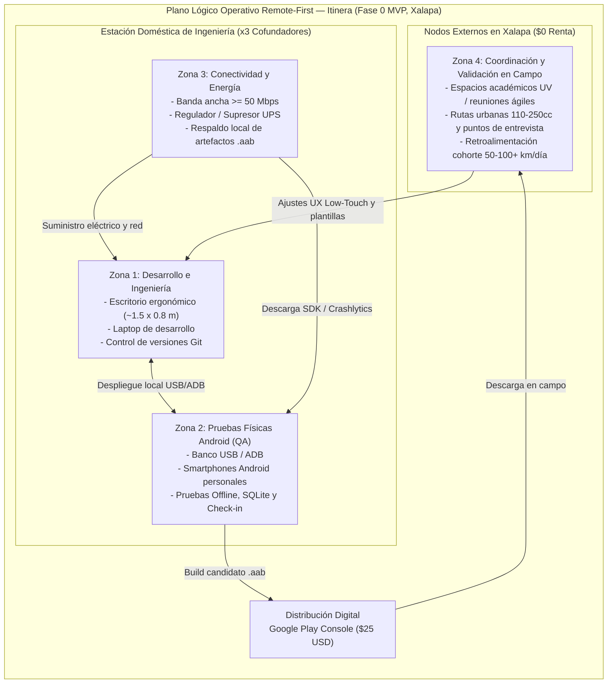
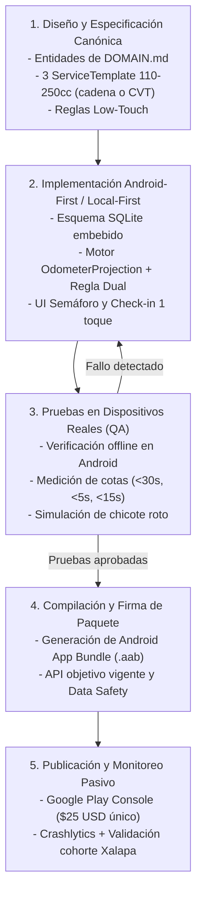
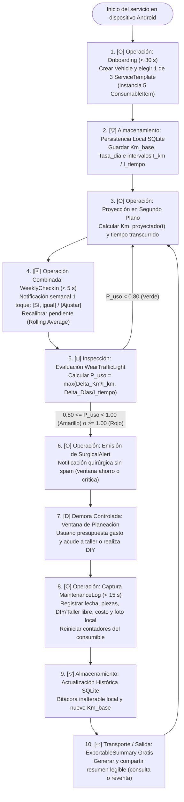
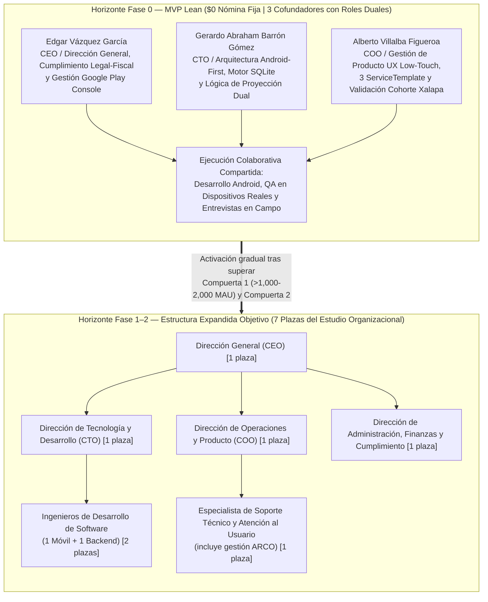

# Estudio Técnico — Proyecto Itinera

> **Documento Técnico-Académico Reconciliado**  
> **Estado:** `[ALINEADO A LÍNEA BASE MVP — SPECIFICATION.md, DOMAIN.md Y ESTUDIO ORGANIZACIONAL RECONCILIADO]`  
> **Asignatura:** Economía para Toma de Decisiones — Licenciatura en Ingeniería de Software (Universidad Veracruzana)  
> **Proyecto:** Itinera (*"Donde cada kilómetro cuenta"*)  
> **Ubicación y fecha:** Xalapa, Veracruz — Noviembre 2026  
> **Equipo de trabajo:**
> - Gerardo Abraham Barrón Gómez
> - Edgar Vázquez García
> - Alberto Villalba Figueroa

---

## 1. Marco Conceptual y Preguntas Directrices del Estudio Técnico

De acuerdo con la consigna de la asignatura (incorporada en [spec.md](file:///C:/Users/OGSha/OneDrive/Escritorio/Developer/App%20Development/Itinera/.tickets/004-create-itinera-technical-study/spec.md)) y los materiales de referencia —particularmente [Estudio-Técnico---Localización_1.pdf](file:///C:/Users/OGSha/OneDrive/Escritorio/Developer/App%20Development/Itinera/Estudio-T%C3%A9cnico---Localizaci%C3%B3n_1.pdf), [EstudioTecnico_Proceso-Organizacion_2.pdf](file:///C:/Users/OGSha/OneDrive/Escritorio/Developer/App%20Development/Itinera/EstudioTecnico_Proceso-Organizacion_2.pdf) y [Estudio-Técnico-y-organizacional_Ejemplo.pdf](file:///C:/Users/OGSha/OneDrive/Escritorio/Developer/App%20Development/Itinera/Estudio-T%C3%A9cnico-y-organizacional_Ejemplo.pdf)—, el **Estudio Técnico** tiene como finalidad **determinar si es física y tecnológicamente posible ejecutar el proyecto**, definiendo la composición óptima de recursos, procesos, tecnología, espacios y estructura operativa para producir un bien o prestar un servicio de manera eficaz y eficiente.

Como advierte el marco teórico de la asignatura, las decisiones tomadas en este estudio inciden directamente en los montos de inversión inicial, costos fijos y costos variables que alimentan la evaluación económico-financiera; por ello, sobredimensionar la infraestructura técnica antes de validar la demanda comprometería la viabilidad del emprendimiento.

Dado que **Itinera** es una **plataforma de software móvil (*Android-First*, arquitectura *Local-First* en SQLite)** y no una planta manufacturera tradicional, la metodología clásica de ingeniería de proyectos se traduce de forma rigurosa al desarrollo y operación de software sin fabricar requisitos físicos ajenos al producto.

### 1.1 Respuesta a las 5 Preguntas Directrices del Estudio Técnico

Siguiendo el esquema metodológico de Dorantes Hernández (`Estudio-Técnico---Localización_1.pdf`, lámina 3), el presente estudio resuelve las cinco preguntas fundamentales aplicadas al proyecto Itinera:

| Pregunta Directriz | Respuesta Estratégica y Técnica en Itinera |
| :--- | :--- |
| **¿Dónde producir y operar?** | En **Xalapa, Veracruz**, bajo un esquema operativo **remoto (*remote-first*)** apoyado en estaciones de trabajo de ingeniería de los cofundadores y puntos de validación en campo en la ciudad, sin arrendamiento de local comercial ni planta física en Fase 0 (`$0 MXN` en renta). |
| **¿Cuándo ejecutar?** | En un despliegue gradual protegido por compuertas: **Fase 0 (MVP)** durante un semestre académico (Meses 1–6); **Fase 1** al superar `>1,000–2,000` usuarios activos mensuales (MAU) en Xalapa; y **Fase 2** al superar `>10,000+` MAU multi-ciudad. |
| **¿Cuánto producir / atender?** | En Fase 0, la arquitectura *Local-First* en SQLite otorga capacidad de procesamiento virtualmente ilimitada por dispositivo (`$0` cuello de botella en servidor). La capacidad de desarrollo y validación se acota a la velocidad de ingeniería de 3 cofundadores y al seguimiento de la cohorte piloto intensiva (`50–100+ km/día`) en motocicletas `110–250cc`. |
| **¿Cómo producir y entregar el servicio?** | Mediante desarrollo ágil nativo/móvil **Android-First** empaquetado como `.aab` en Google Play Store, entregando un flujo *Low-Touch* de baja fricción: configuración en `< 30 s` con 3 `ServiceTemplate`, proyección automática de odómetro, `WeeklyCheckIn` en `< 5 s`, semáforo `WearTrafficLight` y `MaintenanceLog` en `< 15 s`. |
| **¿Con qué recursos?** | En Fase 0: 3 laptops existentes del equipo, smartphones Android personales para pruebas físicas, conectividad de banda ancha $\ge 50\text{ Mbps}$, licencia única de **Google Play Console (`$25 USD`)**, motor embebido SQLite y telemetría pasiva gratuita (Crashlytics), manteniendo en `$0 MXN` servidores cloud, SMS y licencias iOS. |

### 1.2 Mapeo de los 5 Componentes del Estudio Técnico y Puntos de la Consigna

Las láminas de cátedra (`Estudio-Técnico---Localización_1.pdf`, lámina 5; `EstudioTecnico_Proceso-Organizacion_2.pdf`, lámina 4) y el ejemplo estructural del Capítulo 5 (`Estudio-Técnico-y-organizacional_Ejemplo.pdf`, pp. 44–57) integran cinco componentes esenciales que este documento desarrolla en correspondencia directa con los 6 requisitos de la consigna ([spec.md](file:///C:/Users/OGSha/OneDrive/Escritorio/Developer/App%20Development/Itinera/.tickets/004-create-itinera-technical-study/spec.md)):

1. **Localización óptima (Macro y Microlocalización)** $\to$ Sección 2 (`STUDY.md` Punto 1).
2. **Tamaño óptimo, capacidad y distribución de espacios** $\to$ Sección 3 (`STUDY.md` Punto 2).
3. **Proceso de producción/servicio, tecnología y disponibilidad de insumos/recursos** $\to$ Sección 4 (`STUDY.md` Punto 3).
4. **Organización jurídica, fiscal y regulatoria** $\to$ Sección 5 (`STUDY.md` Punto 4).
5. **Organización humana, alineación organizacional y requisitos operativos/financieros** $\to$ Secciones 6 y 7 (`STUDY.md` Puntos 5 y 6 + regla de alineación).

---

## 2. Descripción y Justificación Geográfica: Macro y Microlocalización (`STUDY.md` Punto 1)

### 2.1 Macrolocalización: Selección de Ciudad mediante el Método Cualitativo por Puntos

La literatura de cátedra (`Estudio-Técnico---Localización_1.pdf`, lámina 9) presenta tres métodos para determinar la localización óptima de un proyecto:
1. **Método cualitativo por puntos:** Asigna pesos ponderados a criterios relevantes de localización y califica cuantitativamente a cada sitio candidato para elegir el de mayor puntuación total.
2. **Método cuantitativo de Vogel:** Optimiza costos de transporte físico de materias primas y productos terminados entre plantas y centros de consumo.
3. **Método de Brown y Gibson:** Combina factores objetivos cuantificables (como fletes y costos de terreno) con factores subjetivos ponderados.

Para **Itinera**, el **Método cuantitativo de Vogel resulta inaplicable** porque el producto final es software digital distribuido electrónicamente a través de Google Play Store con costo marginal de transporte físico igual a cero. En consecuencia, se aplica el **Método Cualitativo por Puntos**, evaluando tres ciudades mexicanas candidatas: **Xalapa, Veracruz**, **Puerto de Veracruz** y **Ciudad de México (CDMX)**.

#### Criterios de Evaluación y Ponderación (Escala de 1 a 10)
- **C1. Proximidad a la cohorte piloto (`110–250cc`, `50–100+ km/día`) y equipo de ingeniería UV (`30%`):** Facilidad de acceso presencial del equipo desarrollador (Facultad de Estadística e Informática, Universidad Veracruzana) a motociclistas urbanos y repartidores independientes para pruebas de campo y calibración en un semestre académico.
- **C2. Costo operativo de vida y operación para un equipo *bootstrapped* (`25%`):** Costo de manutención, servicios y logística local mientras el proyecto opera con ingresos directos de `$0 MXN` en Fase 0.
- **C3. Acceso a ecosistema de refaccionarias y talleres locales (`20%`):** Densidad y accesibilidad de comercios independientes de repuestos y mantenimiento ligero para validar futuras alianzas B2B en Fase 1 (`ContextualPromotion`).
- **C4. Conectividad de banda ancha y cobertura móvil 4G/5G (`15%`):** Estabilidad para desarrollo, descarga de paquetes, pruebas de Crashlytics y uso cotidiano por conductores.
- **C5. Eficiencia de traslados y seguridad logística en pruebas de campo (`10%`):** Facilidad de desplazamiento del equipo dentro de la mancha urbana para levantar retroalimentación directa.

| Factor / Criterio de Macrolocalización | Peso ($w_i$) | Xalapa, Ver. *(Calif.)* | Xalapa, Ver. *(Ponderado)* | Puerto de Veracruz *(Calif.)* | Puerto de Veracruz *(Ponderado)* | Ciudad de México *(Calif.)* | Ciudad de México *(Ponderado)* |
| :--- | :---: | :---: | :---: | :---: | :---: | :---: | :---: |
| **C1. Proximidad a cohorte piloto y equipo UV** | `0.30` | `10` | `3.00` | `6` | `1.80` | `4` | `1.20` |
| **C2. Costo operativo de vida y arranque lean** | `0.25` | `9` | `2.25` | `8` | `2.00` | `4` | `1.00` |
| **C3. Acceso a refaccionarias y talleres locales** | `0.20` | `9` | `1.80` | `8` | `1.60` | `9` | `1.80` |
| **C4. Conectividad banda ancha y cobertura móvil** | `0.15` | `8` | `1.20` | `8` | `1.20` | `10` | `1.50` |
| **C5. Eficiencia de traslados en pruebas de campo** | `0.10` | `8` | `0.80` | `7` | `0.70` | `5` | `0.50` |
| **TOTAL PONDERADO** | **`1.00`** | — | **`9.05`** | — | **`7.30`** | — | **`6.00`** |

#### Conclusión de Macrolocalización
Se selecciona objetivamente a **Xalapa, Veracruz (`9.05 / 10.00`)** como sede operativa y ciudad piloto de lanzamiento de Itinera. Además de concentrar al equipo de ingeniería en la Universidad Veracruzana y ofrecer costos operativos significativamente inferiores a la Ciudad de México, Xalapa presenta una combinación ideal para validar el producto en condiciones exigentes: topografía accidentada con pendientes pronunciadas, tráfico urbano denso y alta circulación de motocicletas `110–250cc` de uso laboral y estudiantil, factores que aceleran el desgaste real de aceite, cadena/kit de arrastre y frenos.

### 2.2 Microlocalización: Modelo Operativo *Remote-First* en Xalapa

En alineación con la sección *Ubicación y Esquema Operativo* de [Emprendimiento Tecnologico - Estudio Organizacional - ITINERA.pdf](file:///C:/Users/OGSha/OneDrive/Escritorio/Developer/App%20Development/Itinera/Emprendimiento%20Tecnologico%20-%20Estudio%20Organizacional%20-%20ITINERA.pdf) (p. 5), Itinera fija su domicilio administrativo en la República Mexicana (Xalapa, Veracruz) y adopta un **esquema de trabajo remoto (*remote-first*)**.

- **Cero arrendamiento físico en Fase 0 (`$0 MXN` en renta):** Al tratarse de un producto digital distribuido en Google Play Store y ejecutado localmente en el teléfono del usuario (*Local-First* en SQLite), arrendar una oficina comercial o local abierto al público generaría costos fijos innecesarios que asfixiarían la etapa de validación.
- **Adaptación de criterios de microlocalización:** Mientras que una planta industrial evalúa tipo de suelo, drenaje pesado, andenes o eliminación de residuos (`Estudio-Técnico---Localización_1.pdf`, lámina 8), la microlocalización de Itinera se apoya en:
  1. **Tres estaciones de trabajo domésticas (*home-office*)** ubicadas en Xalapa con conectividad residencial estable ($\ge 50\text{ Mbps}$) y energía eléctrica regulada.
  2. **Puntos de coordinación académica/coworking** en instalaciones de la Universidad Veracruzana para revisiones técnicas de sprint y pruebas de usabilidad.
  3. **Corredores urbanos de validación en campo** (zonas de alta afluencia motociclista y refaccionarias locales en Xalapa) para entrevistas de cohorte en Fase 0 y futura prospección de `ContextualPromotion` en Fase 1.

> [!NOTE]
> **Reconciliación explícita con el Estudio Organizacional:** El documento organizacional preliminar asumía que el esquema *remote-first* operaría desde el Día 1 con *"infraestructura alojada íntegramente en la nube"*. Conforme a [SPECIFICATION.md](file:///C:/Users/OGSha/OneDrive/Escritorio/Developer/App%20Development/Itinera/.routing/academic/SPECIFICATION.md#L61), en **Fase 0** se conserva el modelo *remote-first* sin oficina física, pero la persistencia de la aplicación se ejecuta **Local-First (SQLite en dispositivo)**, posponiendo los servidores cloud hasta Fase 1–2.

---

## 3. Especificaciones del Establecimiento, Capacidad Operativa y Distribución de Espacios (`STUDY.md` Punto 2)

### 3.1 Capacidad Operativa y de Sistema (Equivalente a Capacidad de Planta)

En el modelo de referencia (`Estudio-Técnico-y-organizacional_Ejemplo.pdf`, sección 5.2), la *capacidad de planta* mide el volumen máximo de atención soportado por la infraestructura para responder a la demanda sin crear estructuras ociosas. En Itinera, la capacidad técnica se analiza en dos dimensiones según la etapa evolutiva:

| Dimensión de Capacidad | Fase 0 — MVP (*Local-First*) | Fase 1 — Monetización Local *(`>1,000–2,000` MAU en Xalapa)* | Fase 2 — Escala Regional / B2B *(`>10,000+` MAU multi-ciudad)* |
| :--- | :--- | :--- | :--- |
| **Capacidad de cómputo y almacenamiento por usuario** | **Virtualmente ilimitada en cliente:** cada dispositivo Android procesa su propia base SQLite, cálculo de `OdometerProjection` y alertas locales (`$0` cuello de botella de servidor). | **Híbrida:** el núcleo gratuito sigue *Local-First*; al cruzar `>1,000–2,000` MAU se habilita backend ligero para `ContextualPromotion`, validación de canjes (`CouponRedemption`, desde el celular del encargado o por WhatsApp) y respaldo en nube opcional (`PlusSubscription` `2+` motos, `<2%–5%` conversión). | **Escalable en la nube:** instancia relacional (PostgreSQL) + Object Storage para sincronización multi-dispositivo, panel web `MicroFleetAccount` (`2–15` uds. comerciales) y expansión a automóviles. |
| **Capacidad de ingeniería y soporte operativo** | **3 cofundadores (roles duales):** ~30–45 horas/semana combinadas de desarrollo, QA en dispositivos y seguimiento a la cohorte piloto (`30–100` motos `50–100+ km/día` para cerrar ciclo en `3–6` semanas). Autoservicio estricto *in-app*. | **Transición modular:** mantenimiento Android + gestión comercial local de refaccionarias/talleres (códigos QR y cupones en mostrador). | **Estructura expandida (hasta 7 plazas):** incorporación gradual de desarrolladores móvil/backend y soporte técnico especializado financiado por ingresos recurrentes. |

### 3.2 Especificaciones de Espacio Físico y Plano Lógico de Distribución

Siguiendo las directrices de distribución en planta de la Universidad de Castilla-La Mancha citadas en `Estudio-Técnico-y-organizacional_Ejemplo.pdf` (sección 5.4: integración de factores, distancias mínimas, flujo efectivo, seguridad del trabajador y flexibilidad de reajuste), el entorno operativo *remote-first* de Itinera se organiza en **cuatro zonas lógicas** integradas en las estaciones de trabajo de los cofundadores y nodos de validación en Xalapa:

#### Tabla de Especificaciones Técnicas de Espacios e Infraestructura Mínima

| Zona / Espacio | Superficie / Formato | Requerimientos Técnicos y Ergonómicos | Propósito Operativo |
| :--- | :--- | :--- | :--- |
| **1. Estación de Desarrollo e Ingeniería** *(3 nodos domésticos)* | ~`4–6 m²` por nodo *(home-office existente)* | Mesa de trabajo ergonómica, silla con soporte lumbar, iluminación neutra, laptop con entorno Android SDK/compilación. | Programación del núcleo Android, modelado SQLite, mantenimiento de invariantes de `DOMAIN.md` y documentación. |
| **2. Zona de Pruebas en Dispositivos Android (QA)** | Integrada en escritorio *(~`0.5 m²`)* | Cableado USB de datos, teléfonos Android reales (gama de entrada y media), simulación de modo avión (*offline*) y notificaciones en pantalla de bloqueo. | Verificar tiempos `< 30 s` en onboarding, `< 5 s` en `WeeklyCheckIn`, `< 15 s` en `MaintenanceLog` y estabilidad de `WearTrafficLight`. |
| **3. Infraestructura de Conectividad y Energía** | Servicio residencial existente | Conexión de internet fija $\ge 50\text{ Mbps}$, supresor de picos o UPS básico para protección contra variaciones de voltaje en Xalapa. | Sincronización de repositorios Git, compilación de paquetes `.aab`, carga a Play Console y consulta pasiva de Crashlytics. |
| **4. Zona de Coordinación y Validación en Campo** | Espacios UV / vía pública en Xalapa | Acceso sin costo a aulas/bibliotecas universitarias para sesiones de equipo y contacto directo con cohorte motociclista `110–250cc`. | Entrevistas de validación, pruebas de usabilidad con guantes/luz de día y calibración de las 3 `ServiceTemplate`. |

> [!IMPORTANT]
> **Clarificación metodológica sobre infraestructura física:** A diferencia de proyectos industriales o turísticos (`Estudio-Técnico-y-organizacional_Ejemplo.pdf`, secciones 5.5 y 5.6), Itinera **no requiere adecuaciones de obra civil, drenaje industrial, plantas de emergencia de alta capacidad, bodegas de almacenamiento ni andenes de carga**, dado que el producto es software móvil sin inventario físico ni atención presencial en establecimiento.

---

## 4. Proceso de Producción/Servicio, Tecnología y Listado de Recursos (`STUDY.md` Punto 3)

### 4.1 Tecnología y Arquitectura Técnica

En coherencia con [SPECIFICATION.md](file:///C:/Users/OGSha/OneDrive/Escritorio/Developer/App%20Development/Itinera/.routing/academic/SPECIFICATION.md#L57-L68) y [DOMAIN.md](file:///C:/Users/OGSha/OneDrive/Escritorio/Developer/App%20Development/Itinera/.routing/DOMAIN.md#L10-L16), la tecnología seleccionada para el arranque (Fase 0) responde a criterios de **bajo costo, alta cobertura de mercado y cero dependencia de conectividad continua**:

1. **Plataforma objetivo — Android-First:** En México, Android concentra entre `74.11%` y `89.13%` del mercado móvil según StatCounter (la proporción en el segmento utilitario de motocicletas `110–250cc`, estimada en `>85%`, es un supuesto sujeto a medición con los reactivos `A35`–`A36` del Instrumento A, que también detectan teléfonos Android sin Google Play). Concentrar el MVP en Android evita duplicar esfuerzo de desarrollo y QA, y elimina la barrera inicial de hardware Apple y suscripción anual (`$99 USD/año`). La elección específica del framework de interfaz y código Android se mantiene como decisión estratégica *Android-First* a formalizar en `INFRASTRUCTURE.md`, sin introducir complejidad multiplataforma innecesaria en Fase 0.
2. **Motor de persistencia — Local-First en SQLite:** Toda la lógica del dominio (`Vehicle`, las 3 `ServiceTemplate`, los 5 `ConsumableItem`, `OdometerProjection`, `WeeklyCheckIn`, `MaintenanceLog` con foto local opcional y `ExportableSummary`) reside localmente en **SQLite** dentro del teléfono del usuario. Esto garantiza operación 100% *offline* y costo variable de servidores igual a `$0 MXN`.
3. **Motor matemático de desgaste dual:** Implementa localmente las dos invariantes centrales de `DOMAIN.md`:
   - Proyección adaptativa de odómetro: $Km_{\text{proyectado}}(t) = Km_{\text{base}} + (Tasa_{\text{día}} \times \Delta t)$, recalibrada por media móvil (*Rolling Average*) desde el `WeeklyCheckIn`.
   - Regla dual por lo que ocurra primero: $\text{Fecha de Alerta} = \min(t_{\text{alcanza\_km}},\; t_{\text{alcanza\_meses}})$, clasificada en el semáforo `WearTrafficLight` ($P_{\text{uso}} < 0.80$ Verde, $0.80 \le P_{\text{uso}} < 1.00$ Amarillo, $P_{\text{uso}} \ge 1.00$ Rojo).
4. **Telemetría pasiva y cero deuda de comunicaciones:** Se integra reporte automatizado de fallos (*Crashlytics*) sin captura intrusiva de datos personales. En Fase 0 quedan estrictamente excluidos servidores cloud propios, pasarelas SMS/WhatsApp y soporte humano en tiempo real.

### 4.2 Diagramas de Bloques y de Flujo de Proceso (ASME Adaptado)

Siguiendo las técnicas de análisis de `EstudioTecnico_Proceso-Organizacion_2.pdf` (láminas 9–11), se presentan dos diagramas complementarios: el **Diagrama de Bloques del Proceso de Producción de Software (SDLC)** y el **Diagrama de Flujo Operativo del Servicio en la App** utilizando simbología estándar **ASME/ANSI** (`Operación`, `Inspección`, `Transporte`, `Demora`, `Almacenamiento` y `Operación combinada`).

#### A. Diagrama de Bloques — Proceso de Producción y Despliegue de Software (SDLC Fase 0)

#### B. Diagrama de Flujo de Proceso del Servicio en App (Simbología ASME Adaptada)

En `EstudioTecnico_Proceso-Organizacion_2.pdf` (lámina 10), cada símbolo ASME representa una naturaleza de actividad: **Operación (`O`)** transforma o crea un registro/valor; **Inspección (`□`)** verifica condición o calidad; **Transporte (`⇨`)** transfiere o entrega un artefacto; **Demora (`D`)** indica espera; **Almacenamiento (`▽`)** resguarda información; y **Operación combinada (`回`)** ejecuta transformación y verificación simultánea.

### 4.3 Cursograma Analítico Comparativo (*Método Actual* vs. *Método Propuesto Itinera*)

Con base en el formato de **Cursograma Analítico** (`EstudioTecnico_Proceso-Organizacion_2.pdf`, lámina 12), la siguiente tabla compara el método tradicional (*"Síndrome de la Guantera"* con libretas, notas o memoria) frente al método automatizado de **Itinera**, cuantificando la reducción de pasos manuales, fricción cognitiva y tiempo operativo por ciclo de mantenimiento:

| Paso | Descripción del Proceso | Método Actual *(Manual / Guantera)* Actividad y Tiempo | Método Propuesto *(Itinera Local-First)* Actividad y Tiempo | Reducción / Mejora Técnica |
| :---: | :--- | :--- | :--- | :--- |
| **1** | **Configuración inicial de intervalos de la moto `110–250cc`** | `[O] + [D]` Buscar manual físico o preguntar en taller qué piezas revisar y cada cuántos km. *Tiempo:* **~20–40 min** *(frecuentemente omitido)*. | `[O]` Elegir 1 de 3 `ServiceTemplate` editables en onboarding. *Tiempo:* **`< 30 s`** *(una sola vez)*. | Reducción de **>97% en tiempo** y eliminación de barrera técnica inicial. |
| **2** | **Seguimiento semanal de kilometraje recorrido** | `[□]` Revisar tablero manualmente cada semana o estimar de memoria; si el chicote está roto, no hay control. *Tiempo:* **~5–10 min/sem** *(abandono habitual)*. | `[回]` Proyección automática `OdometerProjection` + confirmación 1 toque (`WeeklyCheckIn`) en pantalla de bloqueo. *Tiempo:* **`< 5 s/sem`**. | Reducción de **>98% en tiempo**; opera incluso con odómetro físico averiado. |
| **3** | **Evaluación de desgaste y detección de servicio próximo** | `[D]` Sesgo de falsa seguridad hasta escuchar ruido mecánico o falla en ruta (*correctivo*). *Tiempo de diagnóstico reactivo:* **Horas / paro de unidad**. | `[□] + [O]` Cálculo continuo `WearTrafficLight` y `SurgicalAlert` dual ($\min(t_{km}, t_{meses})$) en umbral Amarillo/Rojo. *Tiempo:* **`0 s` de cálculo manual** *(automático)*. | Sustituye falla correctiva imprevista por ventana de previsibilidad económica. |
| **4** | **Registro de cambio de consumible (Taller o *DIY*)** | `[O] + [▽]` Anotar en libreta o guardar ticket térmico en guantera/cartera (ilegible o extraviado). *Tiempo:* **~3–5 min** *(alta pérdida de soporte)*. | `[O] + [▽]` Capturar `MaintenanceLog` (`DIY` o `Taller` libre, costo y foto opcional) en SQLite. *Tiempo:* **`< 15 s`**. | Reducción de **~90% en tiempo**; expediente indexado, legible y permanente. |
| **5** | **Consulta o entrega de historial al cotizar o vender la moto** | `[⇨] + [D]` Buscar recibos arrugados en casa/guantera y reconstruir historial de memoria. *Tiempo:* **~15–30 min** *(historial incompleto)*. | `[⇨]` Exportación instantánea local de `ExportableSummary` gratuito. *Tiempo:* **`< 5 s`**. | Reducción de **>99% en tiempo**; respaldo inmediato sin costo para el usuario. |
| **TOTAL** | **Carga operativa por ciclo completo (`~2,500 km` / ~4–6 semanas)** | **~45–90+ min acumulados** + alto riesgo de abandono y falla correctiva | **< 1.5 min acumulados por ciclo** *(onboarding único `<30 s` + ~20 s de check-ins + `<15 s` de log)* | **Eliminación radical de fricción** y retención sostenible en cohorte intensiva. |

### 4.4 Listado de Recursos, Equipamiento y Presupuesto Técnico por Fase

Para alimentar con rigor al futuro *Estudio Económico-Financiero* sin inflar la inversión de arranque, el listado de recursos y costos técnicos separa tajantemente la **Fase 0 (MVP)** de los elementos condicionales de **Fase 1 y Fase 2**:

| Categoría de Recurso | Recurso / Ítem Técnico | Fase 0 — Arranque MVP (*Local-First*) | Fase 1 y Fase 2 — Escalamiento Condicional | Justificación Técnico-Financiera |
| :--- | :--- | :--- | :--- | :--- |
| **Distribución en Tiendas** | Cuenta Google Play Console | **`$25 USD` (pago único)** *(~$500 MXN ref.)* | Misma cuenta activa | Única inversión de plataforma obligatoria para publicar `.aab` en Android (`74.11%–89.13%` nacional según StatCounter; `>85%` en el segmento utilitario es un supuesto a medir en campo). |
| **Distribución iOS** | Apple Developer Program + `D-U-N-S` | **`$0 MXN`** *(Pospuesto)* | **`$99 USD/año`** *(solo en Fase 2)* | Se difiere hasta validar retención y demanda pagada en Android. |
| **Hardware de Ingeniería y QA** | 3 laptops de desarrollo + teléfonos Android de prueba | **`$0 MXN` CAPEX adicional** *(activos propios del equipo)* | Reposición o ampliación de dispositivos QA según ingresos | El equipo ya cuenta con equipo de cómputo y terminales Android personales para depuración USB/ADB. |
| **Infraestructura y Almacenamiento** | Motor de base de datos, almacenamiento de fotos y notificaciones | **`$0 MXN`** *(SQLite local + almacenamiento interno + push locales)* | **Instancia cloud selectiva** *(PostgreSQL/Supabase + Object Storage)* | En Fase 0 toda la data vive en el teléfono. El backend cloud se enciende solo al cruzar `>1,000–2,000` MAU para `ContextualPromotion`, `PlusSubscription` y `MicroFleetAccount`. |
| **Comunicaciones y Mensajería** | Alertas y confirmaciones semanales | **`$0 MXN`** *(notificaciones locales nativas)* | **`$0 MXN`** *(mantiene push nativas)* | Excluye costos variables por SMS o API de WhatsApp transaccional. |
| **Telemetría y Desarrollo** | Git, IDE Android y Crashlytics | **`$0 MXN`** *(capas gratuitas)* | Planes estándar solo si crece volumen de equipo | Minimiza costos fijos de licenciamiento SaaS en etapa temprana. |
| **Pasarela de Pagos** | Procesamiento de cobros electrónicos | **`$0 MXN`** *(sin cobros in-app en Fase 0)* | **Comisión `~3.5% + $3 MXN`** por transacción | Aplica únicamente sobre suscripciones o cobros B2B a comercios aliados (cuota mensual o pago por venta comprobada) en Fase 1–2. |
| **Protección Legal / PI y Fiscal** | `S.A.S.`, `IMPI` (Clases 9 y 42), `INDAUTOR` y contabilidad | **`$0 MXN` notarial** en `S.A.S.`; tasas `IMPI`/`INDAUTOR` programadas al cierre de validación | Tasas oficiales `IMPI`/`INDAUTOR` + honorarios contables `RESICO-PM` / `CFDI 4.0` | Evita quemar capital en trámites fiscales o asesoría recurrente antes de activar ingresos B2B en Fase 1. |
| **Talento Humano Base** | 3 cofundadores con roles duales (Ingeniería/Producto/Gestión) | **`$0 MXN` nómina fija** *(inversión en horas de ingeniería)* | Nómina progresiva hasta **7 plazas** soportada por flujo B2B | Mantiene el punto de equilibrio operativo mínimo durante la validación semestral. |

---

## 5. Especificaciones Legales, Fiscales y Regulatorias (`STUDY.md` Punto 4)

En concordancia con el análisis jurídico de `EstudioTecnico_Proceso-Organizacion_2.pdf` (láminas 20–26) y las disposiciones mexicanas documentadas en [Emprendimiento Tecnologico - Estudio Organizacional - ITINERA.pdf](file:///C:/Users/OGSha/OneDrive/Escritorio/Developer/App%20Development/Itinera/Emprendimiento%20Tecnologico%20-%20Estudio%20Organizacional%20-%20ITINERA.pdf) (pp. 10–13), Itinera estructura su cumplimiento normativo de manera proporcional a cada fase:

### 5.1 Constitución Mercantil
- **Sociedad por Acciones Simplificada (`S.A.S.`):** Figura mercantil idónea para el arranque formal del proyecto ante la Secretaría de Economía mediante trámite **100% electrónico y `$0 MXN` de costo notarial**. Permite operar con uno o múltiples accionistas personas físicas, otorga personalidad jurídica propia, separa el patrimonio personal de los fundadores y habilita la firma de contratos comerciales en Fase 1.
- **Ruta de escalamiento societario:** En Fase 2 o ante rondas de inversión externa (*Venture Capital* / inversionistas ángeles), la sociedad contempla su transformación a **Sociedad Anónima Promotora de Inversión de Capital Variable (`S.A.P.I. de C.V.`)**.

### 5.2 Marco Fiscal y Tributario (`SAT`)
- **Identidad fiscal:** Tramitación de **RFC corporativo** y **Firma Electrónica Avanzada (`e.firma`)** para operar cuentas bancarias empresariales, contratos y facturación.
- **Régimen tributario preferente:** Inscripción en el **Régimen Simplificado de Confianza para Personas Morales (`RESICO-PM`)**, aplicable a sociedades constituidas exclusivamente por personas físicas con ingresos anuales menores a 35 millones de pesos, lo que simplifica la determinación del ISR sobre flujo efectivo.
- **Facturación y obligaciones periódicas:** Emisión de **Comprobantes Fiscales Digitales por Internet (`CFDI 4.0`)**, declaraciones provisionales mensuales de ISR e IVA, declaración anual y contabilidad electrónica conforme al Código Fiscal de la Federación. Su activación operativa plena coincide con el inicio de facturación a refaccionarias/talleres (`ContextualPromotion` en Fase 1) y flotillas (`MicroFleetAccount` en Fase 2).

### 5.3 Propiedad Intelectual y Activos Intangibles
1. **IMPI (Signos Distintivos):** Solicitud de registro de marca mixta (`"ITINERA"` y logotipo distintivo) ante el Instituto Mexicano de la Propiedad Industrial dentro de la Clasificación de Niza en la **Clase 9** (aplicaciones de software descargables) y **Clase 42** (servicios de diseño, desarrollo y tecnología de software), previa búsqueda fonética y gráfica de anterioridades.
2. **INDAUTOR (Derechos de Autor):** Depósito y registro del código fuente de la aplicación móvil, lógica de cálculo de desgaste y manuales técnicos ante el Instituto Nacional del Derecho de Autor bajo la figura de **obra de programa de computación**.
3. **Resguardo interno y código abierto:** Suscripción de convenios de confidencialidad (**NDA**) y cesión de derechos patrimoniales entre los cofundadores/futuros colaboradores a favor de la sociedad, además de auditoría de cumplimiento de licencias *open-source* de las librerías empleadas.

### 5.4 Protección de Datos Personales (`LFPDPPP`) y Privacidad por Diseño
En estricto apego a la **Ley Federal de Protección de Datos Personales en Posesión de los Particulares (`LFPDPPP`)**:
- **Aviso de Privacidad Integral y Simplificado:** Disponible dentro de la aplicación y en enlace web accesible, detallando identidad del responsable, finalidades estrictamente operativas (bitácora vehicular y alertas), prohibición de comercialización de datos personales y medios para ejercer derechos **ARCO** (*Acceso, Rectificación, Cancelación y Oposición*).
- **Ventaja jurídica del diseño *Local-First* en Fase 0:** Al almacenar `Vehicle`, `MaintenanceLog` y fotografías únicamente en la base **SQLite local del teléfono** (sin registro obligatorio de cuentas en la nube ni transmisión de PII a servidores propios), Itinera minimiza el riesgo de brechas de seguridad, simplifica el cumplimiento de la `LFPDPPP` y reduce la superficie de declaración en la sección *Data Safety* de Google Play.
- **Escalamiento de seguridad en Fase 1–2:** Cuando el usuario opte voluntariamente por `PlusSubscription` (sincronización cloud) o cuentas B2B (`MicroFleetAccount`), se exigirá consentimiento digital expreso (casilla no premarcada), cifrado en tránsito (**TLS/HTTPS**), cifrado en reposo (**AES-256**) y mecanismo directo de cancelación y borrado irreversible de cuenta.

### 5.5 Requisitos Normativos de Tiendas de Distribución Digital

| Tienda / Canal | Estado en Hoja de Ruta | Requisitos Técnicos y Regulatorios Aplicables |
| :--- | :--- | :--- |
| **Google Play Store (Android)** | **Activo en Fase 0 (MVP)** | • Cuenta de desarrollador en Google Play Console (**`$25 USD` pago único**). • Paquete firmado en formato **Android App Bundle (`.aab`)**. • Cumplimiento del nivel de **API objetivo vigente** exigido por Google (p. ej. Android 16 / API 36 según calendario oficial). • Diligenciamiento veraz del formulario **Seguridad de Datos (*Data Safety*)** y enlace funcional de política de privacidad / supresión de datos cuando corresponda. |
| **Apple App Store (iOS)** | **Pospuesto a Fase 2** | • Suscripción anual al *Apple Developer Program* (**`$99 USD/año`**) + obtención del número internacional **`D-U-N-S`** (*Dun & Bradstreet*). • Compilación en Xcode bajo *Human Interface Guidelines*, entorno de prueba para *App Review*, cumplimiento de *App Tracking Transparency (ATT)* y borrado de cuenta in-app. • Se difiere explícitamente hasta que la retención en Android y los ingresos validados justifiquen el gasto y el mantenimiento multiplataforma. |

---

## 6. Alineación Organizacional y Otros Requisitos Administrativos y Financieros (`STUDY.md` Punto 5 y Regla de Alineación)

En cumplimiento de la consigna académica incorporada en [spec.md](file:///C:/Users/OGSha/OneDrive/Escritorio/Developer/App%20Development/Itinera/.tickets/004-create-itinera-technical-study/spec.md) (*"Todo esto deberá estar alineado a tu estudio organizacional y a datos obtenidos del estudio técnico"*), esta sección articula el organigrama operativo de Itinera en dos horizontes y resuelve explícitamente las diferencias entre la versión pre-auditoría de `Emprendimiento Tecnologico - Estudio Organizacional - ITINERA.pdf` y la línea base reconciliada en `SPECIFICATION.md` y `DOMAIN.md`.

### 6.1 Organigramas Reconciliados por Fase

#### Tabla Comparativa de Roles: Fase 0 Lean vs. Fase 1–2 Expandida

| Área Funcional | Fase 0 — MVP Lean *(3 Cofundadores, `$0` Nómina)* | Fase 1–2 — Estructura Expandida *(7 Plazas Remotas)* | Responsabilidades Técnicas Clave |
| :--- | :--- | :--- | :--- |
| **Dirección General y Cumplimiento** | **Edgar Vázquez García** *(rol dual)* | **CEO** (1 plaza) + **Dir. Administración, Finanzas y Cumplimiento** (1 plaza) | Constitución `S.A.S.`, gestión ante SAT (`RESICO-PM` / `CFDI 4.0`), registros `IMPI`/`INDAUTOR`, cuenta Google Play Console y cierre de alianzas B2B en Fase 1. |
| **Tecnología e Ingeniería** | **Gerardo Abraham Barrón Gómez** *(rol dual)* | **CTO** (1 plaza) + **2 Ingenieros de Software** (1 Móvil + 1 Backend) | Arquitectura Android-First, persistencia SQLite *Local-First*, invariantes de `OdometerProjection` y `WearTrafficLight`, paquete `.aab`, Crashlytics y backend selectivo en Fase 1–2. |
| **Operaciones, Producto y Usuario** | **Alberto Villalba Figueroa** *(rol dual)* | **COO** (1 plaza) + **Especialista de Soporte Técnico y ARCO** (1 plaza) | Diseño UX *Low-Touch* (`< 30 s`, `< 5 s`, `< 15 s`), curación de las 3 `ServiceTemplate`, validación con cohorte `50–100+ km/día` en Xalapa y atención a derechos ARCO en Fase 1–2. |

### 6.2 Tabla de Reconciliación Técnico–Organizacional

Para garantizar coherencia absoluta entre los documentos entregables del curso, la siguiente matriz documenta cómo cada supuesto preliminar de `Emprendimiento Tecnologico - Estudio Organizacional - ITINERA.pdf` se ajusta a la línea base auditada de [SPECIFICATION.md](file:///C:/Users/OGSha/OneDrive/Escritorio/Developer/App%20Development/Itinera/.routing/academic/SPECIFICATION.md#L219-L234) y [DOMAIN.md](file:///C:/Users/OGSha/OneDrive/Escritorio/Developer/App%20Development/Itinera/.routing/DOMAIN.md#L47-L55):

| Elemento en `Estudio Organizacional` (Pre-Auditoría) | Decisión Reconciliada (`SPECIFICATION.md` / `DOMAIN.md`) | Justificación Técnica y Económica |
| :--- | :--- | :--- |
| **Infraestructura alojada íntegramente en la nube (AWS/GCP, PostgreSQL, uptime 99.9%) desde el inicio** | **Fase 0 = Local-First SQLite (`$0 MXN`); Cloud Sync pospuesto a Fase 1–2** | Evita costos fijos de servidores, buckets S3 y complejidad de sincronización mientras se valida la retención semanal en el MVP. |
| **Lanzamiento simultáneo Android + iOS (`$99 USD/año` + `D-U-N-S`) con framework multiplataforma (Flutter/RN)** | **Fase 0 = Android-First (`$25 USD` único); iOS pospuesto a Fase 2** | Android concentra `74.11%–89.13%` del mercado móvil nacional según StatCounter (superando el `85%` estimado en motos `110–250cc`); duplicar QA y pagar Apple desde el Día 1 destruye la eficiencia del MVP. |
| **Organigrama de 7 vacantes con nómina fija y despacho contable mensual desde el arranque** | **Fase 0 = 3 cofundadores con roles duales (`$0` nómina fija); 7 plazas solo en Fase 1–2** | Mantiene viabilidad financiera mientras los ingresos directos de Fase 0 son `$0 MXN`; la estructura crece conforme el flujo B2B la financie. |
| **Módulos B2B para talleres "certificados" y piloto de 15 talleres que avalan la bitácora** | **Eliminado (`CertifiedWorkshopDirectory`); sustituido en Fase 1 por `ContextualPromotion`** | Auditar calidad mecánica presencialmente genera deuda operativa inviable y riesgo reputacional; los cupones trazables en mostrador prueban retorno sin certificar talleres. |
| **Venta de reportes periciales/certificados PDF (`ITINERA Pro` / `$49 MXN`) en monetización** | **Reubicado a `ExportableSummary` 100% gratuito en Fase 0** | Datos autodeclarados (especialmente *DIY*) no prueban veracidad mecánica ante terceros y la reventa ocurre cada 2–4 años; gratis maximiza retención y boca a boca. |
| **Campañas en TikTok/Instagram/YouTube, portal web, mesa de ayuda SLA y publicidad pagada** | **Fase 0 = ASO orgánico en Google Play + boca a boca + autoservicio estricto *in-app*** | Evita deuda operativa de *community management* y soporte humano en tiempo real para un equipo de 3 ingenieros. |
| **Cobertura inicial de automóviles, Uber/DiDi y flotillas hasta 10 uds. desde versión 1.0** | **MVP = 1 moto principal `110–250cc` (cadena o CVT), personal o de trabajo, con cohorte piloto de rutina intensiva; `PlusSubscription` `2+` motos personales en Fase 1; Autos y `MicroFleetAccount` (`2–15` uds. comerciales) en Fase 2; `HeavyDutyFleet` excluido** | Los intervalos cortos de moto (`2,500 km`) permiten validar el bucle completo en `3–6` semanas dentro de un semestre; no se promete auditoría de choferes sin hardware. |
| **Metas lineales por año (`5,000` usuarios Año 1 $\to$ `20,000` Año 2 $\to$ `50,000` Año 3)** | **Crecimiento gobernado por compuertas de densidad y retención** | Fase 1 se activa únicamente al superar `>1,000–2,000` MAU locales en Xalapa; Fase 2 al superar `>10,000+` MAU multi-ciudad. |

### 6.3 Vínculo con el Estudio de Mercado y el Estudio Económico-Financiero

De acuerdo con la regla de integración de los estudios de evaluación (`Estudio-Técnico---Localización_1.pdf`, lámina 10; y la consigna académica):

1. **Calibración desde el Estudio de Mercado ([`reference/MARKET_STUDY.md`](file:///C:/Users/OGSha/OneDrive/Escritorio/Developer/App%20Development/Itinera/.routing/reference/MARKET_STUDY.md) y [`SPECIFICATION.md`](file:///C:/Users/OGSha/OneDrive/Escritorio/Developer/App%20Development/Itinera/.routing/academic/SPECIFICATION.md#L107-L113)):**
   - La segmentación de demanda hacia la **cohorte piloto intensiva de `50–100+ km/día` en Xalapa** (propietarios-operadores de moto `110–250cc`) determina directamente los escenarios de prueba técnica de `OdometerProjection` (ajuste de pendiente *Rolling Average* en intervalos de 3 a 6 semanas) y la verificación de batería/notificaciones en condiciones reales de reparto urbano.
   - Asimismo, la compuerta de densidad urbana establecida en el análisis de mercado (**`>1,000–2,000` MAU activos en Xalapa**) constituye el disparador técnico objetivo para encender la infraestructura backend mínima de `ContextualPromotion` (Fase 1) y evitar capacidad ociosa en la nube.
2. **Insumo directo para el Estudio Económico-Financiero:**
   - Los requerimientos cuantificados en la Sección 4.4 establecen el presupuesto técnico real para la corrida financiera: inversión inicial monetaria mínima acotada en Fase 0 (`$25 USD` de Google Play Console + capital de trabajo operativo absorbido por los socios) y activación escalonada de OPEX/CAPEX en Fase 1–2 (registro `IMPI`/`INDAUTOR`, hosting cloud selectivo, comisiones de pasarela `~3.5% + $3 MXN`, honorarios contables `RESICO-PM` y eventual licencia Apple `$99 USD/año`).

---

## 7. Otros Requisitos Técnicos Operativos (`STUDY.md` Punto 6)

Para garantizar continuidad operativa y confiabilidad en el contexto real del motociclista urbano mexicano, la arquitectura técnica de Itinera incorpora cuatro requisitos operativos obligatorios:

1. **Resiliencia Offline Total (*Local-First* SQLite):**
   - La aplicación debe operar íntegramente sin conexión a internet (zonas sin cobertura, sótanos, talleres mecánicos periféricos o carretera), permitiendo consultar el `WearTrafficLight`, responder al `WeeklyCheckIn`, capturar un `MaintenanceLog` con foto local y emitir un `ExportableSummary` con latencia cero y consumo nulo de datos móviles.
2. **Respaldo Algorítmico Ante Falla de Odómetro Físico (Chicote Roto):**
   - La tasa diaria inicial se asigna con la tabla canónica `rutina cotidiana × días/semana` de `DOMAIN.md §5.1` y se recalibra con el check-in semanal sin kilómetros (*"¿Usaste tu moto como siempre?"*, factores `0.5 / 1 / 1.5`). El consumible de transmisión se instancia como cadena o banda CVT según `Vehicle.transmision`, deducida del tipo de moto en el onboarding.
   - Dado que una proporción de motocicletas económicas `110–250cc` circula con el odómetro físico desconectado o dañado, el sistema opera sin bloqueo en modo de kilometraje relativo (iniciando en `0`) combinado con la regla dual obligatoria:
     $$\text{Fecha de Alerta} = \min\left(t_{\text{alcanza\_km}},\; t_{\text{alcanza\_meses}}\right)$$
     De este modo, la degradación por tiempo calendario garantiza la emisión oportuna de `SurgicalAlert` aun en ausencia de lectura mecánica del tablero.
3. **Soberanía y Portabilidad Local de Datos (`ExportableSummary` gratuito):**
   - Desde Fase 0, el usuario conserva control total sobre su historial mediante la exportación local gratuita de un resumen estructurado (legible para consulta personal, respaldo al cambiar de teléfono o entrega al vender la moto), sin quedar bloqueado por muros de pago ni depender de servidores externos.
4. **Telemetría Técnica Pasiva y Mantenimiento Evolutivo (`Crashlytics`):**
   - Ante la alta heterogeneidad de hardware y versiones de Android en México, se habilita recolección pasiva y anónima de cierres inesperados (*crashes*) mediante Crashlytics para priorizar correcciones de estabilidad sin recabar PII ni requerir mesas de ayuda humanas en Fase 0.

---

## 8. Referencias Bibliográficas y Documentales

### 8.1 Documentación Canónica Interna del Proyecto Itinera
1. Consigna académica de la asignatura *Economía para Toma de Decisiones*, sección *Estudio Técnico* (incorporada en [spec.md](file:///C:/Users/OGSha/OneDrive/Escritorio/Developer/App%20Development/Itinera/.tickets/004-create-itinera-technical-study/spec.md): definición, puntos obligatorios 1–6 y regla de alineación organizacional).
2. [SPECIFICATION.md](file:///C:/Users/OGSha/OneDrive/Escritorio/Developer/App%20Development/Itinera/.routing/academic/SPECIFICATION.md) — *Especificación Académica y de Dominio — Proyecto Itinera* (línea base MVP reconciliada, arquitectura Android-First / Local-First, segmentación CCU, cohorte `50–100+ km/día`, monetización en 3 fases y bitácora de recortes).
3. [DOMAIN.md](file:///C:/Users/OGSha/OneDrive/Escritorio/Developer/App%20Development/Itinera/.routing/DOMAIN.md) — *Modelo Conceptual y Diccionario del Dominio (Itinera)* (entidades MVP, entidades Fase 1–2, exclusiones explícitas e invariantes matemáticas).
4. [BUSINESS_MODEL_CANVAS.md](file:///C:/Users/OGSha/OneDrive/Escritorio/Developer/App%20Development/Itinera/.routing/reference/BUSINESS_MODEL_CANVAS.md) — *Monografía: Business Model Canvas y su Aplicación Reconciliada en el Proyecto Itinera* (estructura de costes, plataforma de dos lados asimétrica y compuertas de ingeniería).
5. [MARKET_STUDY.md](file:///C:/Users/OGSha/OneDrive/Escritorio/Developer/App%20Development/Itinera/.routing/reference/MARKET_STUDY.md) — *Monografía: Estudio de Mercado — Fundamentos Económicos, Muestreo Estadístico y Aplicación Reconciliada en Itinera* (criterios de segmentación B2C/B2B, elasticidad a la fricción y cohortes de validación).
6. [Emprendimiento Tecnologico - Estudio Organizacional - ITINERA.pdf](file:///C:/Users/OGSha/OneDrive/Escritorio/Developer/App%20Development/Itinera/Emprendimiento%20Tecnologico%20-%20Estudio%20Organizacional%20-%20ITINERA.pdf) — *Proyecto: Emprendimiento Tecnológico Empresarial — Itinera* (Universidad Veracruzana, 28 de octubre de 2026: esquema *remote-first*, estructura organizacional de 7 plazas, marco legal `S.A.S.`, `SAT`/`RESICO-PM`, `IMPI`, `INDAUTOR`, `LFPDPPP` y requisitos de tiendas oficiales).

### 8.2 Material de Cátedra y Fuentes Académicas del Estudio Técnico
7. **Dorantes Hernández, M. E.** (s. f.). *Estudio Técnico* [Presentación de diapositivas, 11 láminas]. ([Estudio-Técnico---Localización_1.pdf](file:///C:/Users/OGSha/OneDrive/Escritorio/Developer/App%20Development/Itinera/Estudio-T%C3%A9cnico---Localizaci%C3%B3n_1.pdf)). Fuentes referenciadas en el material:
   - **Colón, L.** (1 de mayo de 2011). *Estudio técnico*. Universidad del Atlántico. Recuperado de SlideShare.
   - **Unidad de Apoyo para el Aprendizaje (UNAM).** (2017). *El estudio técnico en un proyecto de inversión*. Licenciatura en Contaduría, UNAM.
8. **Ruiz Cuervo, V. A.** (2022). *Estudio Técnico y Organizacional — Economía para la Toma de Decisiones* [Presentación de diapositivas, 34 láminas]. Ingeniería de Software, Universidad Veracruzana. ([EstudioTecnico_Proceso-Organizacion_2.pdf](file:///C:/Users/OGSha/OneDrive/Escritorio/Developer/App%20Development/Itinera/EstudioTecnico_Proceso-Organizacion_2.pdf)). Fuentes referenciadas en el material:
   - **Baca Urbina, G.** (2010). *Evaluación de Proyectos* (6.ª ed.). McGraw-Hill Interamericana Editores S.A. de C.V.
   - **Martínez, C., Soto, M., Magaña, J., Licón, L., & Kiessling, C.** (2015). Estudio técnico del proyecto Tomato-Mix. *Revista Mexicana de Agronegocios*, 36. https://www.redalyc.org/pdf/141/14132408013.pdf
9. **Capítulo 5 — Estudio Técnico (Caso ilustrativo Hotel Paradís).** (s. f.). *Estudio Técnico y Organizacional (Ejemplo)*, pp. 44–57. ([Estudio-Técnico-y-organizacional_Ejemplo.pdf](file:///C:/Users/OGSha/OneDrive/Escritorio/Developer/App%20Development/Itinera/Estudio-T%C3%A9cnico-y-organizacional_Ejemplo.pdf)). Fuentes referenciadas en el material:
   - **Universidad de Castilla-La Mancha.** Marco conceptual y objetivos de la distribución en planta.
   - **Instituto Mexicano de Normalización y Certificación (IMNC).** *NMX-TT-006-1996-IMNC: Requisitos mínimos de calidad en el servicio e instalaciones para establecimientos turísticos*.
   - **Altamirano** (2008) y **Google** (2009). Referencias fotográficas y cartográficas del caso ejemplo.

### 8.3 Marco Legal y Regulatorio Aplicable (México)
10. **Congreso de la Unión (México).** *Ley General de Sociedades Mercantiles* (Disposiciones de la Sociedad por Acciones Simplificada, `S.A.S.`).
11. **Congreso de la Unión (México).** *Ley del Impuesto Sobre la Renta* (`RESICO-PM`) y *Código Fiscal de la Federación* (`CFDI 4.0`).
12. **Congreso de la Unión (México).** *Ley Federal de Protección a la Propiedad Industrial* (`IMPI`, Clasificación Internacional de Productos y Servicios de Niza: Clases 9 y 42) y *Ley Federal del Derecho de Autor* (`INDAUTOR`).
13. **Congreso de la Unión (México).** *Ley Federal de Protección de Datos Personales en Posesión de los Particulares (`LFPDPPP`)* (Aviso de Privacidad y derechos ARCO).
