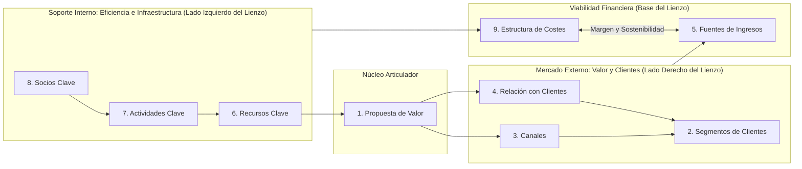
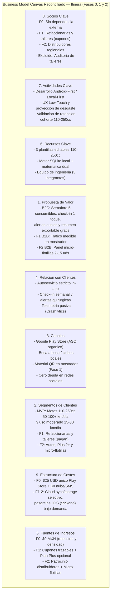
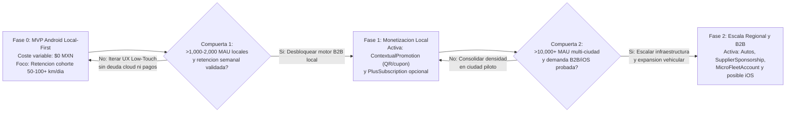

# Monografía: Business Model Canvas y su Aplicación Reconciliada en el Proyecto Itinera

> **Tipo de documento:** Monografía Teórico-Práctica de Modelo de Negocio y Estrategia de Producto  
> **Estado:** `[ALINEADO A LÍNEA BASE MVP — SPECIFICATION.md & DOMAIN.md]`  
> **Asignatura:** Economía para Toma de Decisiones — Licenciatura en Ingeniería de Software  
> **Proyecto Asociado:** [Itinera](file:///C:/Users/OGSha/OneDrive/Escritorio/Developer/App%20Development/Itinera/README.md) (*"Donde cada kilómetro cuenta"*)  
> **Ubicación:** `.routing/reference/BUSINESS_MODEL_CANVAS.md`  
> **Fecha:** Noviembre 2026 — Xalapa, Veracruz  
> **Equipo de trabajo:** Gerardo Abraham Barrón Gómez, Edgar Vázquez García, Alberto Villalba Figueroa  

---

## 1. Fundamentos Teóricos y Epistemológicos del Business Model Canvas

### 1.1 Definición Formal y Origen Histórico

El **Business Model Canvas (BMC)** —o Lienzo de Modelo de Negocio— es un marco estratégico visual desarrollado por **Alexander Osterwalder** e **Yves Pigneur** (en colaboración con 470 practicantes de 45 países) y publicado formalmente en *Business Model Generation* (2010) bajo el ecosistema metodológico de **Strategyzer**. Su raíz académica proviene de la tesis doctoral de Osterwalder en la Universidad de Lausana (*The Business Model Ontology*, 2004), cuyo objetivo fue crear un lenguaje común, riguroso y estandarizado para describir cómo una organización **crea, entrega y captura valor**.

Desde una perspectiva epistemológica, el BMC sustituye los planes de negocio extensos y estáticos (basados en proyecciones lineales difíciles de verificar antes de salir al mercado) por un **sistema de hipótesis interdependientes** representado en un solo plano visual de **9 módulos o bloques constructivos**. Cada módulo responde a una pregunta operativa verificable y mantiene relaciones de causalidad con los demás: modificar un segmento de clientes o una fuente de ingresos exige recalibrar canales, actividades, recursos y estructura de costes.

### 1.2 Anatomía del Lienzo y Balance entre Hemisferios

Osterwalder y Pigneur estructuran el lienzo en torno a cuatro grandes áreas funcionales y proponen una analogía con los **dos hemisferios del cerebro humano** (lógica/eficiencia frente a emoción/valor):

1. **Lado Izquierdo del Lienzo — Eficiencia e Infraestructura (*Qué se necesita para operar*):** Agrupa a los **Socios Clave**, **Actividades Clave** y **Recursos Clave**. Su lógica corresponde al pensamiento analítico de optimización de capacidades, arquitectura técnica y control de complejidad operativa.
2. **Centro — Propuesta de Valor (*Qué problema se resuelve y qué beneficio se entrega*):** Actúa como el puente causal que conecta las capacidades internas de ingeniería con las necesidades reales del mercado.
3. **Lado Derecho del Lienzo — Valor y Clientes (*Para quién se crea y cómo se entrega*):** Agrupa los **Segmentos de Clientes**, los **Canales** y la **Relación con Clientes**. Responde a la empatía conductual, la psicología de adopción, la fricción de uso y el posicionamiento en el ecosistema.
4. **Base del Lienzo — Viabilidad Financiera (*Cuánto cuesta y cómo se captura valor*):** Confronta la **Estructura de Costes** (impulsada por el lado izquierdo) contra las **Fuentes de Ingresos** (generadas por el lado derecho). Un modelo de negocio solo es sostenible cuando las compuertas de monetización cubren y superan los costes activados en cada etapa.

### 1.3 Relación con Metodologías Ágiles y Design Thinking

El BMC no opera de manera aislada frente al desarrollo de software; forma un continuo metodológico con el **Design Thinking** (documentado en [DESIGN_THINKING.md](file:///C:/Users/OGSha/OneDrive/Escritorio/Developer/App%20Development/Itinera/.routing/reference/DESIGN_THINKING.md)) y con enfoques ágiles de validación temprana (*Lean Startup* y *Customer Development*):

- **De la Empatía y el TPNSc hacia Segmentos y Propuesta de Valor:** Las fases de *Empatizar* y *Definir* del Design Thinking evitan que el equipo construya una "solución en busca de problema". En Itinera, los hallazgos conductuales de [SPECIFICATION.md](file:///C:/Users/OGSha/OneDrive/Escritorio/Developer/App%20Development/Itinera/.routing/academic/SPECIFICATION.md#L34-L52) (como el *Síndrome de la Guantera*, el sesgo de falsa seguridad, la falta de liquidez imprevista y la asimetría técnica en talleres) alimentan directamente el diseño del bloque **Propuesta de Valor** y purgan la segmentación **CCU (Consumidores, Clientes y Usuarios)**.
- **De la Ideación y Prototipado hacia Recursos, Actividades y Canales:** Principios de interacción derivados del Design Thinking como *Low-Touch Logging*, confirmación semanal en 1 toque y notificaciones quirúrgicas definen qué capacidades técnicas son indispensables (**Recursos Clave** y **Actividades Clave**) y qué operaciones deben eliminarse por generar deuda insostenible (como soporte humano en redes sociales o auditorías en campo).
- **Validación Ágil por Horizontes:** En lugar de asumir que todas las hipótesis del lienzo deben construirse y monetizarse desde el día uno, Itinera organiza su BMC en **tres compuertas evolutivas (Fase 0, Fase 1 y Fase 2)**, alineando cada decisión comercial con el nivel real de retención y densidad local comprobada.

---

## 2. Arquitectura General del Business Model Canvas de Itinera (3 Horizontes)

El modelo de negocio de **Itinera** parte de una **Plataforma de Dos Lados Asimétrica** (*Two-Sided Platform*): el **Lado A** (conductores particulares B2C) utiliza el núcleo de la aplicación de manera gratuita para maximizar la adopción, la frecuencia de retención semanal y la densidad geográfica; el **Lado B** (refaccionarias y talleres locales en Fase 1, seguidos de distribuidores y micro-flotillas en Fase 2) financia el ecosistema al capturar demanda preventiva medible en el momento exacto en que el conductor necesita un consumible o servicio.

---

## 3. Desglose Exhaustivo de los 9 Módulos Aplicados a Itinera

### Bloque 1: Propuesta de Valor (*Value Proposition*)

#### Fundamento Teórico
En la ontología de Osterwalder y Pigneur, la Propuesta de Valor describe el conjunto de productos y servicios que crean valor específico para un segmento determinado al resolver un problema relevante o satisfacer una necesidad. El valor puede ser cuantitativo (ahorro de tiempo, prevención de costos correctivos) o cualitativo (reducción de ansiedad, empoderamiento, seguridad personal).

#### Criterios Canónicos y Aplicación a Itinera
Para evitar la fragmentación prematura del producto, Itinera mantiene una **propuesta de valor unificada en su núcleo funcional**, diferenciada por el rol que ocupa cada actor en la plataforma asimétrica ([SPECIFICATION.md](file:///C:/Users/OGSha/OneDrive/Escritorio/Developer/App%20Development/Itinera/.routing/academic/SPECIFICATION.md#L173-L182)):

1. **Para el Conductor B2C (Lado A — 100% Gratuito en su núcleo):**
   - **Visibilidad inmediata contra la falsa seguridad (`WearTrafficLight`):** Traduce el uso diario a un semáforo intuitivo (Verde, Amarillo, Rojo) sobre los **5 consumibles críticos** (`ConsumableItem`: aceite de motor, kit de arrastre/cadena, frenos/balatas, bujía y llantas), eliminando el agobio de listas de 30+ piezas.
   - **Seguimiento sin fricción (`OdometerProjection` + `WeeklyCheckIn`):** Resuelve el abandono de libretas (*Síndrome de la Guantera*) y el hábito ausente de registro mediante proyección automática de kilometraje y una confirmación semanal en 1 toque (`< 5 segundos`) desde la pantalla de bloqueo, operando incluso cuando el chicote del odómetro está roto gracias a la **regla dual** ($\min(t_{alcanza\_km}, t_{alcanza\_meses})$).
   - **Previsibilidad económica y seguridad vial (`SurgicalAlert`):** Emite alertas únicamente al cruzar el umbral **Amarillo** (ventana de planeación para ahorrar y cotizar) o **Rojo** (umbral crítico de motor o seguridad), reduciendo averías previsibles en ruta.
   - **Bitácora rápida, soporte DIY y empoderamiento (`MaintenanceLog` + `ExportableSummary`):** Permite registrar servicios de taller o auto-mantenimiento (*DIY*) en `< 15 segundos` con costo y foto local opcional, además de generar un **resumen exportable gratuito** para consulta personal, respaldo al cotizar (neutralizando asimetría técnica y sobrecostos, especialmente relevante para conductoras y novatos) o entrega al vender la unidad.
2. **Para *Power Users* Multi-Vehículo (Fase 1 — Complemento Opcional):**
   - **Continuidad multi-unidad (`PlusSubscription`):** Gestión de `2+` vehículos personales o familiares y sincronización/respaldo en la nube entre dispositivos para entusiastas o familias que sí requieren persistencia remota.
3. **Para Refaccionarias y Talleres Locales (Lado B — Monetizable en Fase 1):**
   - **Atribución medible en mostrador (`ContextualPromotion`):** Canaliza demanda preventiva con intención de compra inmediata cuando un usuario cercano entra en estado `Amarillo` o `Rojo`, mediante códigos o cupones canjeables en caja que prueban retorno directo **sin que Itinera certifique presencialmente la calidad del taller**.
4. **Para Dueños de Micro-Flotillas Comerciales (Fase 2 — B2B):**
   - **Centralización operativa (`MicroFleetAccount`):** Tablero unificado de vencimientos y comprobantes de gasto para `2–15` unidades ligeras comerciales, evitando paros operativos por olvido sin prometer auditoría de conducta de choferes sin telemetría física.

| Actor / Horizonte | Mecanismo Central de Valor | Dolor Específico que Resuelve | Qué NO Promete (Frontera de Alcance) |
| :--- | :--- | :--- | :--- |
| **Conductor Moto 110–250cc (MVP Fase 0)** | `WearTrafficLight`, `WeeklyCheckIn`, `SurgicalAlert`, `ExportableSummary` gratis | Olvido de intervalos cortos, gastos sorpresa, chicote roto, asimetría en talleres | Cero fallas súbitas (ponchaduras/eléctricas) o contabilidad exhaustiva de gasolina |
| **Power User Multi-Vehículo (Fase 1)** | `PlusSubscription` (`2+` unidades personales + cloud sync) | Pérdida de historial al cambiar de teléfono con múltiples unidades | Funcionalidades gratuitas bloqueadas para el conductor de 1 unidad |
| **Refaccionaria / Taller Local (Fase 1)** | `ContextualPromotion` con cupón trazable | Publicidad ciega sin saber si el cliente llegó por la app | Certificación de calidad mecánica ni gestión de agenda del taller |
| **Micro-Flotilla 2–15 Unidades (Fase 2)** | `MicroFleetAccount` | Desorganización de servicios y tickets dispersos entre choferes | Detección de robo de combustible o maltrato del chofer sin hardware GPS/OBD-II |

---

### Bloque 2: Segmentos de Clientes (*Customer Segments*)

#### Fundamento Teórico
Ninguna organización sobrevive sin definir con precisión a quién sirve y **quién genera el flujo económico**. En modelos de **plataforma multilateral o de dos lados**, Osterwalder advierte que es un error crítico confundir al *usuario que adopta gratuitamente* con el *cliente que financia la operación*. Adicionalmente, en Design Thinking e ingeniería de producto, la selección de la **cohorte inicial de validación** debe permitir cerrar el ciclo completo de retroalimentación dentro de la ventana temporal disponible.

#### Criterios Canónicos y Segmentación Reconciliada
Itinera separa rigurosamente la **cohorte de validación semestral del MVP**, el **lado pagador de Fase 1** y el **universo de expansión de Fase 2** ([SPECIFICATION.md](file:///C:/Users/OGSha/OneDrive/Escritorio/Developer/App%20Development/Itinera/.routing/academic/SPECIFICATION.md#L86-L113)):

1. **Cohorte Prioritaria de Validación MVP (B2C — Uso Intensivo, `50–100+ km/día`):**
   - **Perfil:** Propietarios-operadores de motocicletas `110–250cc` (18 a 45 años; concentración clave 20–35 años), incluyendo estudiantes, trabajadores de trayectos largos y **repartidores independientes dueños de su propia motocicleta**.
   - **Justificación matemática de validación semestral:** Un usuario moderado que rueda `25 km/día` (5 días/semana) tarda aproximadamente **5 meses** en alcanzar un intervalo base de `2,500 km`, lo que imposibilita observar un ciclo completo de servicio y retención dentro de un semestre académico. En cambio, un propietario-operador a `50–100+ km/día` completa el ciclo completo en **3 a 6 semanas**, permitiendo calibrar `OdometerProjection`, validar la tasa real de respuesta al `WeeklyCheckIn` y medir la retención posterior al primer mantenimiento.
   - **Regla de desacoplamiento del repartidor:** Si el repartidor es *dueño* de su motocicleta, pertenece a esta cohorte B2C MVP (alineación total entre usuario, pagador de refacciones y beneficiario). Si la motocicleta pertenece a una empresa o patrón, se deriva a **Fase 2 B2B** (`MicroFleetAccount`), evitando el desacople de incentivos en el MVP.
2. **Cohorte B2C Secundaria (MVP — Traslado Urbano Moderado, `15–30 km/día`):**
   - **Perfil:** Conductores particulares de moto `110–250cc` (18 a 60 años; concentración 22–40 años).
   - **Mecanismo de retención:** Aunque acumulan menor kilometraje, quedan cubiertos por el componente calendario de la regla dual (degradación temporal de aceite, líquido de frenos y hules) y por las plantillas estándar frente al desconocimiento mecánico.
3. **Nichos Transversales B2C (sin romper la ortogonalidad vehicular):**
   - *Conductores novatos / primera moto:* Requieren lenguaje cotidiano y plantillas precargadas.
   - *Comunidad DIY (auto-mantenimiento):* Requieren registrar cambios propios sin depender de sellos de taller.
   - *Mujeres conductoras:* Buscan respaldo técnico objetivo al solicitar cotizaciones y reducción de fallas previsibles en traslados nocturnos o vías solitarias.
   - *Adultos mayores (55+ años):* Exigen alta legibilidad y mínima carga cognitiva.
4. **Lado B Monetizable en Fase 1 (`>1,000–2,000` MAU locales):**
   - **Refaccionarias y talleres mecánicos locales:** Negocios con margen comercial directo en aceites, kits de arrastre, balatas, bujías, llantas y mano de obra, que adquieren visibilidad contextual ante usuarios con necesidad inminente.
5. **Segmentos de Expansión en Fase 2:**
   - **Propietarios de automóviles particulares** (18 a 75 años; concentración 28–50 años, vehículos usados/seminuevos fuera de garantía).
   - **Power Users Multi-Vehículo** (`2+` unidades personales o familiares en `PlusSubscription`).
   - **Micro-flotillas comerciales locales (B2B)** con `2–15` unidades ligeras comerciales (reparto propio, mensajería, ferreterías, panaderías, taxis bajo contrato; escalonado en Micro `2–5` y Pequeña `6–15`), donde el **dueño del negocio** es el cliente comprador y los choferes son usuarios operativos.
   - **Distribuidores regionales y fabricantes de insumos** (`>10,000+` MAU).

#### Exclusiones Permanentes de Segmentación
- **Tráilers, tractocamiones y autobuses (*Heavy-Duty*):** Excluidos permanentemente por requerir telemetría satelital J1939/OBD-II, normativa federal SCT y sistemas neumáticos atendidos por plataformas enterprise especializadas (Samsara, Geotab).
- **Auditoría de conducta de choferes sin hardware:** Excluida porque sin sensores físicos el operador no tiene incentivo para autorreportar exceso de velocidad o maltrato.

---

### Bloque 3: Canales (*Channels*)

#### Fundamento Teórico
Los Canales definen los puntos de contacto a través de los cuales una propuesta de valor llega al cliente, cubriendo las 5 fases clásicas de Osterwalder: **información (conciencia), evaluación, compra/adopción, entrega y posventa**. Para un equipo pequeño de ingeniería, cada canal conlleva un costo de adquisición y una carga de mantenimiento operativo que debe mantenerse por debajo de su capacidad real.

#### Criterios Canónicos y Estrategia de Cero Deuda Operativa
Itinera prohíbe explícitamente estrategias intensivas en mano de obra editorial o atención diaria en redes sociales (como mantener perfiles activos en múltiples plataformas con respuesta humana en tiempo real), priorizando canales de **alta intención, distribución automatizada y tracción física escalonada** ([SPECIFICATION.md](file:///C:/Users/OGSha/OneDrive/Escritorio/Developer/App%20Development/Itinera/.routing/academic/SPECIFICATION.md#L183-L189)):

1. **Fase 0 (MVP Android-First):**
   - **Google Play Store con ASO orgánico (*App Store Optimization*):** Canal principal de descubrimiento y entrega. Optimización de ficha, capturas y palabras clave de alta intención en México (*"mantenimiento moto"*, *"control cambio de aceite"*, *"bitácora moto"*), aprovechando que Android concentra `74.11%–89.13%` del mercado móvil nacional (StatCounter); la proporción en el segmento motociclista (`>85%` estimado) se medirá en campo.
   - **Recomendación orgánica boca a boca y clubes locales:** Difusión en grupos de motociclistas urbanos y repartidores, potenciada de manera natural cuando el usuario comparte su `ExportableSummary` gratuito en PDF/texto al vender su unidad o al recomendar la herramienta a compañeros de ruta.
2. **Fase 1 (Activación Local con Densidad Comprobada):**
   - **Tracción física en punto de venta (QR en mostrador):** Colocación de señalética con código QR en refaccionarias y talleres participantes de la ciudad piloto, conectando la adquisición de nuevos usuarios directamente con el momento de compra de aceite o refacciones y cerrando el bucle de los cupones trazables.
3. **Fase 2 (Escala Regional y B2B):**
   - **Prospección directa B2B y alianzas de distribución:** Venta consultiva ligera para cuentas `MicroFleetAccount` y acuerdos comerciales con distribuidores regionales (`SupplierSponsorship`).
   - **Apple App Store (iOS):** Activado únicamente si la tracción en Android y la demanda pagada validada justifican cubrir la licencia anual y el QA multiplataforma.

---

### Bloque 4: Relación con Clientes (*Customer Relationships*)

#### Fundamento Teórico
Este bloque establece el tipo de vínculo que la empresa mantiene con cada segmento (asistencia personal, autoservicio, automatización, comunidades, cocreación) y responde directamente a los objetivos de **adquisición, retención y expansión**.

#### Criterios Canónicos en Itinera
Para preservar la viabilidad económica de un producto B2C gratuito y no colapsar al equipo de ingeniería con soporte técnico humano, la relación con clientes sigue una política de **autoservicio estricto y automatización no invasiva** ([SPECIFICATION.md](file:///C:/Users/OGSha/OneDrive/Escritorio/Developer/App%20Development/Itinera/.routing/academic/SPECIFICATION.md#L189-L193)):

1. **Autoservicio estricto *in-app*:**
   - Todo el ciclo de vida del usuario (elección de una de las 3 `ServiceTemplate` en `< 30 s`, registro de `MaintenanceLog` en `< 15 s`, edición de intervalos y exportación del historial) ocurre de forma autónoma dentro de la aplicación, redactado en **lenguaje cotidiano sin tecnicismos** y sin chat de soporte humano en tiempo real.
2. **Interacción automática de baja fricción (*Low-Touch*):**
   - **Confirmación semanal en 1 toque (`WeeklyCheckIn`):** Mantiene viva la relación con el usuario una vez por semana desde la notificación del sistema (*"¿Esta semana rodaste ~X km? [Sí, igual] [Ajustar]"*), calibrando el modelo sin exigir apertura diaria.
   - **Notificaciones quirúrgicas (`SurgicalAlert`):** Regla anti-spam que limita los avisos exclusivamente al cruce de los umbrales **Amarillo** y **Rojo**, evitando la fatiga de notificaciones que provoca desinstalaciones en la primera semana.
   - **Cero canales externos costosos:** Queda excluido el envío de SMS o mensajes transaccionales por WhatsApp en el MVP.
3. **Telemetría técnica pasiva y retroalimentación asíncrona:**
   - Captura automatizada de fallos de estabilidad mediante **Crashlytics** y un buzón asíncrono ligero para reportes o sugerencias, reduciendo el costo operativo de mantenimiento a horas controladas de ingeniería.
4. **Relación B2B por reporte de retorno (Fase 1 y 2):**
   - Para comercios locales (`ContextualPromotion`) y micro-flotillas (`MicroFleetAccount`), la relación se apoya en métricas objetivas de ventas comprobadas con cupón en mostrador y un reporte mensual simple y en la continuidad operativa del panel administrativo.

---

### Bloque 5: Fuentes de Ingresos (*Revenue Streams*)

#### Fundamento Teórico
Osterwalder distingue entre ingresos transaccionales (pagos únicos) y recurrentes (suscripciones, publicidad continua, licenciamiento), subrayando que el precio debe reflejar el mecanismo real de captura de valor y la disposición a pagar (*willingness to pay*) de cada segmento.

#### Diagnóstico Económico Central y Modelo Honesto en 3 Fases
El análisis económico del proyecto estableció una restricción estructural innegociable: **el conductor particular de clase media/baja en México presenta una alta resistencia psicológica y económica a pagar por una aplicación de bitácora** (*"persona no paga, taller/agencia sí"*). Quienes poseen margen comercial real para pagar son los **actores del ecosistema que monetizan la demanda preventiva**.

En consecuencia, la captura de valor se estructura en **3 fases secuenciales** ([SPECIFICATION.md](file:///C:/Users/OGSha/OneDrive/Escritorio/Developer/App%20Development/Itinera/.routing/academic/SPECIFICATION.md#L205-L216)):

| Fase / Compuerta | Flujo de Ingresos | Mecanismo y Tarifa Referencial | Rol Estratégico |
| :--- | :--- | :--- | :--- |
| **Fase 0 — Validación MVP** *(Meses 1–6)* | `$0 MXN` *(100% gratuito)* | Núcleo completo para 1 vehículo + `ExportableSummary` gratuito | Maximizar adopción, validar retención semanal en cohorte intensiva y construir densidad urbana |
| **Fase 1 — Monetización Local** *(Al superar `>1,000–2,000` MAU en una ciudad)* | **`ContextualPromotion`** *(Motor principal B2B local)* | Tras prueba por volumen (primeros `N` clientes comprobados gratis): cuota mensual accesible (hipótesis `$299–$499 MXN/mes`) o pago por cada venta comprobada con cupón (hipótesis `$20–$40 MXN`) | Capturar margen comercial de refaccionarias/talleres con atribución verificable en mostrador |
| **Fase 1 — Complemento Freemium** *(Opcional)* | **`PlusSubscription`** *(Power Users)* | `$49 MXN/mes` o `$399 MXN/año` para `2+` vehículos personales y cloud sync (conversión conservadora `<2%–5%`) | Financiar de manera proporcional el costo de almacenamiento y sincronización en la nube |
| **Fase 2 — Escala Regional** *(Al superar `>10,000+` MAU)* | **`SupplierSponsorship`** *(Patrocinio técnico nativo)* | Patrocinio contextual de especificaciones compatibles por distribuidores o fabricantes | Escalar monetización B2B sin anuncios genéricos intrusivos |
| **Fase 2 — Expansión B2B** *(Empresas locales)* | **`MicroFleetAccount`** *(Suscripción por unidad)* | `$39–$79 MXN/vehículo/mes` para negocios con `2–15` unidades ligeras comerciales | Ingreso recurrente predecible por centralización de vencimientos y comprobantes |

#### Por qué se Eliminó la Tesis del Certificado PDF Pagado (`$49 MXN`) en el Año 1
En versiones preliminares del proyecto se propuso cobrar `$49 MXN` por emitir un resumen histórico en PDF con sello criptográfico para la reventa de vehículos. Esta hipótesis fue **eliminada como fuente de ingresos del Año 1** por dos fallas económicas y de incentivos verificadas:
1. **Invalidez probatoria de datos autodeclarados:** Un hash o firma criptográfica sobre registros capturados manualmente por el propio usuario (especialmente en modalidad *DIY*) garantiza que el archivo no fue alterado después de exportarse, pero **no certifica ante un comprador escéptico que el cambio de aceite o refacción haya ocurrido mecánicamente**.
2. **Descalce temporal del ciclo de reventa:** El propietario típico conserva su motocicleta o vehículo entre **2 y 4 años** antes de venderlo, lo cual no genera flujo de caja viable durante el primer año de operación. En cambio, entregar `ExportableSummary` **de forma gratuita** fortalece la retención y sirve como vector orgánico de recomendación boca a boca.

---

### Bloque 6: Recursos Clave (*Key Resources*)

#### Fundamento Teórico
Los Recursos Clave comprenden los activos físicos, intelectuales, humanos y financieros indispensables para operar el modelo de negocio, entregar la propuesta de valor y sostener los canales y relaciones definidas.

#### Criterios Canónicos y Activos Reales en Itinera
Itinera evita acumular activos costosos o editoriales difíciles de mantener, concentrándose en cuatro recursos de alto apalancamiento:

1. **Recursos Intelectuales — Las 3 Plantillas Curadas Editables (`ServiceTemplate`):**
   - Conjunto de 3 perfiles configurables para motocicletas `110–250cc` (*Moto Urbana 110–250cc*, *Moto Trabajo / Uso Rudo* y *Personalizada*) que definen intervalos iniciales ($I_{km}$ e $I_{tiempo}$) para los 5 `ConsumableItem`, con variante de transmisión por cadena o banda CVT según `Vehicle.transmision`.
   - Cubren aproximadamente el **80% del parque económico circulante** (Italika, Bajaj, Honda, Vento) y sustituyen por completo la deuda inviable de mantener un catálogo exacto de compatibilidades por año/lote (`ExactModelPartsCatalog`).
2. **Recursos Tecnológicos — Motor *Local-First* SQLite y Lógica Matemática de Proyección:**
   - Base de datos embebida en dispositivo (**SQLite**) con almacenamiento local de fotografías de servicio, asegurando operación offline total en talleres o carretera con costo de servidor igual a cero.
   - Núcleo algorítmico que ejecuta la proyección de odómetro ($Km_{proyectado}(t) = Km_{base} + (Tasa_{dia} \times \Delta t)$), el ajuste adaptativo por media móvil (*Rolling Average*) en `WeeklyCheckIn`, la regla dual de vencimiento ($\min(t_{alcanza\_km}, t_{alcanza\_meses})$) y la clasificación en tiempo real del semáforo `WearTrafficLight` ($P_{uso} < 0.80$ Verde, $0.80 \le P_{uso} < 1.00$ Amarillo, $P_{uso} \ge 1.00$ Rojo).
   - Diseño conceptualmente polimórfico de `Vehicle`, preparado para habilitar automóviles en Fase 2 sin reescribir las invariantes del dominio.
3. **Recursos Humanos — Equipo de Ingeniería de Software:**
   - Los 3 integrantes del equipo de desarrollo encargados de arquitectura móvil Android, diseño de experiencia *Low-Touch*, validación en campo y evolución técnica.
4. **Recurso de Red y Datos Agregados (Habilitado en Fase 1–2):**
   - Masa crítica de usuarios activos mensuales (`>1,000–2,000` MAU por ciudad en Fase 1; `>10,000+` MAU en Fase 2) con demanda preventiva geolocalizada por ventana `Amarillo`/`Rojo`, activo indispensable para negociar con refaccionarias y distribuidores regionales.

---

### Bloque 7: Actividades Clave (*Key Activities*)

#### Fundamento Teórico
Las Actividades Clave son las acciones estratégicas más importantes que la organización debe ejecutar de manera continua para que su modelo funcione. Osterwalder las clasifica en **producción/desarrollo**, **resolución de problemas** y **gestión de plataforma/red**.

#### Criterios Canónicos en Itinera
1. **Desarrollo Móvil Android-First / Local-First:**
   - Construcción, pruebas y estabilización continua de la aplicación nativa/móvil exclusivamente en **Android** durante el MVP, garantizando resiliencia sin conexión, persistencia segura en SQLite y consumo mínimo de batería y almacenamiento.
2. **Refinamiento de Estimación de Desgaste y UX *Low-Touch*:**
   - Iteración continua sobre la fricción de entrada para cumplir estrictamente las cotas temporales del diseño: onboarding inicial `< 30 segundos`, registro de `MaintenanceLog` en `< 15 segundos` y respuesta a `WeeklyCheckIn` en `< 5 segundos`.
   - Calibración del algoritmo de desgaste dual y del ajuste por media móvil frente a hábitos reales de conducción y casos de odómetro físico averiado.
3. **Validación de Retención en Cohorte `110–250cc`:**
   - Seguimiento empírico de la cohorte semestral (`50–100+ km/día`) para comprobar tasa de activación, respuesta semanal al check-in, completitud de al menos un ciclo de cambio de aceite/cadena (3 a 6 semanas) y conversión de exportación gratuita.
4. **Activación Ecosistémica y Operación Selectiva (Activadas solo en Fase 1 y Fase 2):**
   - En Fase 1: Afiliación local de refaccionarias/talleres con cupones trazables en mostrador y verificación de retorno en caja.
   - En Fase 2: Operación de backend cloud/storage únicamente para cuentas `PlusSubscription` y `MicroFleetAccount`, además de gestión comercial con distribuidores regionales.

---

### Bloque 8: Socios Clave (*Key Partnerships*)

#### Fundamento Teórico
Las alianzas permiten optimizar economías de escala, reducir riesgos e incertidumbres o adquirir recursos y canales que no conviene construir internamente. Sin embargo, toda alianza introduce dependencias contractuales, operativas o reputacionales que deben evaluarse con rigor.

#### Criterios Canónicos y Exclusiones de Alianzas
Itinera adopta una postura deliberadamente austera en socios durante el lanzamiento para no frenar el desarrollo técnico, escalando alianzas únicamente cuando aportan distribución física o monetización validada:

1. **Fase 0 (MVP) — Independencia Operativa Total:**
   - No se requieren convenios comerciales ni alianzas con talleres, aseguradoras o marcas multinacionales para lanzar y validar el MVP. La plataforma de distribución (Google Play) actúa únicamente como proveedor de infraestructura estándar.
2. **Fase 1 (`>1,000–2,000` MAU locales) — Refaccionarias y Talleres Mecánicos Locales:**
   - **Rol:** Proveedores de beneficios contextuales (`ContextualPromotion`) y puntos de distribución física mediante material QR en mostrador.
   - **Mecánica de alianza:** Transparencia pura basada en códigos/cupones trazables. El comercio ofrece un descuento o paquete en aceite/refacciones/revisión; Itinera le entrega clientes locales en ventana preventiva con atribución comprobable en caja.
3. **Fase 2 (`>10,000+` MAU) — Distribuidores Regionales y Fabricantes de Insumos:**
   - **Rol:** Patrocinadores de contenido técnico contextual (`SupplierSponsorship`, por ejemplo especificaciones de viscosidad compatibles). Se pospone explícitamente a Fase 2 porque marcas globales como Motul o Castrol no celebran convenios directos por cientos de registros en una sola ciudad.

#### Exclusión Crítica: No a la "Certificación" de Talleres en Campo
Queda **permanentemente excluido** el concepto `CertifiedWorkshopDirectory` (directorio de talleres certificados o pines verificados). Auditar la honestidad y calidad técnica de talleres de barrio en campo convertiría a una startup de software en una **agencia de servicios presenciales con deuda operativa inasumible**, y expondría a Itinera a un **riesgo reputacional letal** si un taller "certificado" estafa o realiza un mal trabajo a un usuario.

---

### Bloque 9: Estructura de Costes (*Cost Structure*)

#### Fundamento Teórico
La Estructura de Costes identifica todos los gastos fijos y variables necesarios para operar el modelo. Osterwalder diferencia entre modelos **impulsados por el coste** (*cost-driven*, estructura austera al máximo) y modelos **impulsados por el valor**. En etapa de validación temprana, mantener costes variables cercanos a cero evita que la falta de ingresos iniciales asfixie al proyecto antes de comprobar retención.

#### Costes Reales del MVP vs. Costes Condicionales de Escalamiento
Itinera aplica una estructura **estrictamente austera (*Lean / Bootstrapped*)** en Fase 0, protegiendo las finanzas del equipo mediante compuertas claras ([SPECIFICATION.md](file:///C:/Users/OGSha/OneDrive/Escritorio/Developer/App%20Development/Itinera/.routing/academic/SPECIFICATION.md#L194-L204)):

| Rubro de Coste | Fase 0 — MVP (*Local-First*) | Fase 1 y Fase 2 — Escalamiento Condicional | Justificación Técnica y Financiera |
| :--- | :--- | :--- | :--- |
| **Publicación en Tiendas** | `$25 USD` *(pago único Google Play Console)* | `$99 USD/año` *(Apple Developer Program)* | Android concentra `74.11%–89.13%` del mercado nacional (`>85%` en el segmento, supuesto a medir); iOS se pospone hasta validar retención y demanda pagada |
| **Infraestructura Cloud y Storage** | `$0 MXN` *(SQLite y fotos locales)* | Instancia base PostgreSQL / Supabase + Object Storage | Solo se activa para usuarios de `PlusSubscription` (cloud sync) o panel web `MicroFleetAccount` |
| **Comunicaciones (SMS / WhatsApp)** | `$0 MXN` *(notificaciones push locales)* | `$0 MXN` *(mantiene push nativas)* | Las alertas y check-ins se ejecutan localmente en el dispositivo sin pasarelas de mensajería |
| **Pasarelas de Pago** | `$0 MXN` *(sin cobros in-app)* | Comisión estándar (`~3.5% + $3 MXN` por transacción) | Aplicada únicamente sobre suscripciones o cobros B2B a comercios aliados en Fase 1–2 |
| **Soporte y Redes Sociales** | `$0 MXN` *(autoservicio + Crashlytics)* | Mínimo automatizado / prospección B2B selectiva | Elimina la deuda operativa de *community management* y mesa de ayuda en tiempo real |
| **Inversión Principal Real** | Horas de ingeniería del equipo + curación de 3 plantillas | Evolución de producto, operación B2B local y QA multiplataforma | El riesgo de capital monetario inicial se acota prácticamente a la licencia Play Store |

---

## 4. Interconexión con el Modelo de Dominio y el Roadmap de Ingeniería

### 4.1 Trazabilidad Directa: Bloques del Canvas hacia `.routing/DOMAIN.md`

Cada hipótesis estratégica del Business Model Canvas de Itinera tiene un correlato directo en una entidad o invariante de [DOMAIN.md](file:///C:/Users/OGSha/OneDrive/Escritorio/Developer/App%20Development/Itinera/.routing/DOMAIN.md), o bien responde a una **exclusión explícita** diseñada para blindar la arquitectura de software:

| Bloque del Business Model Canvas | Entidades / Reglas Vinculadas en `DOMAIN.md` | Exclusiones de Dominio que Protegen el Bloque |
| :--- | :--- | :--- |
| **1. Propuesta de Valor** | `WearTrafficLight`, `ConsumableItem` (5 críticos), `OdometerProjection`, `WeeklyCheckIn`, `SurgicalAlert` ($\min(t_{km}, t_{meses})$), `MaintenanceLog`, `ExportableSummary`, `ContextualPromotion` (F1), `PlusSubscription` (F1), `MicroFleetAccount` (F2) | `FuelAccountingLedger` (evita clon complejo tipo Drivvo); `ExactModelPartsCatalog` (evita catálogo inexacto de miles de motos) |
| **2. Segmentos de Clientes** | `Vehicle` (MVP `110–250cc`; polimórfica para autos F2), `PlusSubscription` (`2+` unidades personales), `MicroFleetAccount` (`2–15` unidades ligeras comerciales F2) | `HeavyDutyFleet` (tráilers, autobuses, SCT, J1939/OBD-II) y auditoría de choferes sin hardware |
| **3. Canales** | `ExportableSummary` (vector orgánico boca a boca gratuito) y `ContextualPromotion` (puente con QR en mostrador F1) | Venta pagada de PDF criptográfico (`$49 MXN`) como canal transaccional en Año 1 |
| **4. Relación con Clientes** | `WeeklyCheckIn` (`< 5 s`), `SurgicalAlert` (solo en `Amarillo` / `Rojo`), `MaintenanceLog` (`< 15 s`, modo `DIY` o `Taller` libre) | Canales de soporte humano en tiempo real, SMS/WhatsApp transaccional y notificaciones diarias invasivas |
| **5. Fuentes de Ingresos** | `ExportableSummary` (`$0` en F0), `ContextualPromotion` (F1 `>1,000–2,000` MAU), `PlusSubscription` (F1 opcional), `SupplierSponsorship` (F2 `>10,000+` MAU), `MicroFleetAccount` (F2 B2B) | Monetización prematura al usuario particular de 1 unidad o cobro por certificado PDF en Año 1 |
| **6. Recursos Clave** | `ServiceTemplate` (3 plantillas editables), `Vehicle`, `ConsumableItem`, `OdometerProjection` (`Km_proyectado` + *Rolling Average*) | `ExactModelPartsCatalog` (sustituido por 3 `ServiceTemplate` configurables) |
| **7. Actividades Clave** | Implementación SQLite *Local-First*, cálculo de $P_{uso}$ en `WearTrafficLight`, reinicio de ciclo al crear `MaintenanceLog` | Desarrollo simultáneo iOS, backend cloud prematuro y curación editorial por año/lote |
| **8. Socios Clave** | Comercios locales vía `ContextualPromotion` (F1) y distribuidores vía `SupplierSponsorship` (F2) | `CertifiedWorkshopDirectory` (cero auditorías presenciales ni responsabilidad reputacional de talleres) |
| **9. Estructura de Costes** | Arquitectura *Local-First* sin backend en `Vehicle` / `MaintenanceLog` (F0); activación modular de nube solo en `PlusSubscription` y `MicroFleetAccount` (F1–2) | Infraestructura cloud obligatoria en F0, licenciamiento iOS prematuro y pasarelas de pago sin tracción |

### 4.2 Cómo las Compuertas de Monetización Protegen el Roadmap de Ingeniería

El principal riesgo en proyectos de ingeniería de software impulsados académicamente es el **sobre-diseño prematuro (*over-engineering*)**: construir servidores distribuidos, integraciones de pago, paneles web multi-inquilino y aplicaciones multiplataforma antes de comprobar si un usuario real abre la app durante seis semanas consecutivas.

El diseño por compuertas del Business Model Canvas protege la hoja de ruta técnica (`ROUTES.md`, `DESIGN.md` e `INFRASTRUCTURE.md`) mediante tres candados arquitectónicos:

1. **Aislamiento de Deuda Cloud y de Pasarelas en Fase 0:** Al fijar el ingreso directo de Fase 0 en `$0 MXN` y el núcleo B2C en SQLite *Local-First*, el equipo de ingeniería elimina de raíz la necesidad de implementar autenticación distribuida, sincronización conflict-free, buckets de almacenamiento de imágenes (S3), pasarelas de cobro y manejo de facturación fiscal durante el MVP.
2. **Aislamiento de Deuda Multiplataforma (Android-First):** Posponer la compilación y el QA en iOS (`$99 USD/año`) hasta la Fase 2 concentra el 100% de las horas de ingeniería en optimizar la experiencia Android para el mercado mayoritario (`74.11%–89.13%` nacional; `>85%` estimado en el segmento motociclista, sujeto a medición).
3. **Aislamiento de Deuda de Operaciones en Campo:** Sustituir el directorio de talleres certificados (`CertifiedWorkshopDirectory`) por `ContextualPromotion` con cupones trazables y mantener la relación B2C en autoservicio estricto garantiza que Itinera escale como **empresa de software de alta eficiencia**, y nunca como una operación intensiva en personal de campo, auditoría mecánica o atención telefónica.

---

## 5. Conclusión Estratégica

La aplicación del **Business Model Canvas** en **Itinera** demuestra cómo un marco conceptual de estrategia empresarial se convierte en una **herramienta de defensa de ingeniería**. Al cruzar las nueve dimensiones de Osterwalder y Pigneur con los hallazgos conductuales del Design Thinking y las invariantes de [DOMAIN.md](file:///C:/Users/OGSha/OneDrive/Escritorio/Developer/App%20Development/Itinera/.routing/DOMAIN.md), el proyecto evita tres trampas fatales frecuentes en emprendimientos tecnológicos tempranos:

1. **Asumir pago B2C donde no existe disposición económica:** Resuelto mediante gratuidad total del núcleo personal y monetización por atribución comercial en mostrador (`ContextualPromotion`) una vez alcanzada densidad urbana.
2. **Elegir una cohorte imposible de validar en un semestre:** Resuelto priorizando propietarios-operadores de motocicletas `110–250cc` de uso intensivo (`50–100+ km/día`) cuyos ciclos de servicio ocurren en 3 a 6 semanas.
3. **Comprometer al equipo con deuda operativa o infraestructura innecesaria:** Resuelto mediante arquitectura Android *Local-First* en SQLite, 3 plantillas curadas editables, autoservicio estricto y compuertas explícitas de escalamiento para Fase 1 y Fase 2.
