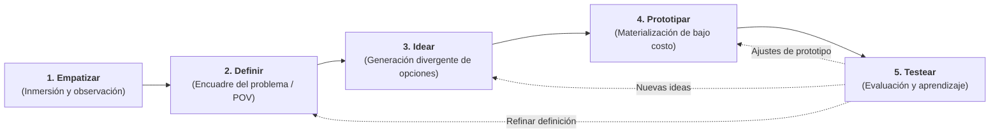
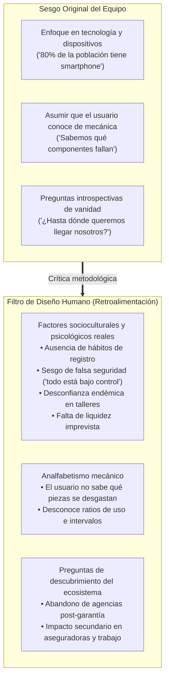
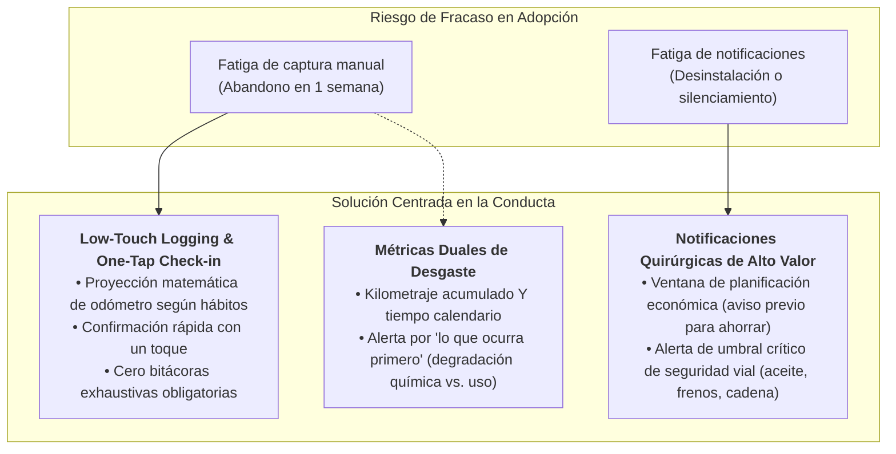

# Monografía: Design Thinking y su Aplicación en el Proyecto Itinera

> **Tipo de documento:** Monografía Teórico-Práctica de Estudio e Integración Metodológica  
> **Área:** Ingeniería de Software / Diseño de Producto / Innovación Centrada en el Usuario  
> **Proyecto Asociado:** [Itinera](file:///C:/Users/OGSha/OneDrive/Escritorio/Developer/App%20Development/Itinera/README.md)  
> **Ubicación:** `.routing/reference/DESIGN_THINKING.md`  
> **Fecha:** Noviembre 2026 — Xalapa, Veracruz  

---

## 1. Introducción y Marco Epistemológico del Design Thinking

### 1.1 Origen y Fundamentos
El **Design Thinking** (Pensamiento de Diseño) es una metodología estructurada para la resolución de problemas complejos y la generación de soluciones innovadoras, formalizada académicamente por la **d.school de Stanford** (Hasso Plattner Institute of Design) y popularizada globalmente por la consultora de innovación **IDEO** (liderada por David Kelley y Tim Brown).

A diferencia de los modelos analíticos y lineales tradicionales —los cuales parten de requisitos cerrados, optimización de costos o viabilidad tecnológica inmediata—, el Design Thinking propone un **enfoque iterativo, divergente-convergente y centrado radicalmente en el ser humano (*Human-Centered Design*)**.

### 1.2 El Modelo del Doble Diamante (*Design Council*)
Para comprender la dinámica del Design Thinking, el modelo del Doble Diamante articula cuatro momentos fundamentales organizados en dos ciclos de divergencia (abrir opciones) y convergencia (focalizar decisiones):

1. **Investigación (Divergir):** Explorar el entorno humano, conductual y cultural sin preconcepciones.
2. **Síntesis (Converger):** Cribar hallazgos para formular un *Point of View* (Punto de Vista o TPNSc).
3. **Ideación (Divergir):** Explorar múltiples conceptos, funciones y modelos de servicio.
4. **Validación e Implementación (Converger):** Construir, verificar y entregar la solución mínima viable.

---

## 2. Las 5 Fases Canónicas de la d.school de Stanford

### Fase 1: Empatizar (*Empathize*)
- **Objetivo:** Sumergirse en la experiencia del usuario para comprender sus necesidades profundas, motivaciones intrínsecas, limitaciones cognitivas, hábitos y frustraciones contextuales.
- **Herramientas canónicas:** Entrevistas cualitativas en profundidad, observación encubierta/participativa (*shadowing*), mapas de empatía (*¿Qué piensa? ¿Qué siente? ¿Qué ve? ¿Qué oye? ¿Qué dice y hace?*).

### Fase 2: Definir (*Define*)
- **Objetivo:** Sintetizar la información dispersa de la empatía para identificar un problema central significativo y accionable. Se formula el **Problema o Tema, Problema, Necesidad o Situación a Cambiar (TPNSc)** y la declaración de Punto de Vista (*Point of View - POV*).
- **Regla de oro metodológica:** **El problema nunca es la ausencia de la solución propuesta.** (Error común: *"El problema es que no tienen nuestra app"*). El problema debe describir la ineficiencia, el dolor humano y las consecuencias socioeconómicas en la vida del usuario.

### Fase 3: Idear (*Ideate*)
- **Objetivo:** Abrir el espectro creativo mediante preguntas guía detonadoras tipo *"¿Cómo podríamos nosotros...?"* (*How Might We - HMW*), desafiando las asunciones iniciales y generando un amplio abanico de respuestas antes de filtrar por viabilidad técnica.
- **Técnicas clave:** Lluvia de ideas estructurada (*brainstorming*), matriz de impacto vs. esfuerzo, analogías de industrias cruzadas.

### Fase 4: Prototipar (*Prototype*)
- **Objetivo:** Transformar conceptos abstractos en artefactos tangibles interactivos de bajo costo que permitan pensar con las manos y poner a prueba hipótesis críticas.
- **Tipos de prototipos:** Bocetos en papel (*low-fidelity*), flujos de navegación, wireframes interactivos, maquetas de interfaz y prototipos de conserje (*Wizard of Oz*).

### Fase 5: Testear (*Test*)
- **Objetivo:** Someter los prototipos a interacción con usuarios reales para validar o refutar hipótesis, descubrir nuevos dolores y retroalimentar las fases anteriores en ciclos rápidos de aprendizaje.

---

## 3. Estudio de Caso: Cómo se ha Aplicado el Design Thinking en Itinera

En el proyecto **Itinera**, el Design Thinking no se ha empleado como una plantilla estática de formato académico, sino como un **filtro crítico de ingeniería de producto** para corregir sesgos y garantizar la viabilidad del software.

### 3.1 La Transición en la Fase de Empatía

#### Aplicación concreta en la documentación del repositorio:
1. **Identificación de factores humanos en lugar de tecnológicos:**
   - En [academic/SPECIFICATION.md](file:///C:/Users/OGSha/OneDrive/Escritorio/Developer/App%20Development/Itinera/.routing/academic/SPECIFICATION.md#L35-L48) se descartó hablar de especificaciones móviles genéricas y se modelaron los **5 factores de comportamiento**:
     - *Fricción cultural:* No hay hábito de anotar fechas en libretas o notas.
     - *Restricción de liquidez:* El mantenimiento programado se aplaza si llega de sorpresa sin margen para presupuestar.
     - *Sesgo de optimismo:* El usuario cree erróneamente que si la moto arranca, no requiere inspección.
     - *Costo de oportunidad:* El taller representa pérdida de días de trabajo y movilidad.
     - *Desconfianza social:* Temor a cobros opacos y piezas no sustituidas.

2. **Detección de la asimetría de conocimiento:**
   - Se registró en [academic/DRAFT_NOTES.md](file:///C:/Users/OGSha/OneDrive/Escritorio/Developer/App%20Development/Itinera/.routing/academic/DRAFT_NOTES.md#L26-L29) que el usuario ignora los ratios de desgaste y las piezas críticas, deduciendo la regla de producto: **la app no puede ser una libreta en blanco**, debe precargar un catálogo inteligente con intervalos recomendados.

---

### 3.2 La Transición en la Fase de Definición (El TPNSc Canónico)

#### La trampa de la solución anticipada vs. el problema real
- **Planteamiento primitivo:** *"Los usuarios carecen de una plataforma móvil para registrar su mantenimiento."*  
  *(Error: confunde la falta de la app con el problema del usuario; una libreta de \$15 pesos ya resuelve "el registro").*
- **Definición purgada en Itinera:**
  > *"El proceso actual de gestión y seguimiento del mantenimiento de vehículos particulares en México opera bajo un esquema ineficiente, reactivo y desarticulado... lo que provoca el abandono del seguimiento preventivo. Como consecuencia, los propietarios enfrentan asimetría de información técnica, toman decisiones a destiempo y dependen de mantenimientos correctivos imprevistos, los cuales elevan los costos operativos, reducen la vida útil del vehículo y comprometen la seguridad vial de los conductores."* ([SPECIFICATION.md](file:///C:/Users/OGSha/OneDrive/Escritorio/Developer/App%20Development/Itinera/.routing/academic/SPECIFICATION.md#L24-L31)).

Esta definición cumple con el principio de Design Thinking: se enfoca en la **ineficiencia sistémica**, el **costo humano** y la **reactividad involuntaria**.

---

### 3.3 La Transición en la Segmentación (Consumidores, Clientes y Usuarios - CCU)

La aplicación del pensamiento de diseño permitió desenredar confusiones críticas de segmentación:

1. **Desacoplamiento del conductor de reparto:**
   - En el análisis inicial se colocaba a los repartidores de plataforma como un tercer bloque ambiguo.
   - Mediante la crítica de diseño, se identificó que el repartidor en moto particular comparte los mismos dolores del propietario urbano B2C pero con uso intensivo; mientras que si la unidad pertenece a una corporación o PYME de reparto, el cliente que decide y financia es la **empresa (B2B)**.
   - **Decisión de diseño:** Proteger el MVP manteniendo el foco B2C y programar la gestión corporativa de micro-flotillas para el roadmap de expansión ([SPECIFICATION.md](file:///C:/Users/OGSha/OneDrive/Escritorio/Developer/App%20Development/Itinera/.routing/academic/SPECIFICATION.md#L73-L93)).
2. **Identificación de perfiles sensibles y nichos catalizadores:**
   - **Mujeres conductoras:** Diseñar una herramienta que actúe como ecualizador técnico para neutralizar abusos en talleres mecánicos.
   - **Comunidad DIY (Do It Yourself):** Facilitar el registro de intervenciones mecánicas caseras sin forzar validaciones de talleres externos.
   - **Conductores novatos:** Proveer explicaciones cotidianas sin tecnicismos mecánicos intimidantes.

---

## 4. Principios de Interacción (UX) Derivados del Design Thinking

Como fruto directo de las preguntas de empatía (*"¿Están dispuestos a introducir datos diarios?"* y *"¿Están dispuestos a recibir muchas notificaciones?"*), se establecieron los siguientes **principios de diseño de interacción en Itinera**:

---

## 5. Próximos Pasos en el Proceso de Design Thinking para Itinera

| Fase de Design Thinking | Estado en Itinera | Entregables y Próximas Acciones | Archivos Vinculados |
| :--- | :--- | :--- | :--- |
| **1. Empatizar** | Consolidada (Borrador purgado) | Entrevistas cualitativas de campo con motociclistas urbanos y validación de ratios de desgaste reales. | [DRAFT_NOTES.md](file:///C:/Users/OGSha/OneDrive/Escritorio/Developer/App%20Development/Itinera/.routing/academic/DRAFT_NOTES.md) |
| **2. Definir** | Refinada | TPNSc validado, segmentación CCU depurada y delimitación estricta del MVP (motos 125cc-250cc). | [SPECIFICATION.md](file:///C:/Users/OGSha/OneDrive/Escritorio/Developer/App%20Development/Itinera/.routing/academic/SPECIFICATION.md) |
| **3. Idear** | En proceso de formalización | Mapeo de flujos clave de usuario, arquitectura de información y modelos de entidad en el dominio. | [DOMAIN.md](file:///C:/Users/OGSha/OneDrive/Escritorio/Developer/App%20Development/Itinera/.routing/DOMAIN.md) y [ROUTES.md](file:///C:/Users/OGSha/OneDrive/Escritorio/Developer/App%20Development/Itinera/.routing/ROUTES.md) |
| **4. Prototipar** | Por iniciar | Construcción de wireframes móviles, diseño de componentes visuales (semáforo de salud) y maquetas navegables. | [DESIGN.md](file:///C:/Users/OGSha/OneDrive/Escritorio/Developer/App%20Development/Itinera/.routing/DESIGN.md) |
| **5. Testear** | Por iniciar | Pruebas de usabilidad del flujo de *Check-in* en un toque con conductores reales para medir tiempo de registro (<15 seg). | `.tickets/` de testing |

---

## 6. Conclusión y Recomendación para el Equipo

El Design Thinking ha permitido transformar una idea abstracta de aula en un **producto de software con propuesta de valor defendible**:
1. Evita construir funciones inútiles (como balances exhaustivos de combustible que el motociclista no pide).
2. Protege al equipo del desgaste técnico delimitando un MVP realista y manejable.
3. Asegura que la arquitectura de software responda a la **psicología real del conductor mexicano**: bajo esfuerzo cognitivo, alta previsibilidad económica y empoderamiento ante la asimetría técnica de los talleres.
