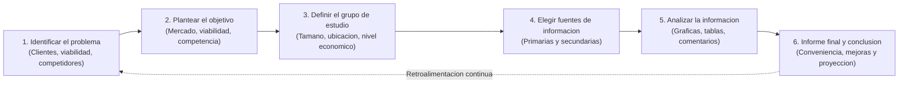
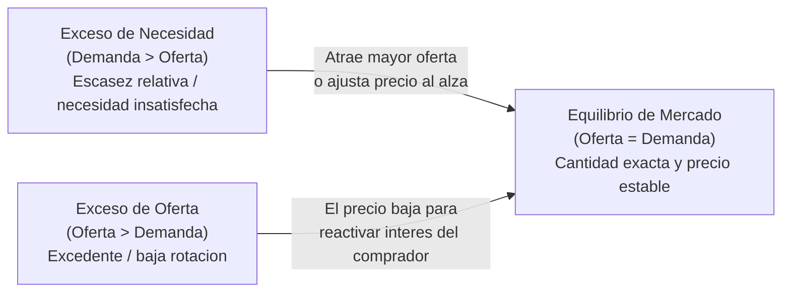
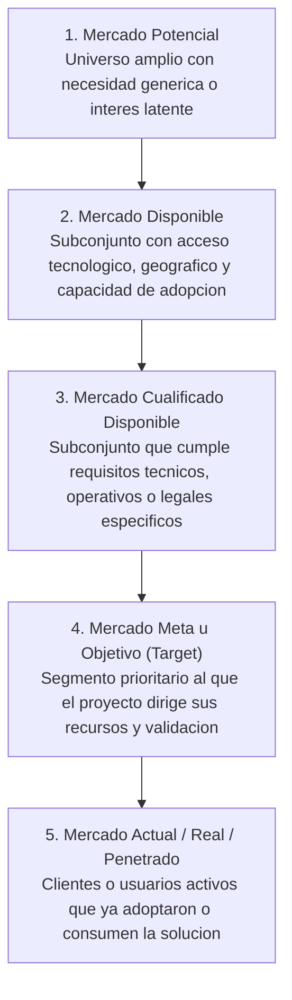
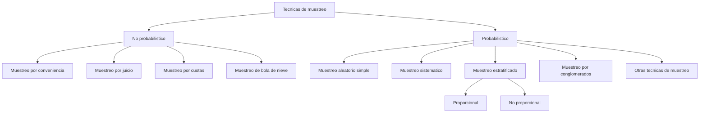
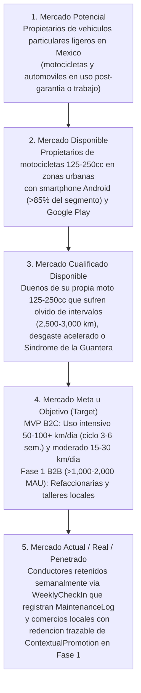

# Monografía: Estudio de Mercado — Fundamentos Económicos, Muestreo Estadístico y Aplicación Reconciliada en Itinera

> **Tipo de documento:** Monografía Teórico-Práctica de Investigación de Mercados y Análisis Económico  
> **Estado:** `[ALINEADO A LÍNEA BASE MVP — SPECIFICATION.md & DOMAIN.md]`  
> **Asignatura:** Economía para Toma de Decisiones — Licenciatura en Ingeniería de Software  
> **Proyecto Asociado:** [Itinera](file:///C:/Users/OGSha/OneDrive/Escritorio/Developer/App%20Development/Itinera/README.md) (*"Donde cada kilómetro cuenta"*)  
> **Ubicación:** `.routing/reference/MARKET_STUDY.md`  
> **Fecha:** Noviembre 2026 — Xalapa, Veracruz  
> **Equipo de trabajo:** Gerardo Abraham Barrón Gómez, Edgar Vázquez García, Alberto Villalba Figueroa  

---

## 1. Fundamentos Económicos y Alcance del Estudio de Mercado

### 1.1 Definición Formal, Propósito y Rol Estratégico

El **Estudio de Mercado** constituye la etapa fundacional de evaluación de viabilidad de cualquier proyecto productivo o emprendimiento tecnológico. Su finalidad primordial —de acuerdo con la consigna académica incorporada en [spec.md](file:///C:/Users/OGSha/OneDrive/Escritorio/Developer/App%20Development/Itinera/.tickets/003-design-itinera-market-study/spec.md)— es **probar que existe un número suficiente de individuos, empresas u otras entidades económicas que, dadas ciertas condiciones, presentan una demanda capaz de justificar la puesta en marcha de un proyecto en un cierto período**, o el arranque formal de una iniciativa empresarial.

Desde la perspectiva económica y de mercadotecnia:
- Es un **instrumento del mercadeo** orientado a estimar la cuantía de bienes o servicios provenientes de una unidad de producción que los clientes están dispuestos a adquirir a determinados precios durante un período específico.
- Opera como un **esfuerzo organizado de recopilación de información** sobre nichos y consumidores particulares que, apoyado en métodos y técnicas estadísticas, subsidia la toma de decisiones estratégicas y **disminuye el riesgo e incertidumbre** del negocio.

Un estudio de mercado riguroso permite conocer y dimensionar cinco características clave antes de comprometer capital o capacidad de ingeniería:
1. **Medición de mercados potenciales** y aspectos de magnitud comercial.
2. **Análisis de nichos específicos de mercado** y determinación precisa de sus características.
3. **Evaluación de penetración de mercado** y rentabilidad esperada.
4. **Pronósticos de ventas y de demanda a corto plazo**, además de la identificación de competidores y su comportamiento.
5. **Pruebas de productos similares existentes** para calibrar características y fijación de precios.

### 1.2 Sistemas de Información de Mercadotecnia (SIM)

Los estudios de mercado no deben ejecutarse como ejercicios aislados o improvisados; se apoyan en los **Sistemas de Información de Mercadotecnia (SIM)**, definidos como una **estructura permanente e interactiva** compuesta por cuatro pilares interdependientes:

| Componente del SIM | Función Estructural |
| :--- | :--- |
| **Personas** | Analistas, investigadores, equipo de producto y tomadores de decisiones que formulan preguntas de negocio e interpretan hallazgos. |
| **Equipos** | Infraestructura tecnológica de captura, almacenamiento, procesamiento estadístico y visualización (encuestas digitales, hojas de cálculo, bases de datos). |
| **Procesos** | Flujos sistemáticos para recabar, clasificar, analizar, evaluar y distribuir datos primarios y secundarios. |
| **Procedimientos** | Reglas metodológicas, criterios muestrales, protocolos de validación y periodicidad de actualización de la información. |

El **objetivo del SIM** es recabar, clasificar, analizar, evaluar y distribuir información pertinente y precisa para quienes toman decisiones de mercadotecnia, mejorando tres funciones directivas: **la planeación**, **la ejecución** y **el control**. Sus productos resultantes —los **informes de mercado**— sintetizan datos del entorno operativo derivados de la influencia de factores sociales, políticos, legales, económicos y tecnológicos.

### 1.3 Variables del Microentorno (Internas) y Macroentorno (Externas)

El estudio de mercado reconoce el comportamiento integral del ecosistema analizando tanto las variables controlables o próximas a la operación (**variables internas**) como las fuerzas del entorno que la empresa no controla directamente (**variables externas**):

| Dimensión | Variables Clave (6 por dimensión) | Alcance Analítico en el Estudio |
| :--- | :--- | :--- |
| **Variables Internas** *(Microentorno operativo)* | 1. **Clientes** 2. **Demanda** 3. **Oferta** 4. **Comercialización** 5. **Consumo** 6. **Precio** | Miden quién adopta o compra, qué volumen requiere, qué capacidad de producción/servicio ofrece el proyecto, cómo se distribuye el valor, con qué frecuencia se consume y bajo qué esquema monetario o de fricción se intercambia. |
| **Variables Externas** *(Macroentorno y mercado)* | 1. **Competencia** 2. **Gustos** 3. **Preferencias** 4. **Tendencia del consumidor** 5. **Condiciones políticas y legales** 6. **Tecnología** | Evalúan la estructura competitiva, hábitos culturales y conductuales del usuario, evolución de preferencias, marcos regulatorios o fiscales aplicables y disponibilidad tecnológica de acceso (ej. penetración de smartphones). |

### 1.4 Pasos Generales, Ciclo Práctico de Ejecución y Estudios de Detalle

Los lineamientos académicos incorporados en la especificación del Ticket 003 ([spec.md](file:///C:/Users/OGSha/OneDrive/Escritorio/Developer/App%20Development/Itinera/.tickets/003-design-itinera-market-study/spec.md)) establecen **6 pasos generales** para estructurar la investigación y **4 estudios de detalle** que los operacionalizan de forma analítica:

#### Los 6 Pasos Generales del Estudio de Mercado
1. **Definir los aspectos del estudio general del mercado** que interesan en relación directa con el proyecto específico.
2. **Recopilar información de antecedentes:** usos del bien o servicio, series estadísticas (producción, importación, exportación), tipo y costumbres de los consumidores, distribución geográfica del mercado, métodos de comercialización y posibles cambios demográficos.
3. **Fijación de la cuantía de la demanda** total actual, real y aparente.
4. **Conclusiones y previsiones respecto a la comercialización** del bien o servicio (formas de distribución, problemas de transporte, canales de comunicación con el cliente).
5. **Conclusiones y previsiones respecto a la incidencia de la política económica** en el mercado (fijaciones de precios, racionamientos, monopolios de distribución o transporte, protección aduanera, exenciones fiscales y vías de comunicación).
6. **Proyección de la demanda** hacia el horizonte operativo del proyecto.

#### Operacionalización en el Ciclo Práctico de 6 Pasos y Entregables de Campo
Para llevar estos lineamientos a ejecución práctica, el proceso metodológico se articula en seis etapas iterativas que alimentan los 5 bloques del entregable (`TASK` de la consigna académica):

#### Los 4 Estudios de Detalle Obligatorios
Todos los puntos anteriores se abordan mediante cuatro sub-estudios especializados:
1. **Análisis de la demanda:** Cuantificación de la necesidad real, hábitos de consumo, segmentación y sensibilidad ante precio o fricción.
2. **Análisis de la oferta:** Evaluación de competidores actuales, sustitutos, capacidad de respuesta y propuesta diferencial.
3. **Análisis de los canales de comercialización:** Revisión de los mecanismos de descubrimiento, entrega y soporte hasta el consumidor final.
4. **Análisis de precios:** Determinación de la estructura tarifaria, disposición a pagar (*willingness to pay*) y equilibrio competitivo.

Asimismo, cuando un proyecto atiende diferentes segmentos de clientes o usuarios donde sea necesario medir características específicas, la consigna académica ([spec.md](file:///C:/Users/OGSha/OneDrive/Escritorio/Developer/App%20Development/Itinera/.tickets/003-design-itinera-market-study/spec.md)) ordena elaborar **secciones específicas o instrumentos de recolección diferenciados** por segmento, y la conclusión obtenida sirve de insumo base para proyectar el estudio técnico, económico-financiero, organizacional y los ajustes al modelo de negocio.

### 1.5 Matriz Complementaria FODA

Para obtener mejores resultados diagnósticos al cruzar las variables internas con el entorno competitivo, el estudio de mercado se complementa con un análisis **FODA** (*Fortalezas, Oportunidades, Debilidades y Amenazas*):

| Origen del Factor | Factores Positivos (A favor del proyecto) | Factores Negativos (Restricciones o riesgos) |
| :--- | :--- | :--- |
| **Análisis Interno** *(Controlable por el equipo/proyecto)* | **Fortalezas (F):** Capacidades técnicas, diferenciadores de producto, eficiencia de costos o ventajas operativas propias. | **Debilidades (D):** Limitaciones de recursos, carencias de cobertura inicial, dependencias técnicas o brechas de adopción. |
| **Análisis Externo** *(Condiciones del mercado/entorno)* | **Oportunidades (O):** Vacíos desatendidos por competidores, tendencias de digitalización, crecimiento de nichos o aliados potenciales. | **Amenazas (A):** Competidores consolidados, resistencia cultural al cambio, barreras regulatorias o cambios económicos adversos. |

> [!NOTE]
> **Corrección terminológica de fuente primaria:** En la lámina 11 de la presentación de apoyo (`Estudio-Mercado-2.pdf`) aparece un error tipográfico en el acrónimo (`FDOA`). En este documento y en toda la documentación del proyecto se emplea exclusivamente la sigla canónica correcta en español: **FODA** (*Fortalezas, Oportunidades, Debilidades y Amenazas*), equivalente al acrónimo anglosajón *SWOT*.

---

## 2. Teoría de Oferta, Demanda, Elasticidad y Clasificación de Mercados

### 2.1 Análisis de la Oferta

En teoría económica, la **oferta** comprende **todos los bienes y servicios disponibles en el mercado que los socios comerciales pueden adquirir a cambio de dinero, bienes materiales u otros servicios**. El **análisis de la oferta** tiene como objetivo conocer, medir y comprender los volúmenes y condiciones en que opera determinada economía o industria dispuesta a proveer un producto o servicio.

Para caracterizar adecuadamente a los oferentes existentes y al propio proyecto frente a ellos, deben establecerse cinco parámetros esenciales:
1. **Capacidad de producción (o entrega):** Volumen máximo sostenible de unidades, usuarios atendidos o servicios prestados sin degradación operativa.
2. **Características del producto:** Atributos funcionales, técnicos, de calidad y experiencia de uso.
3. **Ventajas:** Diferenciadores competitivos verificables frente a las alternativas vigentes.
4. **Valor agregado:** Beneficios adicionales (ahorro de tiempo, prevención, soporte, transparencia) que elevan la utilidad percibida.
5. **Portafolio de productos y servicios:** Gama completa de soluciones ofrecidas y su coherencia por etapa o segmento.

### 2.2 Análisis de la Demanda y Elasticidad-Precio

La **demanda** es el término complementario de la oferta: **designa la necesidad real de determinados bienes o servicios que tienen potenciales socios comerciales**, tales como hogares particulares o empresas, respaldada por su capacidad y disposición para acceder a ellos en un período dado.

Un indicador económico central dentro del análisis de la demanda es la **elasticidad-precio de la demanda** ($E_d$), la cual mide la relación funcional e **inversamente proporcional** entre el precio de venta de un bien o servicio y la cantidad demandada por el consumidor (ley general: al subir el precio, disminuye la cantidad demandada, *ceteris paribus*):

$$E_d = \frac{\%\Delta Q_d}{\%\Delta P} = \frac{\Delta Q_d / Q_d}{\Delta P / P}$$

- **Demanda elástica ($|E_d| > 1$):** Una variación porcentual pequeña en el precio provoca una caída proporcionalmente mayor en la cantidad demandada (típico de bienes con muchos sustitutos o consumo discrecional).
- **Demanda de elasticidad unitaria ($|E_d| = 1$):** El cambio porcentual en la cantidad demandada iguala en magnitud al cambio porcentual en el precio.
- **Demanda inelástica ($|E_d| < 1$):** La cantidad demandada responde débilmente ante aumentos de precio (típico de insumos críticos o productos sin sustitutos inmediatos).

> [!TIP]
> **Extensión a productos digitales y modelos freemium:** Cuando un producto digital fija un precio monetario de `$0` para el usuario final, la elasticidad de la demanda no desaparece; se desplaza hacia el **costo no monetario de adopción o fricción de uso** (tiempo de captura, complejidad cognitiva, consumo de datos móviles o fatiga por notificaciones).

### 2.3 Mecánica del Equilibrio de Mercado

Entre la oferta y la demanda existe una **relación dinámica de ajuste**: cuando la demanda es elevada y supera la disponibilidad inmediata, la oferta tiende a expandirse atraída por la rentabilidad; cuando ocurre lo contrario, los precios y márgenes tienden a ajustarse a la baja. De la interacción de ambas curvas surgen tres estados económicos fundamentales:

| Estado del Mercado | Condición Cuantitativa | Dinámica Económica y Consecuencia |
| :--- | :--- | :--- |
| **Exceso de Necesidad** *(Escasez / exceso de demanda)* | $Q_d > Q_o$ | La demanda existente no puede satisfacerse con la oferta disponible en ese momento o nivel de condiciones. Genera oportunidades de entrada para nuevos oferentes o soluciones sustitutas. |
| **Exceso de Oferta** *(Sobreoferta / excedente)* | $Q_o > Q_d$ | Existe más producción o capacidad disponible de la que el mercado absorbe. El precio de mercado desciende hasta que el bien resulta lo bastante económico o conveniente para reactivar el interés de los compradores y recuperar la demanda. |
| **Equilibrio de Mercado** | $Q_o = Q_d$ | Punto donde se cruzan la curva de oferta y la de demanda. Se produce exactamente la cantidad necesaria y tanto el precio de mercado como la cantidad producida se mantienen estables mientras no cambien factores externos. |

### 2.4 Concepto de Mercado y las 5 Clasificaciones Fundamentales

El término **mercado** admite tres lecturas complementarias:
- **Tradicional:** Lugar físico donde compradores y vendedores se reunían a intercambiar bienes.
- **Económica:** Conjunto de compradores y vendedores que negocian con un producto concreto o una clase de productos.
- **De Marketing:** Distintas agrupaciones de consumidores; bajo esta óptica, **los vendedores constituyen la industria y los compradores constituyen el mercado**.

Para caracterizar con rigor un ecosistema comercial, se aplican los **cinco criterios de clasificación de mercados**:

#### 1. Según el Tipo de Comprador
- **Particulares o de consumo:** Individuos u hogares que adquieren bienes o servicios para uso personal o familiar (B2C).
- **Industriales:** Empresas o unidades productivas que adquieren insumos, servicios o activos para su operación comercial (B2B).
- **Organismos públicos:** Entidades gubernamentales y dependencias del sector público.
- **Otras instituciones:** Asociaciones civiles, educativas, cooperativas u organizaciones sin fines de lucro.

#### 2. Según el Tipo de Producto
- **Mercado de productos agropecuarios y del mar**
- **Mercado de materias primas**
- **Mercado de productos industriales**
- **Mercado de servicios**
- **Mercado de productos informáticos** *(categoría central para software, aplicaciones móviles y plataformas digitales)*

#### 3. Según el Número de Competidores (Estructura Competitiva)
| Estructura | Características Distintivas | Poder de Fijación de Precios |
| :--- | :--- | :--- |
| **Monopolio** | Un único oferente controla todo el mercado sin sustitutos cercanos. | Máximo (limitado solo por regulación o elasticidad). |
| **Oligopolio** | Un grupo reducido de grandes competidores domina la oferta; alta interdependencia estratégica. | Alto / coordinado o rígido. |
| **Competencia monopolística** | Múltiples oferentes que compiten con productos diferenciados en marca, experiencia, nicho o valor agregado. | Moderado (depende de la diferenciación percibida). |
| **Competencia perfecta** | Gran número de compradores y vendedores con producto homogéneo y libre entrada/salida. | Nulo (actores tomadores de precio). |

#### 4. Según la Intensidad de la Oferta y la Demanda
El poder de negociación y dominio del mercado recae en una de las dos partes según la relación relativa entre oferta y demanda:
- **Mercado de vendedores ($\text{Demanda} > \text{Oferta}$):** Los vendedores dominan las condiciones de intercambio al haber escasez relativa frente a la necesidad de compra.
- **Mercado de compradores ($\text{Oferta} > \text{Demanda}$):** Los compradores dominan las condiciones y el precio al existir abundancia de opciones competidoras; los oferentes deben competir reduciendo fricción, precio o elevando valor agregado.

#### 5. Según el Tipo de Demanda (Embudo de 5 Niveles)
La demanda total de un mercado se depura progresivamente desde la población teórica máxima hasta la base efectivamente capturada:

---

## 3. Metodología de Investigación y Técnicas de Muestreo

### 3.1 Fuentes de Información: Primarias frente a Secundarias

Conforme a los lineamientos de la asignatura incorporados en [spec.md](file:///C:/Users/OGSha/OneDrive/Escritorio/Developer/App%20Development/Itinera/.tickets/003-design-itinera-market-study/spec.md), todo estudio de mercado debe especificar cómo combina ambos tipos de fuentes:

| Tipo de Fuente | Definición | Ejemplos Aplicables | Rol en el Estudio |
| :--- | :--- | :--- | :--- |
| **Fuentes Primarias** | Datos originales recabados directamente del sujeto de investigación (*clientes, usuarios o compradores*) para responder preguntas específicas del proyecto. | Encuestas estructuradas, entrevistas semiestructuradas, observación directa en punto de venta/taller, pruebas de concepto. | Valida hipótesis conductuales, disposición a pagar, fricción de uso y atributos que no existen en estadísticas públicas. |
| **Fuentes Secundarias** | Información histórica, estadística o documental previamente recopilada y publicada por terceros. | Censos e inventarios del **INEGI**, registros vehiculares, reportes sectoriales de motociclismo, literatura técnica y estudios previos. | Dimensiona el universo de estudio ($N$), contextualiza tendencias macroeconómicas y evita duplicar esfuerzos costosos. |

### 3.2 Enfoque Cuantitativo (Probabilístico) frente a Cualitativo/Exploratorio (No Probabilístico)

La elección metodológica parte de una pregunta decisiva de diseño muestral:

> **¿Se requiere que la información obtenida describa y represente estadísticamente a toda la población?**

- **Respuesta SÍ $\to$ Muestreo Probabilístico (Enfoque Estadístico / Cuantitativo):**  
  Todos los elementos del universo tienen una probabilidad conocida y no nula de ser seleccionados. Cuenta con **sustento estadístico formal** que otorga **representatividad cuantitativa** y permite proyectar/extrapolar los resultados de la muestra hacia todo el universo investigado dentro de un nivel de confianza y margen de error conocidos.
- **Respuesta NO $\to$ Muestreo No Probabilístico (Enfoque No Estadístico / Cualitativo-Exploratorio):**  
  La selección no depende del azar estadístico sino del criterio del investigador, accesibilidad o cuotas prácticas. Es un método **más sencillo, menos costoso y relativamente más flexible**, capaz de aportar **información confiable y real** para comprender motivaciones profundas o validar nichos iniciales, aunque **carece de representatividad estadística** para proyectarse matemáticamente al total del universo.

### 3.3 Árbol Taxonómico de Técnicas de Muestreo

El siguiente árbol reproduce la taxonomía completa de técnicas de muestreo (`Estudio-Mercado-2.pdf`, lámina 18):

#### Criterios Operativos de Cada Técnica

| Rama | Técnica | Mecánica de Selección y Uso Recomendado |
| :--- | :--- | :--- |
| **No Probabilístico** | **Por conveniencia** | Selecciona participantes de fácil acceso y proximidad geográfica o digital. Útil en pilotos exploratorios tempranos con presupuesto cero. |
| **No Probabilístico** | **Por juicio** *(intencional)* | El investigador escoge deliberadamente a informantes expertos o casos críticos que aportan conocimiento profundo del dominio (ej. mecánicos o líderes de flotilla). |
| **No Probabilístico** | **Por cuotas** | Divide la población en categorías relevantes (ej. uso intensivo vs. moderado) y fija un número mínimo de respuestas por categoría sin aleatorización estricta. |
| **No Probabilístico** | **De bola de nieve** | Cada encuestado refiere a nuevos contactos dentro de redes cerradas o gremios difíciles de censar (ej. repartidores independientes o clubes de motociclistas). |
| **Probabilístico** | **Aleatorio simple** | Todo individuo del marco muestral tiene exactamente la misma probabilidad de ser elegido (requiere listado completo o aleatorización pura). |
| **Probabilístico** | **Sistemático** | Elige un punto de partida aleatorio y selecciona cada $k$-ésimo elemento en una lista o flujo ordenado (ej. cada quinto motociclista en un punto de afluencia). |
| **Probabilístico** | **Estratificado** *(Proporcional / No proporcional)* | Segmenta la población en estratos homogéneos relevantes (ej. cilindrada o rango de km/día) y aplica muestreo aleatorio dentro de cada estrato, manteniendo su peso poblacional (*proporcional*) o sobre-representando estratos pequeños de interés analítico (*no proporcional*). |
| **Probabilístico** | **Por conglomerados** | Selecciona aleatoriamente agrupaciones naturales completas (zonas urbanas, colonias, talleres o centros laborales) en lugar de individuos dispersos. |
| **Probabilístico** | **Otras técnicas** | Incluye diseños polietápicos o muestreo por áreas geográficas combinando conglomerados y estratos. |

### 3.4 Compromiso de Costos, Herramientas y Procesamiento de Resultados

Realizar un estudio de mercado presenta un balance directo entre **presupuesto monetario** y **esfuerzo operativo**:
- **Ejecución autofinanciada (costo monetario directo `$0 MXN`):** No exige desembolso en licencias ni agencias, pero demanda inversión intensiva de **tiempo, paciencia, constancia y esfuerzo** del equipo investigador para diseñar instrumentos, levantar datos en campo/digital y depurar respuestas.
- **Inversión en herramientas o agencias:** Es posible utilizar plataformas de encuestas *online* (para acelerar captura, lógica condicional y tabulación) o contratar agencias especializadas; según la herramienta elegida, el presupuesto final será mayor o menor.
- **Organización y análisis de resultados:** La información recolectada se estructura sistemáticamente mediante **gráficas**, **tablas estadísticas** y **comentarios analíticos**, culminando en un informe final que responde tres preguntas clave: *¿Es un negocio conveniente?*, *¿Qué cambiaría o mejoraría?* y *¿Cómo ejecutarlo?*

---

## 4. Cálculo Estadístico del Tamaño de Muestra

### 4.1 Los Cuatro Factores Clave del Dimensionamiento Muestral

Cuando se adopta un enfoque probabilístico para proyectar resultados hacia el universo de estudio, el tamaño de muestra ($n$) se determina a partir de **cuatro factores clave**:

1. **Determinar una hipótesis ($H_0, H_1$) y su variabilidad ($p, q$):**
   - **Hipótesis nula ($H_0$):** Enunciado que describe la situación base donde no existe cambio, diferencia o efecto significativo (o la proposición sometida a contraste).
   - **Hipótesis alternativa ($H_1$):** Enunciado complementario donde sí se espera una diferencia, restricción o efecto en la situación planteada.
   - **Ponderación de variabilidad ($p$ y $q$):** Tras plantear $H_0$ y $H_1$, se evalúa si existe evidencia previa que incline el resultado hacia una de las dos hipótesis, expresándolo en porcentaje ($p + q = 100\% = 1.00$). En la convención de la referencia de curso (`Estudio-Mercado-2.pdf`, lámina 25), $p$ denota la variabilidad negativa de hipótesis y $q$ la variabilidad positiva. Cuando **no existe inclinación previa conocida**, se aplica el criterio conservador de máxima varianza: **$p = 50\%\;(0.5)$ y $q = 50\%\;(0.5)$**, maximizando el tamaño muestral requerido ($p \cdot q = 0.25$).
2. **Definir si el universo ($N$) es finito o infinito:**
   - El **universo** es el conjunto total de unidades o habitantes que integran la población objetivo. Si su magnitud es conocida y acotada se emplea la fórmula de **universo finito**; si el tamaño poblacional es desconocido, sumamente grande o el muestreo es sin marco censal acotado, se emplea la fórmula de **universo infinito**.
3. **Determinar el nivel de confianza ($Z$):**
   - Indica el grado de seguridad estadística con el que los resultados muestrales representan al universo real. **El estándar mínimo aceptado por la industria de investigación de mercados es del `95%` ($Z = 1.96$)**.
4. **Determinar el margen de error ($e$):**
   - Define la desviación máxima esperada entre la proporción observada en la muestra y el parámetro real de la población. **El máximo aceptado generalmente por la industria es del `±5%` ($e = 0.05$)**.

### 4.2 Tabla de Referencia de Nivel de Confianza (`Z`)

La siguiente tabla recoge los valores críticos $Z$ de referencia del curso para niveles de confianza del `90%` al `99%` (`Estudio-Mercado-2.pdf`, lámina 23), destacando el mínimo estándar aceptado por la industria:

| Nivel de Confianza | Valor Crítico ($z$) | Uso / Estándar de Referencia |
| :---: | :---: | :--- |
| `90%` | `1.645` | Estudios exploratorios rápidos con tolerancia moderada al riesgo |
| `91%` | `1.663` | Nivel intermedio |
| `92%` | `1.681` | Nivel intermedio |
| `93%` | `1.699` | Nivel intermedio |
| `94%` | `1.71` | Nivel intermedio |
| **`95%`** | **`1.96`** | **Estándar mínimo aceptado por la industria** *(recomendado con $e \le \pm 5\%$)* |
| `96%` | `2.06` | Nivel de precisión superior |
| `97%` | `2.08` | Nivel de precisión superior |
| `98%` | `2.101` | Alta exigencia estadística |
| **`99%`** | **`2.575`** | **Máxima rigurosidad** *(estudios censales o de inversión crítica)* |

> [!NOTE]
> **Nota técnica de verificación estadística:** La tabla anterior conserva íntegramente los valores de la lámina 23 de `Estudio-Mercado-2.pdf` utilizados en la evaluación académica de la asignatura. Para cálculos con distribución normal estándar bilateral de alta precisión en software estadístico, los cuantiles exactos más utilizados siguen siendo `90% -> 1.645`, `95% -> 1.960` y `99% -> 2.576` (los tres valores ancla coinciden plenamente con la referencia).

### 4.3 Fórmulas Exactas de Tamaño de Muestra (Finito e Infinito)

#### Diccionario de Variables
- $n$: Tamaño de la muestra a obtener (número de encuestas o unidades).
- $N$: Tamaño total de la población o universo conocido.
- $z$: Valor crítico correspondiente al nivel de confianza elegido.
- $p$: Variabilidad negativa de hipótesis (proporción decimal, ej. `0.5`).
- $q$: Variabilidad positiva de hipótesis ($1 - p$, ej. `0.5`).
- $e$: Margen de error permitido (proporción decimal, ej. `0.05` para `±5%`).

#### Fórmula para Universo Finito (Corregida)

$$n = \frac{z^2 N p q}{e^2(N - 1) + z^2 p q}$$

> [!IMPORTANT]
> **Corrección algebraica respecto al material fuente:** En la lámina 25 de `Estudio-Mercado-2.pdf`, la fórmula de universo finito se presenta en formato lineal sin paréntesis agrupadores en el denominador (`n = z²Npq/e² (N-1)+z²pq`), lo cual violaría la precedencia de operadores matemáticos si se evaluara literalmente. En toda implementación analítica o de hoja de cálculo debe agruparse explícitamente el denominador completo: `n = (z^2 * N * p * q) / (e^2 * (N - 1) + z^2 * p * q)`.

#### Fórmula para Universo Infinito

$$n = \frac{z^2 p q}{e^2}$$

### 4.4 Verificación mediante Caso Práctico INEGI (`Estudio-Mercado-2.pdf`, Láminas 26–27)

Para comprobar la exactitud de las fórmulas anteriores, se documenta el ejercicio resuelto de referencia:
- **Contexto del problema:** Una empresa mexicana que ofrece becas para egresados universitarios desea ampliar sus servicios hacia asesoría de bienes raíces en el extranjero, requiriendo estimar la inclinación de los mexicanos mayores de 29 años egresados de estudios universitarios a viajar y radicar definitivamente en otro país.
- **Datos del universo y parámetros:**
  - Universo según estudio intercensal de **INEGI (2017):** $N = 58{,}300{,}000$ habitantes.
  - Hipótesis sin inclinación previa conocida: $p = 0.50$, $q = 0.50$ ($p \cdot q = 0.25$).
  - Nivel de confianza solicitado: $99\% \implies z = 2.575$.
  - Margen de error permitido: $e = \pm 4\% = 0.04$.
- **Sustitución y resultado verificado:**

$$n = \frac{2.575^2 \times 0.5 \times 0.5}{0.04^2} = \frac{6.630625 \times 0.25}{0.0016} = \frac{1.65765625}{0.0016} = 1{,}036.035 \approx \mathbf{1{,}036\;\text{encuestas}}$$

- **Comprobación de convergencia con la fórmula de universo finito:** Si se sustituye $N = 58{,}300{,}000$ en la fórmula finita corregida:

$$n = \frac{2.575^2 \times 58{,}300{,}000 \times 0.25}{0.04^2(58{,}300{,}000 - 1) + 2.575^2(0.25)} = \frac{96{,}641{,}359.375}{93{,}279.9984 + 1.65765625} = 1{,}036.017 \approx \mathbf{1{,}036\;\text{encuestas}}$$

Esto demuestra matemáticamente por qué, ante poblaciones muy extensas donde la fracción de muestreo $n/N$ es despreciable ($< 0.002\%$), el factor de corrección por población finita tiende a $1$ y ambas fórmulas convergen al mismo resultado exacto (**`1,036` encuestas**).

---

## 5. Aplicación Canónica al Dominio Reconciliado de Itinera

La teoría económica y estadística desarrollada en las secciones precedentes se mapea de forma estricta sobre las fronteras reconciliadas del proyecto **Itinera** definidas en [SPECIFICATION.md](file:///C:/Users/OGSha/OneDrive/Escritorio/Developer/App%20Development/Itinera/.routing/academic/SPECIFICATION.md), [DOMAIN.md](file:///C:/Users/OGSha/OneDrive/Escritorio/Developer/App%20Development/Itinera/.routing/DOMAIN.md) y [BUSINESS_MODEL_CANVAS.md](file:///C:/Users/OGSha/OneDrive/Escritorio/Developer/App%20Development/Itinera/.routing/reference/BUSINESS_MODEL_CANVAS.md).

### 5.1 Clasificación Económica y Embudo de 5 Niveles del Mercado de Itinera

| Criterio de Clasificación | Posicionamiento Canónico de Itinera | Justificación desde `SPECIFICATION.md` y `DOMAIN.md` |
| :--- | :--- | :--- |
| **Tipo de Comprador** | **Plataforma de Dos Lados Asimétrica:** • *Lado A (B2C):* Particulares / de consumo. • *Lado B (B2B Fase 1–2):* Industriales / comercios locales. | El usuario particular (Lado A) adopta gratis el núcleo MVP; las refaccionarias y talleres locales (Lado B, Fase 1) y micro-flotillas/distribuidores (Fase 2) poseen el margen comercial para financiar la plataforma. |
| **Tipo de Producto** | **Mercado de productos informáticos** articulado con el **mercado de servicios y refacciones** de movilidad ligera. | Aplicación móvil Android-First, *Local-First* (SQLite) que canaliza demanda preventiva oportuna hacia servicios de taller o compra de consumibles (*DIY*). |
| **Número de Competidores** | **Competencia monopolística** con diferenciación vertical de baja fricción. | Existen libretas físicas (*Síndrome de la Guantera*), recordatorios informales y apps financieras genéricas (ej. Drivvo). Itinera se diferencia por enfocarse exclusivamente en salud mecánica de 5 `ConsumableItem`, `OdometerProjection`, `WeeklyCheckIn` y regla dual $\min(t_{km}, t_{meses})$. |
| **Intensidad Oferta / Demanda** | **Mercado de compradores** en apps genéricas de alto esfuerzo; **Exceso de necesidad latente** en seguimiento preventivo *Low-Touch* para `125–250cc`. | El conductor abandona apps que exigen capturar cada carga de gasolina, pero carece de una herramienta sin fricción que funcione incluso con el chicote del odómetro roto y en lenguaje cotidiano. |

#### Embudo de Demanda de 5 Niveles Aplicado a Itinera

### 5.2 Mapeo de los 4 Estudios de Detalle al MVP y Modelo Monetario en 3 Fases

| Sub-estudio (Consigna) | Variables Críticas a Medir y Mapear en Itinera | Alineación con Fase 0 (MVP), Fase 1 y Fase 2 |
| :--- | :--- | :--- |
| **1. Análisis de la Demanda** | • Frecuencia semanal de uso (`50–100+ km/día` cohorte intensiva vs. `15–30 km/día` moderada). • Propiedad de la moto (propia vs. empresa, para evitar desacople patrón-empleado). • Prevalencia de chicote de odómetro dañado, práctica *DIY* y dolores de asimetría en talleres (incluidos nichos transversales: conductoras, novatos, adultos mayores). | **MVP (Fase 0):** Prioriza `50–100+ km/día` para cerrar un ciclo completo de `2,500 km` en `3–6 semanas` dentro de un semestre. **Fase 2:** Abre expansión a automóviles particulares y `MicroFleetAccount` (`3–15` unidades ligeras). |
| **2. Análisis de la Oferta** | • Evaluación comparativa frente a sustitutos actuales (notas en papel, pólizas de agencia limitadas a garantía, apps financieras tipo Drivvo). • Capacidad de cobertura de las 3 `ServiceTemplate` editables (`~80%` de motos económicas: Italika, Bajaj, Honda, Vento) sobre los 5 `ConsumableItem` y el `WearTrafficLight`. | **MVP (Fase 0):** Arquitectura SQLite *Local-First* (`$0` servidores) con operación offline total, onboarding `< 30 s`, `MaintenanceLog < 15 s` y `ExportableSummary` gratuito. |
| **3. Análisis de los Canales de Comercialización** | • Adopción orgánica vía **Google Play Store (ASO)** para búsquedas de alta intención. • Recomendación boca a boca y clubes locales impulsada por el `ExportableSummary` gratuito. • Captación física en mostrador mediante códigos **QR** en Fase 1. | **MVP (Fase 0):** `$25 USD` pago único en Google Play; cero deuda operativa en redes sociales con atención humana y cero SMS/WhatsApp. **Fase 1:** QR en refaccionarias. **Fase 2:** Prospección B2B directa y eventual iOS (`$99 USD/año`) bajo demanda. |
| **4. Análisis de Precios y Elasticidad** | • **Fase 0 (`$0 MXN`):** Núcleo B2C gratuito. • **Fase 1 (`>1,000–2,000` MAU locales):** `ContextualPromotion` (`$299–$499 MXN/mes` o tarifa por cupón canjeado en caja) + `PlusSubscription` opcional (`$49 MXN/mes` o `$399 MXN/año` para `3+` vehículos, conversión `<2%–5%`). • **Fase 2 (`>10,000+` MAU):** `SupplierSponsorship` + `MicroFleetAccount` (`$39–$79 MXN/vehículo/mes`). | La disposición a pagar reside en el Lado B (comercios y micro-flotillas) y en *power users* multi-unidad, nunca en el conductor particular de 1 unidad en Fase 0. |

#### Dinámica Especial de la Elasticidad en el Modelo Freemium-to-B2B de Itinera

El análisis de precios de Itinera requiere distinguir dos mecanismos de elasticidad según el lado de la plataforma:
1. **Lado A (Conductores B2C en MVP — Elasticidad a la Fricción de Adopción):** Dado que el precio monetario del núcleo funcional y del `ExportableSummary` es **`$0 MXN`**, la sensibilidad clásica al precio monetario desaparece y se traslada íntegramente al **costo de fricción operativa ($C_{\text{fricción}}$)**. En este segmento la retención es **altamente elástica a la fricción**: si la aplicación exigiera abrirse en cada carga de gasolina o capturar listas de 30+ piezas, la "cantidad demandada" (retención semanal) caería abruptamente. El diseño *Low-Touch* (`WeeklyCheckIn` en 1 toque `< 5 s`, `SurgicalAlert` únicamente en `Amarillo`/`Rojo` y respaldo temporal cuando el odómetro está roto) reduce $C_{\text{fricción}}$ al mínimo viable.
2. **Lado B (Refaccionarias y Talleres en Fase 1 — Elasticidad al Retorno Atribuible):** La disposición a pagar de un taller o refaccionaria local (`$299–$499 MXN/mes` o pago por cupón) es **altamente elástica respecto a la verificabilidad del tráfico en mostrador** e inelástica cuando comprueba retorno directo en caja. Por ello `ContextualPromotion` se activa únicamente al superar la compuerta de densidad local (`>1,000–2,000` MAU en una ciudad) y mediante códigos canjeables en caja en ventana `Amarillo`/`Rojo`, evitando pauta ciega.

### 5.3 Por Qué la Consigna Académica Exige Dos Instrumentos Diferenciados (Segmento A y Segmento B)

En estricto cumplimiento de la consigna académica incorporada en [spec.md](file:///C:/Users/OGSha/OneDrive/Escritorio/Developer/App%20Development/Itinera/.tickets/003-design-itinera-market-study/spec.md) (*"si tienes diferentes segmentos de clientes o usuarios en los que debas 'medir' características específicas desde el estudio de mercado, deberás elaborar secciones específicas o hasta instrumentos específicos"*), el estudio de mercado de Itinera **no puede colapsar en un único cuestionario genérico**, sino que exige **dos instrumentos y secciones metodológicas independientes**:

| Dimensión | Instrumento / Sección A: Lado A (B2C Conductores `125–250cc`) | Instrumento / Sección B: Lado B (B2B Fase 1 — Refaccionarias y Talleres) |
| :--- | :--- | :--- |
| **Población / Sujeto** | Propietarios-operadores de motocicleta `125–250cc` en ciudad objetivo (estratificando uso intensivo `50–100+ km/día` frente a traslado moderado `15–30 km/día`). | Dueños o encargados de refaccionarias y talleres mecánicos locales independientes. |
| **Qué Mide** | • Kilometraje diario y frecuencia de cambios de aceite/cadena/frenos. • Propiedad de la unidad y estado del odómetro físico. • Práctica *DIY* vs. taller y fricción máxima tolerable en `WeeklyCheckIn`. • Dolores por gastos sorpresa y asimetría técnica en cotizaciones. | • Margen y rotación en los 5 consumibles críticos. • Presupuesto actual de atracción de clientes y rechazo a pauta sin medición. • Aceptación de `ContextualPromotion` (cupón trazable en mostrador y QR físico). • Rango de tarifa viable (`$299–$499 MXN/mes` o pago por redención). |
| **Naturaleza del Estudio** | Cuantitativo / muestral para estimar proporciones de adopción, uso intensivo y prevalencia de dolores en la cohorte B2C. | Exploratorio / B2B focalizado por zonas comerciales (complementado con entrevistas estructuradas) para validar hipótesis de monetización en Fase 1. |

> [!NOTE]
> **Frontera entre esta monografía y la ejecución de campo:** Este documento establece el marco teórico, estadístico y de dominio. El diseño detallado de los reactivos de ambos instrumentos, el cálculo muestral concreto con datos censales locales y la captura/análisis de resultados de campo pertenecen al diseño operativo del estudio de mercado del proyecto (etapa de ejecución subsecuente), sin inventar ni simular datos empíricos en este marco de referencia.

### 5.4 Qué NO Pertenece al Estudio de Mercado de Itinera (Exclusiones de Alcance)

De acuerdo con la bitácora de recortes de [SPECIFICATION.md](file:///C:/Users/OGSha/OneDrive/Escritorio/Developer/App%20Development/Itinera/.routing/academic/SPECIFICATION.md#L219-L234) y las exclusiones explícitas de [DOMAIN.md](file:///C:/Users/OGSha/OneDrive/Escritorio/Developer/App%20Development/Itinera/.routing/DOMAIN.md#L47-L55), **quedan estrictamente excluidos** del estudio de mercado de Itinera los siguientes conceptos:

1. **Venta de certificado PDF criptográfico de `$49 MXN` en el Año 1:** Un hash sobre registros autodeclarados (especialmente *DIY*) no certifica veracidad mecánica ante un comprador y el ciclo de reventa (`2–4 años`) no genera flujo en Año 1; `ExportableSummary` se entrega **gratis**.
2. **`CertifiedWorkshopDirectory` (Directorio de talleres "certificados"):** No se investiga ni promete auditoría presencial de calidad mecánica en campo por ser deuda operativa inviable y riesgo reputacional letal; se sustituye por pauta transparente con cupones trazables en Fase 1 (`ContextualPromotion`).
3. **`ExactModelPartsCatalog` (Catálogo exacto de refacciones por modelo/año/lote):** No se evalúa mantenimiento editorial de compatibilidades por lote en motos económicas; se cubre con 3 `ServiceTemplate` editables.
4. **`HeavyDutyFleet` y auditoría de choferes sin hardware:** Tráilers, tractocamiones y autobuses (sujetos a norma SCT y telemetría J1939/OBD-II) quedan permanentemente fuera, al igual que promesas de detectar robo o maltrato de operadores sin sensores físicos en `MicroFleetAccount`.
5. **`FuelAccountingLedger`:** No se mide demanda para contabilidad exhaustiva de cargas de gasolina y viajes financieros (clon tipo Drivvo).
6. **Lanzamiento iOS en MVP y soporte humano multicanal:** No se justifica validar inversión simultánea en Apple App Store (`$99 USD/año`), almacenamiento S3/cloud obligatorio en Fase 0, ni canales SMS/WhatsApp o atención en tiempo real en redes sociales.

---

## 6. Referencias Bibliográficas y Documentales

### 6.1 Documentación Canónica Interna del Proyecto Itinera
1. [spec.md (Ticket 003)](file:///C:/Users/OGSha/OneDrive/Escritorio/Developer/App%20Development/Itinera/.tickets/003-design-itinera-market-study/spec.md#L23-L30) — Consigna académica de asignatura incorporada (*Estudio de Mercado*: definición, 6 pasos generales, 4 estudios de detalle y requerimientos `TASK` de doble segmento/instrumento).
2. [SPECIFICATION.md](file:///C:/Users/OGSha/OneDrive/Escritorio/Developer/App%20Development/Itinera/.routing/academic/SPECIFICATION.md) — *Especificación Académica y de Dominio — Proyecto Itinera* (Línea base MVP reconciliada, segmentación CCU, cohorte semestral `50–100+ km/día`, proyección *Low-Touch*, monetización en 3 fases y bitácora de recortes).
3. [DOMAIN.md](file:///C:/Users/OGSha/OneDrive/Escritorio/Developer/App%20Development/Itinera/.routing/DOMAIN.md) — *Modelo Conceptual y Diccionario del Dominio (Itinera)* (Entidades MVP, entidades Fase 1–2, exclusiones explícitas e invariantes matemáticas).
4. [BUSINESS_MODEL_CANVAS.md](file:///C:/Users/OGSha/OneDrive/Escritorio/Developer/App%20Development/Itinera/.routing/reference/BUSINESS_MODEL_CANVAS.md) — *Monografía: Business Model Canvas y su Aplicación Reconciliada en el Proyecto Itinera* (Arquitectura por horizontes, plataforma de dos lados asimétrica y compuertas de ingeniería).

### 6.2 Material de Cátedra y Fuentes Académicas Citadas
5. **Sánchez Morales, A. de J.** (18 de abril de 2022). *Estudio de Mercado — Economía para la Toma de Decisiones* [Presentación de diapositivas, 37 láminas]. (`Act.-6---Estudio-de-Mercado_0303.pdf`). Fuentes referenciadas en el material:
   - **Espinoza, P. I. M.** (2022). *Introducción a la mercadotecnia. Un acercamiento a la satisfacción de necesidades* (1.ª ed.). UPTC.
   - **IONOS Startupguide** (22 de febrero de 2022). *Oferta y demanda: así afectan al mercado*. https://www.ionos.mx/startupguide/gestion/oferta-y-demanda/
   - **Vagary, M.** (s. f.). *El mercado, la demanda y el comportamiento del consumidor*. Universitat d'Alacant.
6. **García Morales, D.** (2022). *Estudio de mercado* [Presentación de diapositivas, 28 láminas]. (`Estudio-Mercado-2.pdf`). Fuentes referenciadas en el material:
   - **Editorial Grudemi** (2019; última actualización: febrero de 2022). *Estudio de mercado*. Enciclopedia Económica. https://enciclopediaeconomica.com/estudio-de-mercado/
   - **Luminos** (s. f.). *El secreto para calcular la muestra de un estudio de mercado*. https://luminos.com.mx/blog/el-secreto-para-calcular-la-muestra-de-un-estudio-de-mercado/
   - **QuestionPro** (s. f.). *Tamaño de la muestra. Qué es y cómo calcularla*. https://www.questionpro.com/es/tama%C3%B1o-de-la-muestra.html
   - **Molero, P. A.** (s. f.). *Cómo hacer un buen estudio de mercado*. Emprendedores.es. https://www.emprendedores.es/crear-una-empresa/como-hacer-un-estudio-de-mercado/
